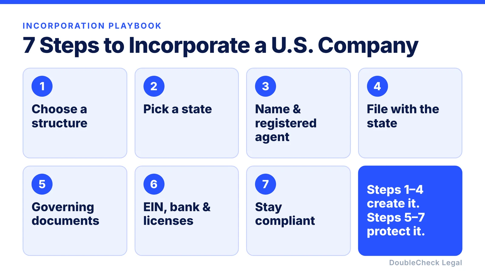
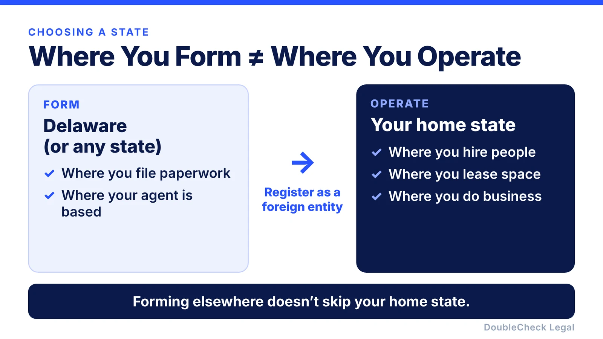
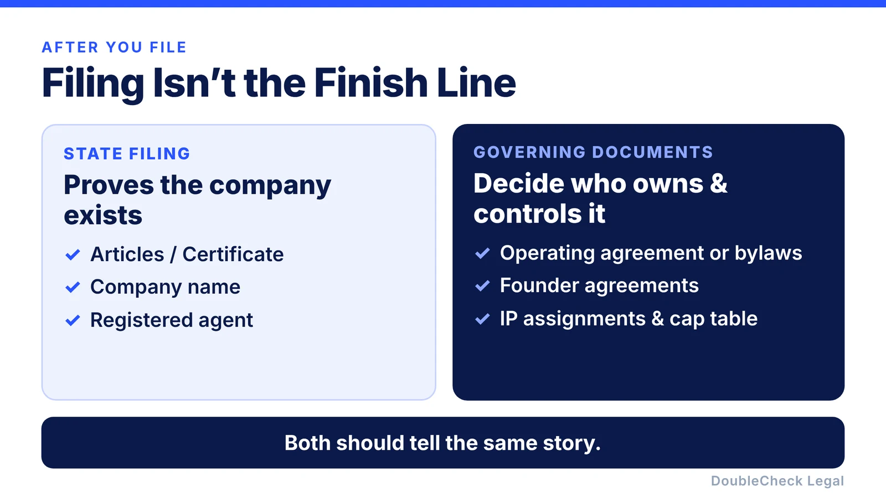

*Incorporating a U.S. company is quick on paper: choose a structure, pick a state, file, and the entity exists. The documents behind that entity — ownership, agreements, IP assignments — are what a bank, investor, or future buyer actually checks. This is general information, not legal, tax, or accounting advice.*

**Key takeaways:**

- Business structure (LLC, C corporation, partnership, sole proprietorship) shapes taxes, fundraising, and liability — an S corporation is a tax election, not a structure.
- Where you form and where you operate can be two different questions; operating outside your formation state usually means registering there too, as a foreign entity.
- Filing with the state is only the entity's birth certificate — operating agreements, bylaws, founder agreements, and IP assignments are what keep ownership and control consistent.
- As of August 14, 2026, U.S.-created companies are exempt from federal Beneficial Ownership Information (BOI) reporting — some older guides still say otherwise.

Starting a company in the United States can sound complicated, but the basic process is relatively straightforward.

Whether you're launching a startup, consulting business, online store, agency, or local business, the same core questions usually come first: **What type of company should I create? Where should I form it? And what documents do I actually need?**

Here's a simple playbook.

## 1. Choose the type of business you want to create

Before filing anything, decide on your basic business structure.

For most new businesses, the main options are:

- **Sole proprietorship:** The simplest setup, but generally without a separate legal entity protecting the owner.
- **LLC:** A flexible structure commonly used by small businesses, consultants, agencies, and founder-owned companies.
- **C Corporation:** A corporation with shareholders, often considered by startups that expect to issue equity or raise outside investment.
- **Partnership:** An option when two or more people operate a business together.

One common point of confusion: an **S Corporation is generally a federal tax election**, rather than simply another company type you create with your state.

Your choice can affect taxes, ownership, fundraising, paperwork, and personal liability, so this is one of the decisions worth discussing with a lawyer or tax professional when the answer is not obvious. The SBA notes that business structure affects taxation, fundraising, paperwork, and personal liability.

### A simple starting point

If you are building a traditional small business, you might start by considering an LLC.

If you are building a startup that expects to raise venture capital and issue stock, you might consider a corporation.

Neither answer is automatically right for everyone.

## 2. Decide which state to form the company in

Next, decide **where your company will be formed**.

For many small businesses, forming in the state where the founders actually operate the business can be the simplest path.

Startups, particularly companies expecting institutional investment, may also consider incorporating in Delaware.

But forming in Delaware does not necessarily mean you can ignore your home state. If you form in one state but conduct business in another, you may also need to register there as a "foreign" entity and comply with that state's requirements.

So before automatically choosing Delaware, ask:

**Where will we actually operate, hire people, maintain offices, and conduct business?**

## 3. Choose your company name and registered agent

You'll normally need an available business name and a **registered agent** in the state where the company is formed.

The registered agent is the person or service authorized to receive official legal and government documents for the company.

Requirements vary by state, so check the relevant Secretary of State or business-registration website before filing. The SBA notes that LLCs and corporations generally need a registered agent in the state where they register.

## 4. File the company

Now you can actually create the entity.

For an LLC, this usually means filing something called **Articles of Organization** or a similar formation document.

For a corporation, you'll generally file **Articles or a Certificate of Incorporation**.

You can often file directly through the state, use a registered-agent or formation service, or use a startup-focused service.

For example, **Stripe Atlas** currently offers formation of Delaware C corporations and LLCs and can also handle items such as obtaining an EIN and generating certain founder documents.

The important point is that the formation service is only the mechanism. You still need to make sure the structure you selected actually fits your business.

## 5. Create the documents behind the company

This is the part founders sometimes overlook.

Creating the entity with the state is only the beginning.

An LLC may need an **operating agreement** covering ownership, decision-making, distributions, and what happens if members leave.

A corporation may need documents such as bylaws, initial board approvals, founder stock documents, equity arrangements, and intellectual-property assignments.

If there are multiple founders, this becomes especially important. Your incorporation documents, ownership records, founder agreements, IP assignments, and cap table should tell the **same story**.

A company can be successfully registered with the state while still having problems in its internal documents.

## 6. Get your EIN, bank account, tax registrations, and licenses

Once the entity exists, you'll usually need to set up the operational side of the company.

An **Employer Identification Number (EIN)** is the federal tax identification number used for a business. You can obtain one directly from the IRS for free.

Depending on your business and location, you may also need state tax registrations, payroll accounts, seller permits, professional licenses, or city and county permits.

Then open a separate business bank account and keep company finances separate from your personal finances.

One recent change is worth knowing: as of August 14, 2026, U.S.-created companies are exempt from federal Beneficial Ownership Information reporting under FinCEN's current rule. Older incorporation guides may still incorrectly tell every new domestic company to file a BOI report.

## 7. Keep the company compliant after launch

Incorporation is not a one-time task.

Depending on your state and structure, you may have annual reports, franchise taxes, registered-agent requirements, tax returns, licenses, board or member approvals, and other ongoing obligations.

Keep your important corporate documents together from day one.

That includes your formation documents, operating agreement or bylaws, ownership records, founder agreements, IP assignments, financing documents, important contracts, and major company approvals.

## Incorporating is easy. Getting the documents right is harder.

Today, it is possible to create a company online very quickly.

The harder question is whether the documents behind that company actually reflect **who owns what, who controls what, what each founder agreed to, and what obligations the business has taken on.**

Before relying on those documents for a bank, investor, employee, customer, or financing round, it can be worth having them checked.

**DoubleCheck** lets you bring your legal documents and company context into one place, work through them with AI, and bring an attorney into the loop when professional legal review is needed.

[Check your startup documents with DoubleCheck](https://www.contactdoublecheck.com)

## Go deeper on specific steps

- State guides: [Florida](/blog/how-to-start-an-llc-in-florida/), [New York](/blog/how-to-start-an-llc-in-new-york/), [Wyoming](/blog/how-to-start-an-llc-in-wyoming/), [Nevada](/blog/how-to-start-an-llc-in-nevada/), [Washington](/blog/how-to-start-an-llc-in-washington-state/), [Georgia](/blog/how-to-start-an-llc-in-georgia/), [Illinois](/blog/how-to-start-an-llc-in-illinois/), [Arizona](/blog/how-to-start-an-llc-in-arizona/), [Colorado](/blog/how-to-start-an-llc-in-colorado/), and [which state to choose](/blog/best-state-to-form-an-llc-comparison/)
- [Converting an LLC to a C-corp before fundraising](/blog/convert-llc-to-c-corp-before-fundraising/) and [adding a member to an LLC](/blog/how-to-add-a-member-to-an-llc/)
- [How to get an EIN for your business for free](/blog/how-to-get-an-ein-for-your-business-free/)
- [How to incorporate in Delaware, step by step](/blog/how-to-incorporate-in-delaware-step-by-step/) and [Delaware registered agent requirements](/blog/delaware-registered-agent-requirements/)
- [Delaware LLC annual tax and the June 1 deadline](/blog/delaware-llc-annual-tax-june-1/)
- [S corp election deadline (Form 2553)](/blog/s-corp-election-form-2553-deadline/) and [S corp vs. C corp for venture-backed startups](/blog/s-corp-vs-c-corp-venture-backed-startup/)
- [QSBS explained](/blog/qsbs-section-1202-explained-startup-founders/)
- [How to dissolve a Delaware corporation](/blog/how-to-dissolve-a-delaware-corporation/)
- By business type: [SaaS or AI startup](/blog/how-to-incorporate-saas-ai-startup-delaware-c-corp/), [Amazon or e-commerce seller](/blog/how-to-form-llc-amazon-seller-ecommerce/), [restaurant](/blog/how-to-incorporate-a-restaurant/), [rental property](/blog/real-estate-rental-llc-do-you-need-one/), [consultant or freelancer](/blog/consulting-freelance-llc-vs-sole-proprietor/), [content creator](/blog/llc-for-content-creators-influencers/), [nonprofit](/blog/how-to-start-a-501c3-nonprofit/), [doctor, lawyer, or accountant (PLLC)](/blog/pllc-vs-llc-doctors-lawyers-accountants/), [contractor](/blog/contractor-construction-business-llc/), [retail store or family business](/blog/retail-store-family-business-llc-or-partnership/)
- Visas for founders and employees: [OPT/STEM OPT](/blog/f1-opt-stem-opt-start-your-own-startup/), [E-2](/blog/e-2-treaty-investor-visa-for-founders/), [L-1A](/blog/l-1a-visa-new-office-foreign-founders/), [startup parole (IER)](/blog/international-entrepreneur-rule-startup-parole-2026/)
- Outside the U.S.? [Start a U.S. company as a non-U.S. resident](/blog/start-us-company-as-non-us-resident/), [get an EIN without an SSN](/blog/get-ein-without-ssn-foreign-founder/), [from China](/blog/set-up-us-company-from-china/), or [depuis la France (en français)](/blog/creer-societe-aux-etats-unis-depuis-la-france/)
- In California? [How to start an LLC in California](/blog/how-to-start-an-llc-in-california-step-by-step/)
- On an H-1B? [Can you start a company on an H-1B?](/blog/start-company-on-h1b-visa-ownership-vs-work/)
- Solo founder? Start with [sole proprietor vs. LLC](/blog/sole-proprietor-vs-llc-solo-founder/) and the [solo founder legal checklist](/blog/solo-founder-legal-checklist-using-ai/)

## FAQ: Incorporating a U.S. company

**What is the easiest way to start a company in the U.S.?**

For most small businesses, forming an LLC in the state where you actually operate is the simplest path. Startups planning to raise venture capital often consider a Delaware C corporation instead, since it fits the equity structure investors expect.

**Is an S Corporation a type of company?**

No. An S Corporation is generally a federal tax election, not a company type you form with your state. You still form an LLC or a corporation first, then may elect S corporation tax treatment if eligible.

**Do I need to incorporate in Delaware?**

Not necessarily. Delaware is common for startups that expect institutional investment, but forming there does not excuse you from registering as a foreign entity in the state where you actually operate, hire, or maintain offices.

**Do new U.S. companies still need to file a Beneficial Ownership Information (BOI) report?**

As of August 14, 2026, U.S.-created companies are exempt from federal BOI reporting under FinCEN's current rule. Some older incorporation guides have not been updated and may still tell you to file one.

**What documents do I need besides the state filing?**

An LLC typically needs an operating agreement; a corporation typically needs bylaws, initial board approvals, founder stock documents, and IP assignments. A company can be properly registered with the state while still having gaps or inconsistencies in these internal documents.

**Can I incorporate without a lawyer?**

Yes, formation services and state portals let you file the paperwork yourself. But the structure, ownership terms, and founder agreements behind the filing are worth having checked, especially once there is more than one founder or outside money involved.

---

*This article provides general information only and is not legal, tax, or accounting advice. Formation, tax, licensing, and compliance requirements vary by business, state, and situation.*
