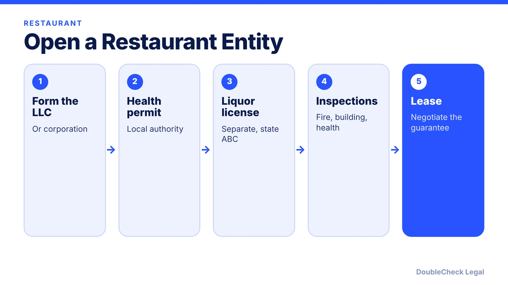
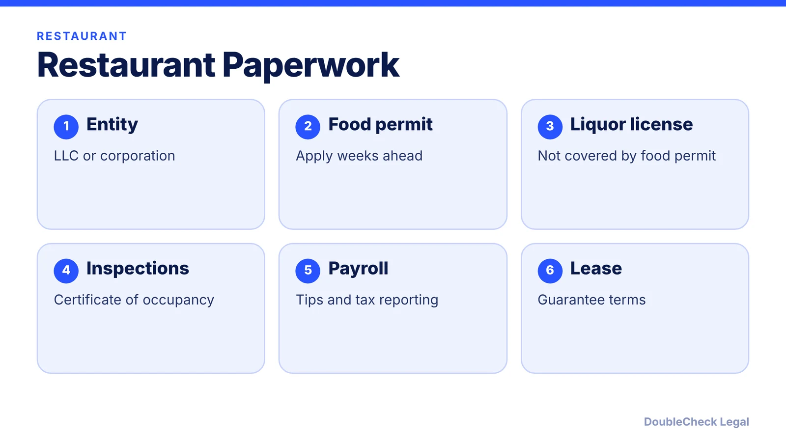

*Opening a restaurant? The LLC is step one. Permits, a separate liquor license, and your lease guarantee matter just as much.*

**Key takeaways:**

- Use an LLC or corporation to limit personal liability, per Nolo.
- A food service license does not cover alcohol; liquor needs a separate license.
- Many landlords ask for a personal guarantee beyond the LLC; negotiate caps or burn-offs.
- Employers cannot keep employees' tips under federal law.

## 1. The quick answer

**Quick answer:** A restaurant should usually use a structure that limits personal liability, such as an LLC or corporation, because restaurants have many customers and employees and a higher risk of injury and property damage, per Nolo. The entity is only the start: you also need food-service permits, a separate liquor license if you serve alcohol, inspections, and a plan for the personal guarantee most landlords ask for.

## 2. Permits and licenses

Nolo's New York example: the food service permit comes from the local health authority, apply at least 21 days before opening, fees are generally several hundred dollars, liquor goes through the State Liquor Authority, and you may need a certificate of authority to collect sales tax. Lightspeed says a food service license does not cover alcohol, on-license types include restaurant, beer and wine, and tavern, and rough costs are about $100 to $1,000 for a health permit and about $50 for a business license (range $25 to $7,000). Fire, plumbing, electrical, and building inspections may be needed for a certificate of occupancy. These are vendor estimates and vary by state and city. The SBA says restaurants are commonly regulated locally.

## 3. The lease personal guarantee

DHC Legal says many New York City restaurant leases require a personal guarantee beyond the LLC. A full guarantee covers rent, damages, and attorney fees, may survive lease termination, and is not wiped out if the entity goes bankrupt. Negotiation options include a Good Guy Guarantee (a New York concept), a cap such as 12 months' rent, burn-offs such as 25% a year after year three, or shared pro-rata guarantees. Have an attorney review the lease before you sign.

## 4. Tips, payroll, and insurance

Under federal law (29 U.S.C. 203), an employer may not keep employees' tips, a tip credit applies only if the employee is informed and keeps all tips, and tip pooling among customarily tipped employees is allowed. Per IRS Topic 761, employees with $20 or more in cash tips in a month report to the employer by the 10th of the next month, and large food and beverage establishments file Form 8027 annually. Nolo's Texas page says general liability should cover slip-and-fall and food illness, with property coverage for equipment. Many states set their own tipped minimum wage, so check yours. See [how to start an LLC in California](/blog/how-to-start-an-llc-in-california-step-by-step/) and [the LLC operating agreement](/blog/llc-operating-agreement-with-ai/).

## Where DoubleCheck fits

[DoubleCheck](https://www.contactdoublecheck.com) helps businesses and founders start legal work with AI, verify it, and, when professional advice is warranted, connect with an independent attorney, including for immigration questions. Attorney availability and practice areas vary. Attorneys on DoubleCheck are independent professionals; an attorney-client relationship forms only if an attorney accepts your engagement.

**Sources:** [Nolo: New York](https://www.nolo.com/legal-encyclopedia/starting-restaurant-business-new-york.html); [Nolo: Texas](https://www.nolo.com/legal-encyclopedia/starting-restaurant-texas.html); [Lightspeed](https://www.lightspeedhq.com/blog/restaurant-licenses-and-permits/); [DHC Legal](https://dhclegal.com/good-guy-guarantees-and-personal-guarantees/); [29 U.S.C. 203](https://www.law.cornell.edu/uscode/text/29/203); [IRS Topic 761](https://www.irs.gov/taxtopics/tc761); [SBA](https://www.sba.gov/business-guide/launch-your-business/apply-licenses-permits).

## FAQ

**Should a restaurant be an LLC or an S corp?**

Nolo suggests a liability-limiting form like an LLC or corporation. The tax election is a separate decision for a tax professional.

**Does a health permit let me serve alcohol?**

No. Lightspeed says a food service license does not cover alcohol; a separate liquor license is required.

**What is a Good Guy Guarantee?**

DHC Legal describes it as a New York lease concept that limits a guarantor's liability. It is not available everywhere.

**Do tipped employees have to report tips?**

Per IRS Topic 761, employees with $20 or more in cash tips in a month report to their employer by the 10th of the next month.

---

*General information only. This article is not legal, tax, investment, or accounting advice.*
