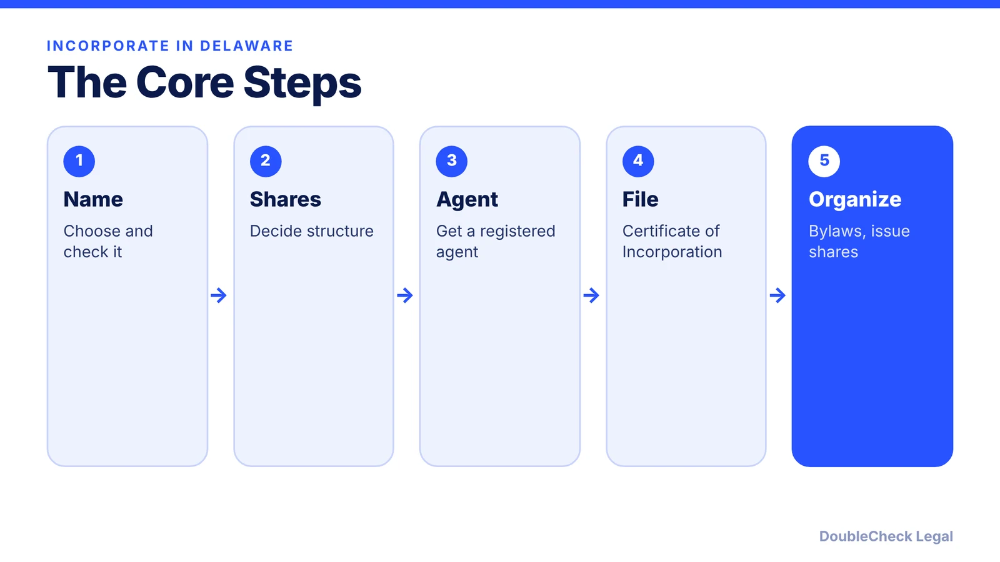
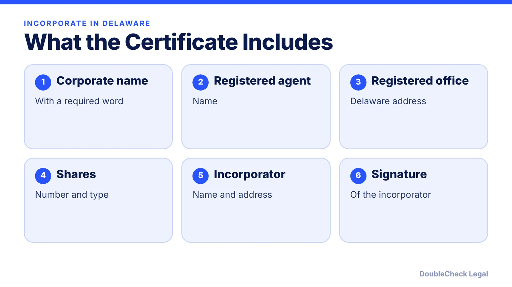

*Here is a step-by-step Delaware incorporation checklist, with what goes in the certificate and what to do after you file.*

**Key takeaways:**

- A Delaware registered agent with a physical Delaware address is required.
- The Certificate of Incorporation lists the name, agent, office, shares, and incorporator.
- After filing, hold an organizational meeting, adopt bylaws, issue shares, and get an EIN.
- Delaware corporations owe an annual report and franchise tax.

## 1. The ten steps

Wolters Kluwer's Delaware incorporation guide lays out ten steps: choose a corporate name, decide on share structure, obtain a Delaware registered agent, file the Certificate of Incorporation, hold an organizational meeting, prepare bylaws, issue shares, get an EIN, select a tax election (such as an S election on Form 2553), and comply with ongoing tax and regulatory requirements, including the annual report and franchise tax.

For the broader picture, see [how to incorporate a company in the U.S.](/blog/how-to-incorporate-a-company-in-the-us/).

## 2. What goes in the Certificate of Incorporation

According to that guide, the Certificate of Incorporation filed with the Delaware Division of Corporations includes the corporate name, the registered agent's name, the registered office address, the number and type of shares, and the incorporator's name, address, and signature.

## 3. Naming rules

The name must include a required word such as "Corporation," "Company," "Incorporated," or "Limited," or an accepted abbreviation, and must be unique among corporations, LLCs, partnerships, and limited partnerships on file in Delaware. Restricted words such as "bank," "trust," "insurance," and "college" require approval from a state agency. Before you commit to a name, see [trademark and business name checks](/blog/trademark-business-name-check/).

## 4. After you file

Hold an organizational meeting, adopt bylaws, issue founder shares, and get an EIN ([how to get an EIN for free](/blog/how-to-get-an-ein-for-your-business-free/)). Delaware corporations owe an annual report and franchise tax; see the [Delaware franchise tax guide](/blog/delaware-franchise-tax-startups/). Founder stock deserves [vesting](/blog/cofounder-vesting-cliff-explained/) and an [83(b) election](/blog/83b-election-startup-founders/).

We have not included Delaware's filing fee amounts here because we could not confirm them from an official source for this article. Check the Division's current fee schedule before you file.

## 5. If you work from another state

Incorporating in Delaware does not remove obligations in the state where you operate. See [Delaware corporation doing business in California](/blog/delaware-corporation-doing-business-in-california/) and [California vs. Delaware](/blog/incorporate-california-vs-delaware-startup/).

## Where DoubleCheck fits

[DoubleCheck](https://www.contactdoublecheck.com) is built for businesses that start legal work with AI. Bring your question or draft, use an AI-first workflow to understand and verify it, and when professional advice is warranted, you can connect with an independent attorney. Attorneys on DoubleCheck are independent professionals; an attorney-client relationship forms only if an attorney accepts your engagement.

**Sources:** [Wolters Kluwer: Delaware incorporation requirements](https://www.wolterskluwer.com/en/solutions/bizfilings/state-guides/delaware-incorporation-requirements).

## FAQ

**Do I need a registered agent to incorporate in Delaware?**

Yes. The agent must have a physical Delaware street address; P.O. boxes are not allowed.

**What goes in a Delaware Certificate of Incorporation?**

The corporate name, registered agent name, registered office address, number and type of shares, and the incorporator's name, address, and signature.

**What happens after I file?**

Hold an organizational meeting, adopt bylaws, issue shares, get an EIN, and handle tax elections and annual compliance.

**Do I owe tax every year?**

A Delaware corporation owes an annual report and franchise tax; see our Delaware franchise tax guide.

---

*General information only. This article is not legal, tax, investment, or accounting advice.*
