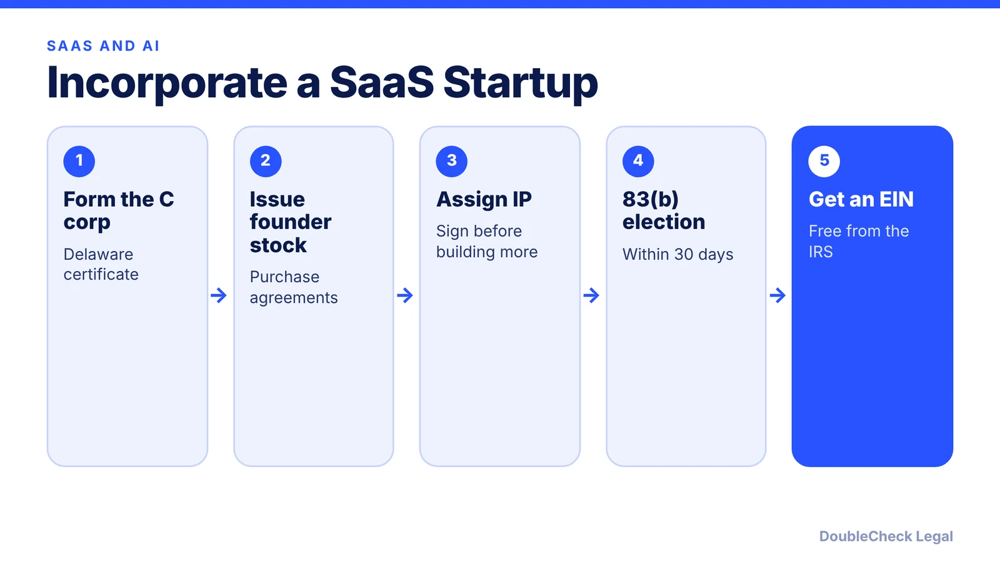
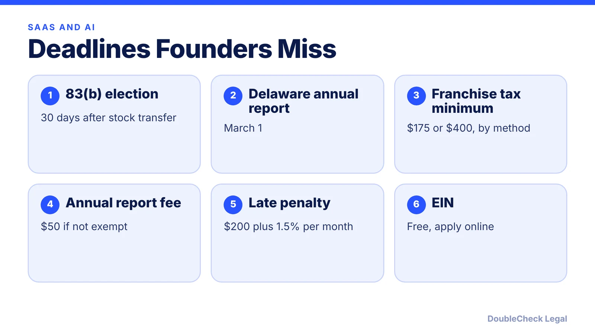

*Building a SaaS or AI startup? Here is the incorporation order that investors expect, and the deadlines founders miss.*

**Key takeaways:**

- A Delaware C corp is the usual choice for startups raising venture capital; only C corp stock can qualify for QSBS, per Rho.
- File the 83(b) election within 30 days of the stock transfer.
- Sign IP assignments; Rho says the company does not own founder work until you do.
- Delaware's annual report and franchise tax are due March 1.

## 1. The quick answer

**Quick answer:** Most SaaS and AI startups that expect to raise venture capital or grant stock options form a Delaware C corporation, because only C corporation stock can qualify for QSBS, per Rho. After you file the certificate of incorporation, you issue founder shares through stock purchase agreements with vesting and IP assignment, file an 83(b) election within 30 days, and get a free EIN.

## 2. Founder stock, vesting, and IP

Per Rho, founders typically buy shares at par value through stock purchase agreements with vesting and IP assignment attached, and standard founder vesting is four years with a one-year cliff, applied to founders too. Rho's example is 10,000,000 authorized common shares at $0.00001 par. Rho also says the company does not legally own founder-built work until an assignment is signed, so founders, employees, and contractors should sign confidentiality and invention assignment agreements. For AI products, also read [AI-generated content and copyright](/blog/ai-generated-content-copyright-solo-business/).

## 3. The 83(b) election

The Treasury regulation says an 83(b) election must be filed not later than 30 days after the property is transferred. It may be filed before the transfer, a copy goes to the company, and it generally cannot be revoked without the Commissioner's consent. Without it, each vesting tranche is taxed as ordinary income as it vests, per Rho. If you make the election, later appreciation is not taxed as compensation.

## 4. Delaware costs and QSBS

Delaware's franchise tax and annual report are due on or before March 1; the minimum is $175 under the Authorized Shares Method or $400 under the Assumed Par Value Capital Method, the annual report fee is $50 for non-exempt filers, and the late penalty is $200 plus 1.5% interest per month, per the state. Rho lists certificate of incorporation fees of at least $109. See [Delaware franchise tax](/blog/delaware-franchise-tax-startups/).

Under 26 U.S.C. 1202 (Cornell LII), stock acquired after July 4, 2025 gets a 50% exclusion at three years, 75% at four, and 100% at five or more, with a per-issuer cap of the greater of $15 million or ten times basis, and the issuer's gross assets must be no more than $75 million. Older stock keeps the earlier rules. Read [QSBS explained](/blog/qsbs-section-1202-explained-startup-founders/) and [how to incorporate in Delaware](/blog/how-to-incorporate-in-delaware-step-by-step/).

## Where DoubleCheck fits

[DoubleCheck](https://www.contactdoublecheck.com) helps businesses and founders start legal work with AI, verify it, and, when professional advice is warranted, connect with an independent attorney, including for immigration questions. Attorney availability and practice areas vary. Attorneys on DoubleCheck are independent professionals; an attorney-client relationship forms only if an attorney accepts your engagement.

**Sources:** [Rho](https://www.rho.co/blog/startup-incorporation-checklist); [26 CFR 1.83-2](https://www.law.cornell.edu/cfr/text/26/1.83-2); [Delaware Division of Corporations](https://corp.delaware.gov/paytaxes/); [26 U.S.C. 1202](https://www.law.cornell.edu/uscode/text/26/1202); [IRS EIN](https://www.irs.gov/businesses/small-businesses-self-employed/employer-id-numbers).

## FAQ

**Should my AI startup be an LLC or a C corp?**

If you expect venture capital or stock options, Rho recommends a Delaware C corp. See the [LLC vs. C corp guide](/blog/llc-vs-c-corp-startups/). Ask an attorney.

**When is the 83(b) election due?**

Not later than 30 days after the stock is transferred, per the Treasury regulation.

**What is the minimum Delaware franchise tax?**

Delaware lists $175 under the Authorized Shares Method and $400 under the Assumed Par Value Capital Method, due by March 1.

**Does my startup qualify for QSBS?**

It depends on stock acquisition date, C corp status, gross assets, and business type. Confirm with a tax professional.

---

*General information only. This article is not legal, tax, investment, or accounting advice.*
