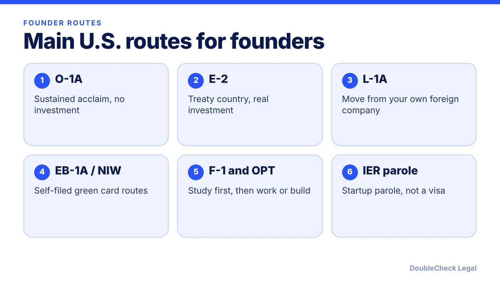
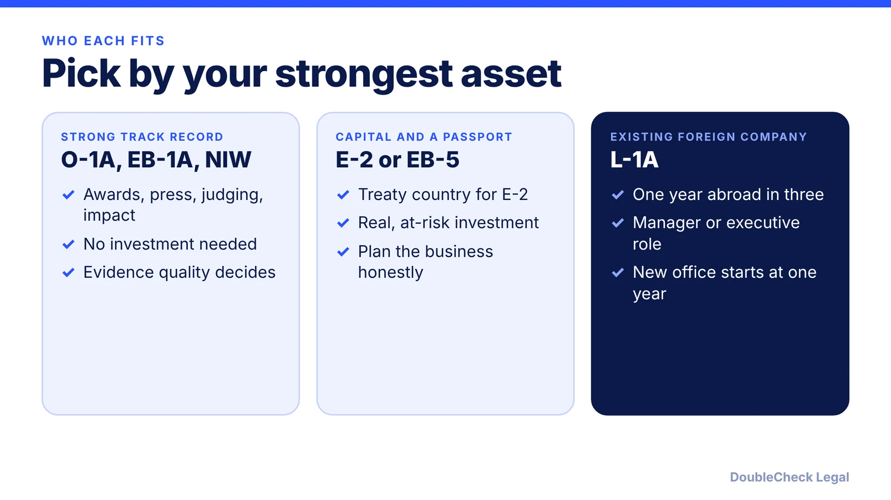

*There is no founder visa, but there are several real routes. Here is what each needs and who it fits.*

**Key takeaways:**

- No dedicated US visa for entrepreneurs exists (per NNU Immigration); founders use general categories.
- O-1A, E-2 and L-1A are the main temporary routes; EB-1A, NIW and EB-5 are permanent ones.
- The International Entrepreneur Rule is parole, not a visa.
- Passport, track record, capital and sponsor decide the route; verify with an attorney before filing.

## 1. The quick answer

**Quick answer:** There is no single "founder visa" for the United States. Entrepreneurs usually come through a general category that fits their facts: O-1A (extraordinary ability), E-2 (treaty investor), L-1A (transfer from your own foreign company), an employer-sponsored status such as H-1B, a student route (F-1 and OPT), or a self-filed green card (EB-1A or the national interest waiver). The International Entrepreneur Rule is parole, not a visa, and rarely used. Per NNU Immigration, US immigration law "does not currently provide a dedicated visa for entrepreneurs." Which route fits depends mostly on your passport, your track record, your money and who can sponsor you.

## 2. The temporary routes, one by one

Each line below is a starting point, not an eligibility finding. Details are in the linked guides.

- **O-1A.** Needs "sustained national or international acclaim," meaning you are among the small percentage at the very top of your field (USCIS). No investment is required. A US employer, a US agent or a foreign employer acting through a US agent files the petition; USCIS lists no self-petition. Initial stay is up to three years, and USCIS requires a written advisory opinion from a peer group or expert. See the [O-1A evidence guide](/blog/o-1a-visa-for-startup-founders-evidence/).
- **E-2.** For nationals of a treaty country who make a substantial investment in a real enterprise and own at least 50% or have operational control (NNU Immigration). No fixed minimum amount. Read the [E-2 guide](/blog/e-2-treaty-investor-visa-for-founders/).
- **L-1A.** For managers and executives of a company that already operates abroad. Per NNU, you need one continuous year of work abroad within the previous three years, a qualifying relationship between the foreign and US companies and a managerial or executive US role. A new office gets one year initially, with a seven-year maximum. See [L-1A for foreign founders](/blog/l-1a-visa-new-office-foreign-founders/).
- **F-1 and OPT.** Study first, then work under OPT, including [starting your own startup on OPT or STEM OPT](/blog/f1-opt-stem-opt-start-your-own-startup/). Students often switch later: see [F-1 to O-1](/blog/f-1-to-o-1-change-of-status-founders/).
- **H-1B through an employer.** Possible, but the sponsor must be an employer, which complicates owning your own company. Rules and fees moved a lot recently: see the [H-1B $100,000 fee status](/blog/h1b-100000-fee-status-2026/) and the comparison in [H-1B vs L-1 vs O-1](/blog/h-1b-vs-l-1-vs-o-1-which-visa-for-tech-employees/).
- **TN and E-3.** Narrower, by passport: [TN for Canadians and Mexicans](/blog/tn-visa-canada-mexico-tech-professionals/) and [E-3 for Australians](/blog/e-3-visa-australians/).

**Visitor status is not a work route.** B-1/B-2 and ESTA are for short visits, such as meetings and networking. See [what a B-1 visitor can do](/blog/b-1-b-2-visa-business-visitor-what-founders-can-do/) before you plan a trip. Do not work for a US company on a visitor visa.

## 3. Permanent routes and the investor path

**EB-1A.** A self-petitioned green card based on sustained national or international recognition, with no employer sponsor needed (NNU Immigration). **National interest waiver (NIW).** Lets you skip the job offer and PERM. A March 2026 article from Alaz Law summarizes the three Matter of Dhanasar prongs: your endeavor has substantial merit and national importance, you are well positioned to advance it, and on balance it benefits the US to waive the job offer. That article also says officers are scrutinizing these petitions more closely in 2026, so evidence quality matters. Compare them in [EB-1A vs NIW for founders](/blog/eb-1a-vs-niw-which-is-better-for-founders/), [EB-1A vs O-1](/blog/eb-1a-vs-o-1-founder-which-path/) and the [NIW guide](/blog/niw-eb-2-national-interest-waiver-founders/).

**EB-5.** An investor green card. Per NNU, the amount is $1,050,000, or $800,000 in a targeted employment area, and the enterprise must create at least ten full-time US jobs; successful applicants get two years of conditional permanent residence. Check current figures in the [EB-5 requirements guide](/blog/eb-5-investor-visa-requirements-2026/).

**International Entrepreneur Rule (IER).** Parole for founders of recent US startups with qualified investor backing. Per NNU, the startup must be formed within the previous five years, and initial parole is up to 30 months. It is not a green card path on its own. Status and thresholds are covered in the [IER guide](/blog/international-entrepreneur-rule-startup-parole-2026/).

## 4. How to choose, and when to get an attorney

Work through these questions in order:

1. **What does your passport allow?** Treaty and trade options (E-2, TN, E-3) depend on nationality.
2. **Is the company already operating abroad?** If yes, L-1A may be possible.
3. **Can you document sustained acclaim?** If yes, O-1A and the self-filed green card routes become realistic.
4. **Who is the sponsor?** Employer-based statuses need an employer; owning the company and being employed by it are different legal questions. See the guides on [live in the US while running a startup](/blog/foreign-founder-live-in-the-us-while-running-startup-what-status-allows/) and [H-1B for founders](/blog/h-1b-for-founders-owning-your-own-company-employer-employee-rule/).
5. **Is moving the right call at all?** See the [reality check on moving to the US](/blog/should-you-move-to-the-us-to-start-a-startup-visa-reality-check/).

You can map your options yourself with the [decision guide by situation](/blog/which-us-visa-is-right-for-you-by-situation-decision-guide/) and the [easiest ways to immigrate compared](/blog/easiest-ways-to-immigrate-to-the-us-compared-by-eligibility/). Form the company correctly: [how to incorporate in the US](/blog/how-to-incorporate-a-company-in-the-us/) and [start a US company as a non-resident](/blog/start-us-company-as-non-us-resident/).

**Handle yourself vs. get an attorney.** Research and a fact list are fine on your own. Get an attorney to review when you hold a status with a deadline, when ownership structure affects the visa, when you have prior refusals or overstays, or before you file any petition. See [how to find a good immigration lawyer](/blog/how-to-find-good-immigration-lawyer-startup-founder/) and [immigration lawyer fees](/blog/immigration-lawyer-fees-flat-fee-vs-hourly/).

## Where DoubleCheck fits

[DoubleCheck](https://www.contactdoublecheck.com) helps businesses and founders start legal work with AI, verify it, and, when professional advice is warranted, connect with an independent attorney, including for immigration questions. Attorney availability and practice areas vary. Attorneys on DoubleCheck are independent professionals; an attorney-client relationship forms only if an attorney accepts your engagement.

**Sources:** [NNU Immigration, US entrepreneur visa options](https://www.nnuimmigration.com/us-entrepreneur-visa/); [USCIS, O-1 visa](https://uscis.gov/o-1); [Alaz Law, NIW Dhanasar test 2026](https://www.alazlaw.com/blog/eb-2-niw-dhanasar-three-prong-test-2026/). The USCIS L-1A page did not load, so L-1A details are attributed to NNU Immigration.

## FAQ

**Is there a founder visa for the US?**

No. NNU Immigration states that US immigration law does not currently provide a dedicated visa for entrepreneurs. Founders use categories such as O-1A, E-2, L-1A, H-1B, EB-1A or the national interest waiver depending on their facts.

**Can I start a company in the US on a tourist visa or ESTA?**

Visitor status is for short visits such as meetings and networking, not for working. See our B-1 guide for what a business visitor can and cannot do, and ask an attorney before relying on any visit for company activity.

**Which route is cheapest or fastest for a founder?**

It depends on your facts, and no single route is fastest for everyone. O-1A needs no investment (USCIS), E-2 needs a substantial investment from a treaty-country national (NNU), and EB-5 is stated at $1,050,000 or $800,000 in a targeted area (NNU).

**Do I need a US company before applying?**

Often yes. E-2, L-1A new office and IER all involve a US business, while O-1A needs a US employer or agent petitioner (USCIS). Plan the company structure and the visa together.

---

*General information only. This article is not legal, tax, investment, or accounting advice.*
