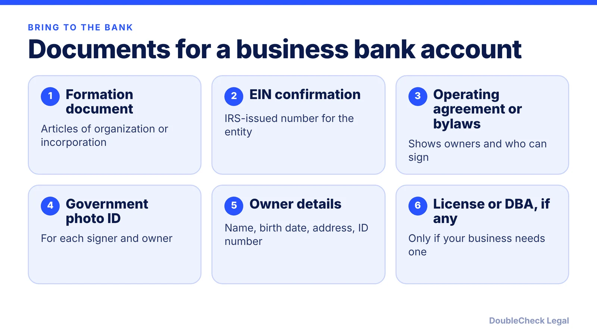
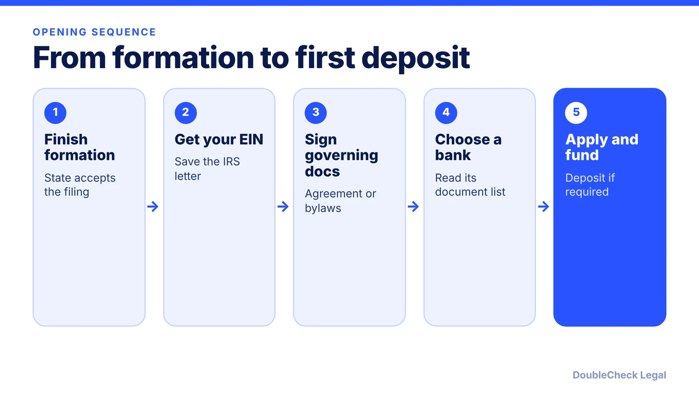

*How to open a business bank account for an LLC or corporation: the documents to bring, what banks must collect about owners, and the steps, as of November 2026.*

**Key takeaways:**

- Bring the formation document, EIN, governing document and photo IDs; banks set their own exact lists.
- Under FinCEN's CDD rule, banks identify each 25% owner and one control person.
- Sign the operating agreement or bylaws before you apply, and keep names consistent across documents.
- Keep business and personal money separate once the account is open.

## 1. The quick answer

**Quick answer:** To open a business bank account for an LLC or corporation, bring your formation document (articles of organization or incorporation), your EIN, a government photo ID, the internal governing document (operating agreement for an LLC, bylaws for a corporation), and the personal details of each owner the bank must identify. Requirements vary by bank, so check the bank's own list first. Per NerdWallet (updated March 20, 2026), LLCs and corporations need an EIN, while a sole proprietor or single-member LLC may be able to use a Social Security number instead.

The point of the account is separation: business money in one place, personal money in another. If you are still deciding on an entity, read [how to incorporate a business](/blog/how-to-incorporate-a-business-complete-guide-llc-s-corp-c-corp-costs-timeline/) first. If the entity exists and you need the next step, this is it.

## 2. Documents by entity type

Banks publish their own lists, but the pattern is consistent across the guides we reviewed. As of November 2026:

- **Sole proprietorship:** Per the SBA, an EIN or a Social Security number, and the bank will typically also want a photo ID and a DBA certificate if you operate under a trade name. NerdWallet adds that freelancers without a registered business name can use their own name.
- **LLC:** Per the SBA, an EIN, business formation documents (articles of organization), ownership agreements (the operating agreement) and a business license if one applies. Expect to provide a photo ID and beneficial ownership information for each member with significant ownership.
- **Corporation:** Per the SBA, an EIN, formation documents (articles of incorporation) and a business license if one applies. Banks commonly also ask for the bylaws, a board resolution authorizing the account and photo ID for authorized signers; confirm with your bank.

Two items deserve a closer look.

**The EIN.** The IRS issues it separately from the state filing. If you do not have one yet, see [how to get an EIN for your business for free](/blog/how-to-get-an-ein-for-your-business-free/). A single-member LLC can sometimes use the owner's SSN at the bank, but NerdWallet notes that LLCs generally need an EIN. Some owners get one anyway to avoid handing out an SSN.

**The governing document.** Banks use the operating agreement or bylaws to confirm who owns the entity and who may sign. If yours is vague about management or signing authority, fix that before you apply. [Corporate bylaws vs operating agreement](/blog/corporate-bylaws-vs-operating-agreement-what-each-covers/) explains what each covers, and [LLC operating agreement with AI](/blog/llc-operating-agreement-with-ai/) shows how to draft and check one.

A certificate of good standing was not on the lists in the guides we read, though some banks may ask for one. Ask the bank rather than assume.

## 3. What the bank must collect about owners

Banks do not just look at paperwork. Federally regulated banks and credit unions follow FinCEN's customer due diligence (CDD) rule, which requires written procedures to identify and verify the beneficial owners of a legal entity customer when a new account is opened, per FinCEN's CDD FAQs.

Under that rule there are two parts:

- **Ownership prong:** each individual who directly or indirectly owns 25% or more of the entity's equity. There may be none.
- **Control prong:** one individual with significant responsibility to manage or direct the entity, such as a CEO, CFO or managing member.

So an entity has between one and five beneficial owners. For each one the bank collects name, date of birth, address and an identification number, per FinCEN. For a foreign person, that number can be a passport number. The person opening the account can supply the information, and the bank may rely on it unless it has reason to doubt it. The bank cannot list a nominee in place of the true owner, and the bank must verify identity using documentary or non-documentary methods.

One 2026 update: FinCEN's February 13, 2026 Account Opening Exceptive Relief Order lets a bank limit this collection to a customer's first account opening, when facts raise doubt, and as needed in ongoing due diligence. Using the relief is at the bank's discretion, so you may still be asked again.

This is separate from the Corporate Transparency Act filing. See [beneficial ownership report (BOI) 2026](/blog/beneficial-ownership-report-boi-2026/) for that status. The bank's questions apply regardless.

Practical takeaway: before the appointment, list each person who owns 25% or more and the person who runs the company, and have their details ready. If a cap table or ownership split is still unsettled, resolve it first.

## 4. Step by step: from filing to first deposit

A clean sequence avoids the most common delays:

1. **Finish formation.** Wait until the state has accepted your filing. See [startup LLC first 30 days checklist](/blog/startup-llc-first-30-days-checklist-after-you-form/) for what to do right after.
2. **Get the EIN** and save the IRS confirmation.
3. **Sign the internal document.** Have the operating agreement or bylaws signed and dated, and a board resolution if you are a corporation.
4. **Pick a bank and read its list.** Compare monthly fees, transaction limits and whether it supports your business type. NerdWallet (March 2026) says most online applications take a few minutes, approval is sometimes immediate but typically takes a couple of days, and a debit card typically arrives in 7 to 10 business days.
5. **Apply and fund.** Some banks require an opening deposit, and NerdWallet's table lists $0 for the four accounts it featured, so check your bank.

## 5. Special cases and common mistakes

**Foreign founders.** A founder without an SSN faces extra questions at some banks. FinCEN accepts a passport number as the identifier for foreign persons in the beneficial ownership information. Individual banks set their own policies, so call ahead. See [get an EIN without an SSN as a foreign founder](/blog/get-ein-without-ssn-foreign-founder/) and [starting a US company as a non-US resident](/blog/start-us-company-as-non-us-resident/).

**DBA or trade name.** If you operate under a name different from the legal entity, the bank may ask for the registered assumed name certificate. See [California fictitious business name (DBA)](/blog/california-fictitious-business-name-dba/) or [change an LLC or business name](/blog/change-llc-name-or-business-name-steps-and-filings/) if the name on your documents does not match what you want on checks.

**Name mismatches.** The legal name on the state filing, the IRS EIN letter and the application must match exactly. This is a frequent cause of rejection.

**Licenses.** If your industry requires one, banks may ask for it. See [business license requirements for small businesses](/blog/business-license-requirements-small-business/).

**Mixing money.** Opening the account is only half of the habit. Paying personal expenses from it can undercut the liability protection you formed the entity to get. Read [LLC startup bank account commingling and liability protection habits](/blog/llc-startup-bank-account-commingling-liability-protection-habits/).

**When to involve an attorney.** If ownership is split in a way that is not documented, if an investor or a co-founder is joining, or if the bank asks you to sign a personal guarantee or a bank-form resolution you do not understand, get the document reviewed first. AI can help you organize the list and spot gaps, but the legal conclusion should be verified. See [verify AI-generated legal documents](/blog/verify-ai-generated-legal-document/) and [when to hire a lawyer for your small business](/blog/when-to-hire-lawyer-small-business/).

## Where DoubleCheck fits

[DoubleCheck](https://www.contactdoublecheck.com) helps businesses and founders start legal work with AI, verify it, and, when professional advice is warranted, connect with an independent attorney, including for immigration questions. Attorney availability and practice areas vary. Attorneys on DoubleCheck are independent professionals; an attorney-client relationship forms only if an attorney accepts your engagement.

**Sources:** [NerdWallet, How to Open a Business Bank Account (updated Mar. 20, 2026)](https://www.nerdwallet.com/article/small-business/how-to-open-business-bank-account); [SBA, Open a business bank account](https://www.sba.gov/business-guide/launch-your-business/open-business-bank-account); [FinCEN, CDD Rule FAQs](https://www.fincen.gov/resources/statutes-and-regulations/cdd-rule-faqs). Not fetched: Chase business account requirements page (blocked).

## FAQ

**What documents do I need to open a business bank account for an LLC?**

Typically an EIN, business formation documents such as articles of organization, ownership agreements such as an operating agreement, and a business license if one applies, per the SBA. Banks also ask for photo ID and beneficial ownership information. Banks set their own lists, so confirm with yours.

**Can I open a business bank account without an EIN?**

Possibly, but only for some structures. NerdWallet (March 2026) says LLCs, partnerships and corporations need an EIN, while sole proprietors and single-member LLCs may use an SSN instead. Many banks still prefer an EIN, so ask the bank.

**Who counts as a beneficial owner at a bank?**

Per FinCEN, each individual who owns 25% or more of the entity's equity, plus one individual with significant control, such as a CEO or managing member. The bank collects each person's name, birth date, address and ID number.

**Do corporations need extra documents compared with LLCs?**

Often yes. Per the SBA, banks commonly ask for ownership agreements, which for an LLC means the operating agreement. Corporations are commonly also asked for bylaws and a board resolution authorizing the account. Check your bank for its exact requirements.

**How long does it take to open a business bank account?**

NerdWallet (March 2026) says most online applications take a few minutes, with approval sometimes immediate but typically a couple of days, and a debit card in 7 to 10 business days. In-person or complex ownership cases can take longer.

---

*General information only. This article is not legal, tax, investment, or accounting advice.*
