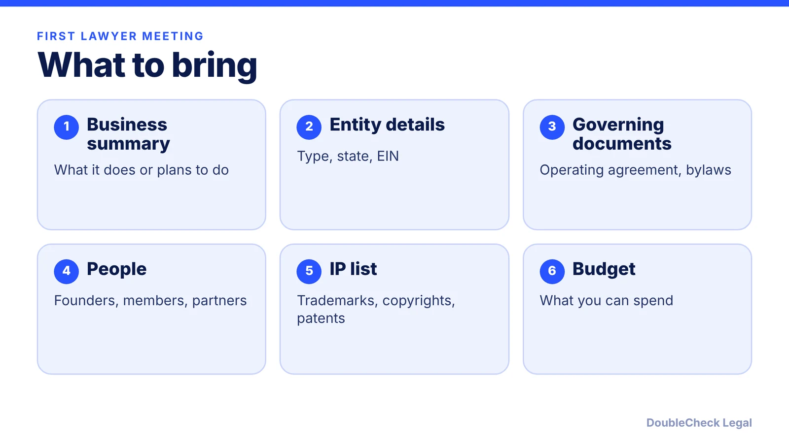
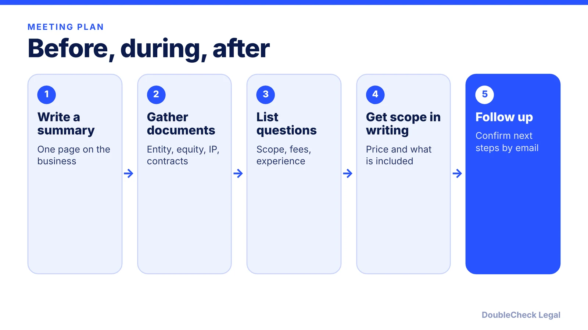

*A prepared first meeting saves time and usually helps you get a clearer scope and price.*

**Key takeaways:**

- Bring a one-page business summary, entity details, and any governing documents.
- Prepare a budget and ask about hourly, flat-fee, and retainer options.
- Ask about startup experience, response times, conflicts, and what is not included.
- Get scope and price in writing before you commit.

## 1. The quick answer

**Quick answer:** Go in with a one-page summary of the business, your key documents, your budget, and a short list of questions. FindLaw's checklist for a first meeting with a business lawyer includes business names and any DBAs, what the business does or plans to do, the entity type and structure, any operating agreement or bylaws, state of incorporation, your EIN, and a list of any IP registrations. FindLaw also notes most small business lawyers require a retainer or flat fee to start work, so be ready to discuss payment.

## 2. Documents and information to gather

Per [FindLaw](https://www.findlaw.com/smallbusiness/business-lawyer-resources/personal-information-questionnaire-hiring-a-lawyer.html), prepare:

- Your current and former names, for the lawyer's conflict check.
- Current and former business names, plus any DBA names.
- A description of the business, or its plan if it is a startup.
- Names and contact information of members or partners.
- Entity type and structure, state of incorporation, and EIN.
- Your operating agreement, bylaws, or partnership agreement, and your business plan, if you have them.
- A list of current or past legal issues involving attorneys.
- A list of federally registered trademarks, servicemarks, copyrights, or patents for IP matters.

If the meeting is about a dispute, FindLaw adds a brief timeline, relevant documents, a budget for attorney's fees, and any demand letter. For a purchase or sale of a business, [LegalMatch](https://www.legalmatch.com/law-library/article/how-to-prepare-for-consultation-for-buying-and-selling-a-business.html) lists a list of business assets, financial records such as profit and loss statements and tax returns, the lease, registration documents like Articles of Incorporation, and the terms you want to negotiate.

If you are still choosing an entity, read [how to incorporate a company in the US](/blog/how-to-incorporate-a-company-in-the-us/) first so the conversation can start at the real decisions.

## 3. Questions to ask the lawyer

[Pandev Law's list of questions for a startup lawyer](https://www.pandevlaw.com/blog/questions-to-ask-startup-lawyer-ensuring-the-best-legal-fit-for-your-new-venture/) is a good base. Choose the ones that matter to you:

- How long have they practiced, and how much of that work involved startups? Which industries and types of legal problems have they handled?
- Do they have experience in areas critical to you, such as fundraising, employee contracts, intellectual property, or regulatory compliance?
- What are their typical response times, and will you work with them directly or mostly with staff?
- Do they have current or past engagements that could affect their judgment or your business, such as work for competitors?
- What are their hourly rates, retainer requirements, and package options? Do they offer flat fees?

Add your own: what is the scope of this engagement, what is not included, and what would trigger extra fees? For benchmark prices, see [how much a startup lawyer costs](/blog/how-much-does-a-startup-lawyer-cost/).

## 4. Using AI before the meeting, and judging the fit

AI can help you prepare, as long as you check what it tells you. Use it to organize your timeline, summarize a contract you want reviewed, and draft questions. Do not treat its output as advice, and be careful with confidential material in tools whose terms you have not read. See [using AI for legal work in a small business](/blog/ai-lawyer-small-business/) and [how to save money on legal work with AI](/blog/save-money-legal-work-with-ai/).

After the meeting, judge the fit: did the lawyer listen, explain in plain English, and give a clear scope and price? [How to choose a good lawyer](/blog/how-to-choose-good-lawyer/) and [how to tell if your lawyer is good](/blog/how-do-i-know-if-my-lawyer-is-good/) cover what to look for. In San Francisco, see [finding a startup lawyer there](/blog/find-startup-lawyer-san-francisco/). If you are not sure you need a lawyer yet, read [when to hire a lawyer for a small business](/blog/when-to-hire-lawyer-small-business/).

## Where DoubleCheck fits

[DoubleCheck](https://www.contactdoublecheck.com) helps businesses and founders start legal work with AI, verify it, and, when professional advice is warranted, connect with an independent attorney, including for immigration questions. Attorney availability and practice areas vary. Attorneys on DoubleCheck are independent professionals; an attorney-client relationship forms only if an attorney accepts your engagement.

**Sources:** [FindLaw](https://www.findlaw.com/smallbusiness/business-lawyer-resources/personal-information-questionnaire-hiring-a-lawyer.html); [LegalMatch](https://www.legalmatch.com/law-library/article/how-to-prepare-for-consultation-for-buying-and-selling-a-business.html); [Pandev Law](https://www.pandevlaw.com/blog/questions-to-ask-startup-lawyer-ensuring-the-best-legal-fit-for-your-new-venture/).

## FAQ

**What should I bring to a first meeting with a startup lawyer?**

Per FindLaw: business names and DBAs, a description of what the business does or plans to do, entity type, state of incorporation, EIN, any operating agreement or bylaws, business plan, and a list of IP registrations. Also bring your budget.

**What questions should I ask a startup lawyer?**

Pandev Law suggests asking about startup experience, relevant specialties, response times, direct access, conflicts, and hourly rates, retainers, package options, and flat fees. Add questions about scope and what is not included.

**Will I have to pay at the first meeting?**

FindLaw notes most small business lawyers require a retainer or flat fee to start work, so be ready to pay soon after hiring. Some initial consultations may be free or paid; ask when you book.

**Can I use AI to prepare for the meeting?**

Yes, to organize facts and draft questions, but verify anything it says and avoid sharing confidential material with tools you have not vetted. It does not replace a lawyer's advice.

---

*General information only. This article is not legal, tax, investment, or accounting advice.*
