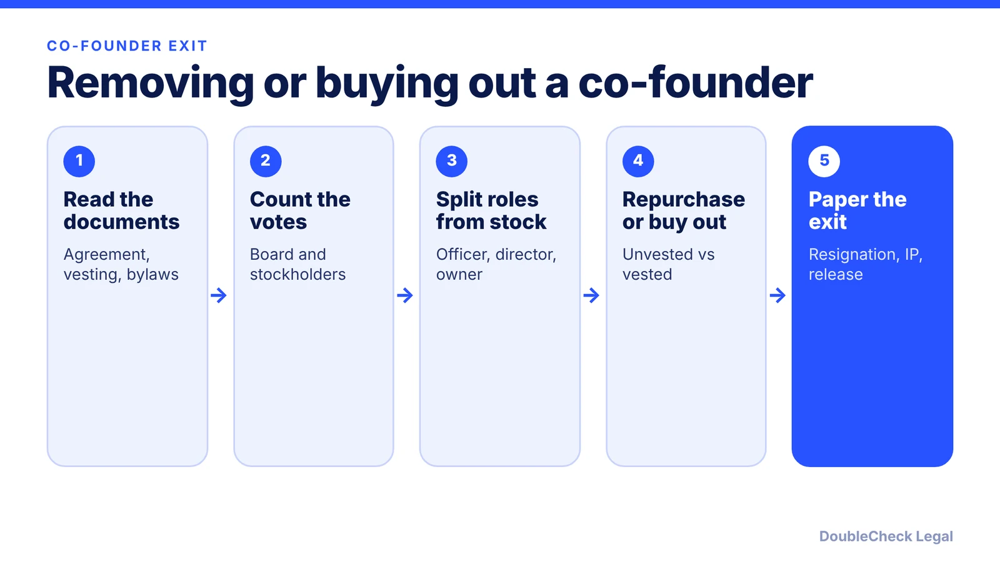
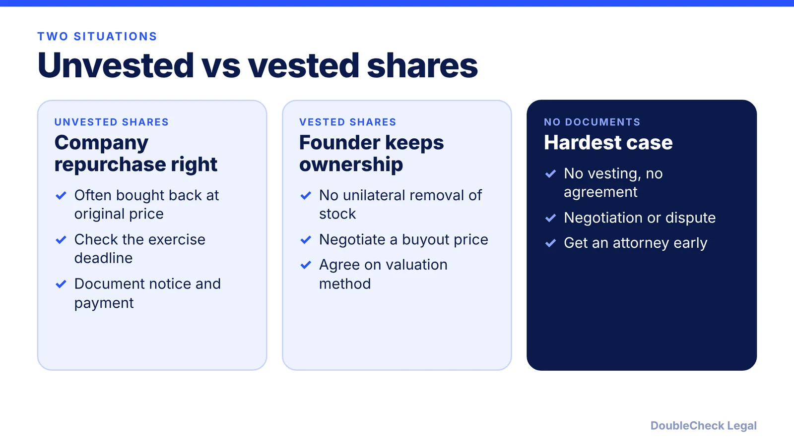
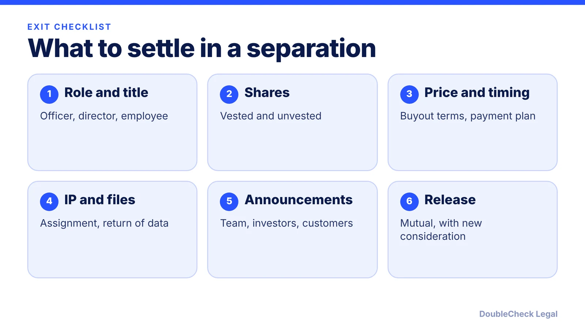

*A practical, U.S. and Delaware-centered guide to a co-founder exit: documents, votes, repurchase, buyout, IP, and tax basics.*

**Key takeaways:**

- Read the stock purchase agreement, vesting schedule, co-founder agreement, and bylaws before you act.
- Unvested shares are typically repurchased at the original price. Vested shares generally need a negotiated buyout.
- Role, board seat, and stock are separate. In Delaware, stockholders can remove directors by majority vote, and board action must follow formalities.
- Confirm IP assignment and tax treatment, and get an attorney when there is any disagreement.

## 1. The quick answer

**Quick answer:** You usually cannot simply "fire" a co-founder who owns stock. Start with the paper: the co-founder or stockholder agreement, the stock purchase agreement and vesting schedule, and the bylaws. If the person's shares are unvested, the company typically has a right to repurchase them, often at the price originally paid, per Clerky and DLA Piper. If they are vested, you generally need a negotiated buyout. A director can be removed by a stockholder vote under Delaware law, and an officer by the board, but each step has to follow the formalities, or a court can undo it.

## 2. Start with the documents: vesting, repurchase, and IP

Before any conversation, pull these and read them in this order:

- **Stock purchase agreement and vesting schedule.** Per [Clerky](https://help.clerky.com/article/1748-what-needs-to-be-addressed-if-a-founder-separates-from-the-company), the company typically repurchases unvested shares at the original purchase price under the founder's stock purchase agreement, and the repurchase should be documented along with the payment. [DLA Piper](https://www.dlapiper.com/insights/publications/accelerate/employee-other-service-provider-matters/early-stage-breakups-a-few-pointers-to-keep-in-mind) adds that the right may expire after a set period, so check the deadline and pay the full amount before it. See [cofounder vesting and cliffs](/blog/cofounder-vesting-cliff-explained/).
- **Co-founder agreement and bylaws.** They may set roles, decision rights, and any buyout or transfer terms. See [co-founder agreements](/blog/co-founder-agreement-startups/). For a company with a few owners and no vesting, a [buy-sell agreement](/blog/buy-sell-agreement-small-business-partners/) may govern what happens on exit.
- **Confidentiality and IP assignment.** DLA Piper says to confirm you have a signed agreement from the departing founder assigning their work to the company, because ownership claims tend to appear at awkward moments, like a financing or acquisition. Clerky notes the CIIAA includes a termination certification the company should have signed. See [IP assignment agreements](/blog/confidentiality-ip-assignment-agreements-startups/).

If there is no vesting and no written agreement, your options narrow to negotiation. Ownership already earned is generally theirs, which is why vesting on founder stock matters. Capbase makes the same point, recommending vesting provisions on founder shares from the start.

## 3. Resignation or removal: who can vote on what

Ownership, board seat, and job are three separate things, and each is changed differently.

- **Officer or employee role.** Per Capbase, a co-founder who is not on the board can be removed at any time, while a board member requires a board vote. This changes the job, not the stock.
- **Board seat.** Under Delaware law, stockholders can remove a director "with or without cause" by a majority of the shares entitled to vote, per [Richards, Layton & Finger](https://www.rlf.com/in-re-vaalco-energy-inc-stockholder-litigation-court-of-chancery-finds-that-certificate-and-bylaw-provisions-providing-that-directors-may-be-removed-for-cause-only-are-invalid-unless-board-is-class/) on Section 141(k). That firm notes removal can be limited to cause only for a classified board or cumulative voting. Check your charter and any voting agreement, because the founder may have a board-designation right.
- **Voluntary resignation.** The cleanest route. Per Clerky, get a short written resignation from all director and officer positions, and consider reducing board size if no successor is planned. DLA Piper notes that if a founder will not resign, the board can consider removal.

**Follow the formalities.** In *Foley v. Session Corp.* (Delaware Court of Chancery, summarized by [Troutman Pepper Locke](https://www.troutman.com/insights/delaware-court-of-chancery-rescinds-stock-cancellation-and-stock-repurchase-agreements-for-board-of-directors-failure-to-adhere-to-corporate-formalities/) in September 2025), one of four equal founders signed board consents alone as the supposed sole director, then terminated two others and repurchased their unvested shares for nominal sums. The court rescinded the agreements, because a non-unanimous director written consent is invalid under the DGCL and the board never properly authorized them. The lesson is procedural: hold a real board meeting or get a valid consent, count the votes correctly, and record them.

## 4. Buyout price, taxes, mediation, and when to get an attorney

**Buyout valuation.** For vested shares there is no formula in the law, only what you agree. Common approaches are an agreed price, a formula in an existing agreement, or an independent valuation by a neutral appraiser. Agree on the method before the number, and decide whether payment is a lump sum or installments. A buyout also changes your cap table, so tell investors and check any consent rights in financing documents.

**Tax at a high level.** The 83(b) election, per [Davis Wright Tremaine](https://dwt.com/blogs/startup-law-blog/2020/10/section-83b-election-for-startup-founders), must be filed within 30 days of receiving the stock with no exceptions, and it is generally irrevocable. That article also says it does not address how a repurchase or forfeiture is treated for tax after an election, so confirm that with a tax adviser before relying on it. See our [83(b) guide](/blog/83b-election-startup-founders/). Taxes on a buyout of vested shares depend on facts, so get tax advice before signing.

**Mediation.** If talks stall, a neutral mediator can be faster and cheaper than litigation, and many agreements require it first. In the Session case, the founders had earlier used a mediation before their later documents were challenged, a reminder to paper results properly.

**When you can handle this yourself vs. when to get an attorney.**

- **Reasonable to handle with the right forms:** an amicable departure, clear vesting, signed IP assignment, and a founder who agrees to the terms. Clerky and similar guides provide templates.
- **Get an attorney's review:** any disagreement, vested shares you want to buy, a board or investor involved, missing agreements, or a founder with a board-designation right. Missed steps here are expensive and hard to reverse. For cap table context, see [how co-founders split equity](/blog/how-co-founders-split-equity-data/) and, if you are choosing counsel, [finding a startup lawyer in San Francisco](/blog/find-startup-lawyer-san-francisco/) and [how to know if your lawyer is good](/blog/how-do-i-know-if-my-lawyer-is-good/). Setting up the company correctly in the first place is covered in [how to incorporate in the U.S.](/blog/how-to-incorporate-a-company-in-the-us/).

## Where DoubleCheck fits

[DoubleCheck](https://www.contactdoublecheck.com) helps businesses and founders start legal work with AI, verify it, and, when professional advice is warranted, connect with an independent attorney, including for immigration questions. Attorney availability and practice areas vary. Attorneys on DoubleCheck are independent professionals; an attorney-client relationship forms only if an attorney accepts your engagement.

**Sources:** [Clerky](https://help.clerky.com/article/1748-what-needs-to-be-addressed-if-a-founder-separates-from-the-company); [DLA Piper](https://www.dlapiper.com/insights/publications/accelerate/employee-other-service-provider-matters/early-stage-breakups-a-few-pointers-to-keep-in-mind); [Capbase](https://capbase.com/how-to-properly-deal-with-a-co-founder-leaving-your-startup/); [Troutman Pepper Locke on Foley v. Session Corp.](https://www.troutman.com/insights/delaware-court-of-chancery-rescinds-stock-cancellation-and-stock-repurchase-agreements-for-board-of-directors-failure-to-adhere-to-corporate-formalities/); [Richards, Layton & Finger on DGCL 141(k)](https://www.rlf.com/in-re-vaalco-energy-inc-stockholder-litigation-court-of-chancery-finds-that-certificate-and-bylaw-provisions-providing-that-directors-may-be-removed-for-cause-only-are-invalid-unless-board-is-class/); [Davis Wright Tremaine on 83(b)](https://dwt.com/blogs/startup-law-blog/2020/10/section-83b-election-for-startup-founders).

## FAQ

**Can I fire a co-founder who owns equity?**

You can generally end an officer or employee role according to your documents, but not take their vested stock. Per Capbase, a non-board co-founder can be removed at any time, while a board member requires a board vote. Shares are handled separately, usually by repurchase or buyout.

**What happens to a co-founder's unvested shares when they leave?**

Per Clerky and DLA Piper, the company typically has a right to repurchase unvested shares at the price originally paid, and the right may expire after a set period. Document the notice and payment before the deadline in your agreement.

**Can stockholders remove a director in Delaware?**

Per Richards, Layton & Finger on DGCL Section 141(k), a director can be removed with or without cause by a majority of shares entitled to vote, unless the board is classified or has cumulative voting. Check your charter and voting agreements.

**What if I skip the formalities?**

A court may undo the action. In Foley v. Session Corp., summarized by Troutman Pepper Locke, the Delaware Court of Chancery rescinded repurchase agreements because a non-unanimous director written consent was invalid under the DGCL.

---

*General information only. This article is not legal, tax, investment, or accounting advice.*
