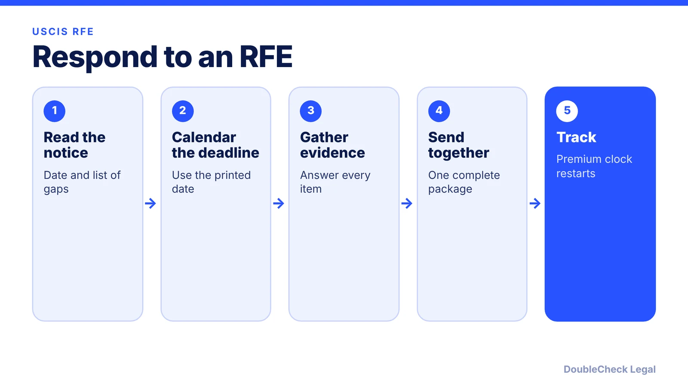
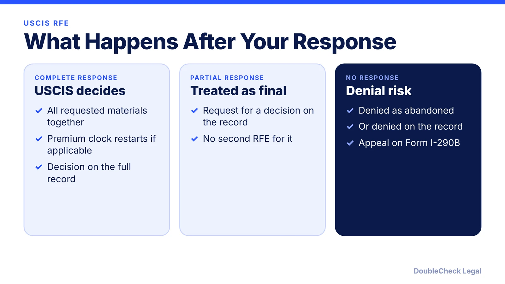

*Got an RFE from USCIS? Here is how the deadline works now, what to send, and what happens if you miss it.*

**Key takeaways:**

- Use the deadline printed on your RFE; the old 87-day rule is no longer a safe default after the August 2026 policy change.
- Send everything in one response; a partial response is treated as a request for a decision on the record.
- Premium processing stops on an RFE and restarts when USCIS gets a complete response.
- If you do not respond, USCIS may deny the case as abandoned.

## 1. The quick answer

**Quick answer:** Use the deadline printed on your RFE notice. The USCIS Policy Manual says the maximum response time is 12 weeks (84 days), plus three days if the notice was mailed (87 days), and 14 extra days if you live outside the U.S. But in August 2026 USCIS changed its guidance so that 12 weeks is now a maximum, with deadlines set case by case, and Greenberg Traurig reports some RFEs now give about 30 days. Send all requested evidence together, in one response.

## 2. Deadlines and what counts

Per the Policy Manual, I-539 and I-601A RFEs have 30-day response periods, and officers may shorten periods case by case. A law firm (Headman, July 2026) says the clock runs from the date printed on the notice, not delivery, that the response must be received (not just mailed) by the deadline, that weekend or holiday deadlines move to the next business day, and that extensions are almost never granted. Treat any older "87 days" article as background only and rely on your notice.

## 3. Premium processing and the new policy

USCIS says that if it issues an RFE or NOID, the premium processing period stops and a new one starts when USCIS receives a complete response. The timeframe is 15 calendar days for most classifications and 45 for I-140 NIW and EB-1. Boundless lists the March 1, 2026 premium fee at $2,965 for I-129 H-1B, L-1, O-1, TN, and E-3 and for I-140, and a wrong fee leads to rejection. Fragomen reports that on August 5, 2026 USCIS let adjudicators deny filings without first issuing an RFE or NOID when initial evidence is missing, so file complete evidence upfront ([O-1 documents checklist](/blog/o-1-visa-documents-checklist-founder/), [O-1 processing time](/blog/o-1-visa-processing-time-premium-processing/)).

## 4. After a denial

Headman says after an abandonment denial you can file Form I-290B within 30 days (33 if mailed). Have an attorney file with Form G-28, send the response to the address on the RFE by certified mail or courier, and keep proof. Learn [how to find an immigration lawyer](/blog/how-to-find-good-immigration-lawyer-startup-founder/) and [use AI to check your paperwork](/blog/check-immigration-documents-with-ai-before-filing/).

## Where DoubleCheck fits

[DoubleCheck](https://www.contactdoublecheck.com) helps businesses and founders start legal work with AI, verify it, and, when professional advice is warranted, connect with an independent attorney, including for immigration questions. Attorney availability and practice areas vary. Attorneys on DoubleCheck are independent professionals; an attorney-client relationship forms only if an attorney accepts your engagement.

**Sources:** [USCIS Policy Manual Vol. 1, Part E, Ch. 6](https://www.uscis.gov/policy-manual/volume-1-part-e-chapter-6); [USCIS premium processing](https://www.uscis.gov/forms/all-forms/how-do-i-request-premium-processing); [Boundless](https://www.boundless.com/blog/uscis-premium-processing-fees-increase-march-2026); [Headman Law](https://headmanlaw.com/insights/uscis-rfe-deadlines-explained/); [Fragomen](https://www.fragomen.com/insights/united-states-uscis-expands-adjudicators-authority-to-deny-filings-without-a-request-for-evidence.html); [Greenberg Traurig](https://www.gtlaw-insidebusinessimmigration.com/rfe/usciss-new-rfe-policy-is-already-having-an-impact-30-day-response-deadlines-are-emerging/).

## FAQ

**How long do I have to respond to an RFE?**

The Policy Manual sets a 12-week maximum (84 days), but the August 2026 guidance lets USCIS set deadlines case by case. Use the date on your notice.

**Can I get an extension on an RFE?**

The Policy Manual says officers cannot grant more than the maximum, and Headman says extensions are almost never granted.

**Can I send my RFE response in pieces?**

No. USCIS says all materials must be submitted together; a partial response is treated as a request for a decision on the existing record.

**What happens if I do not respond?**

USCIS may deny as abandoned, deny on the record, or both.

---

*General information only. This article is not legal, tax, investment, or accounting advice.*
