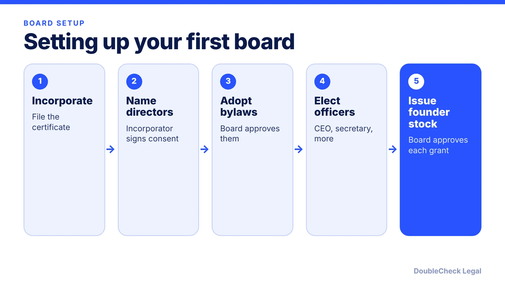
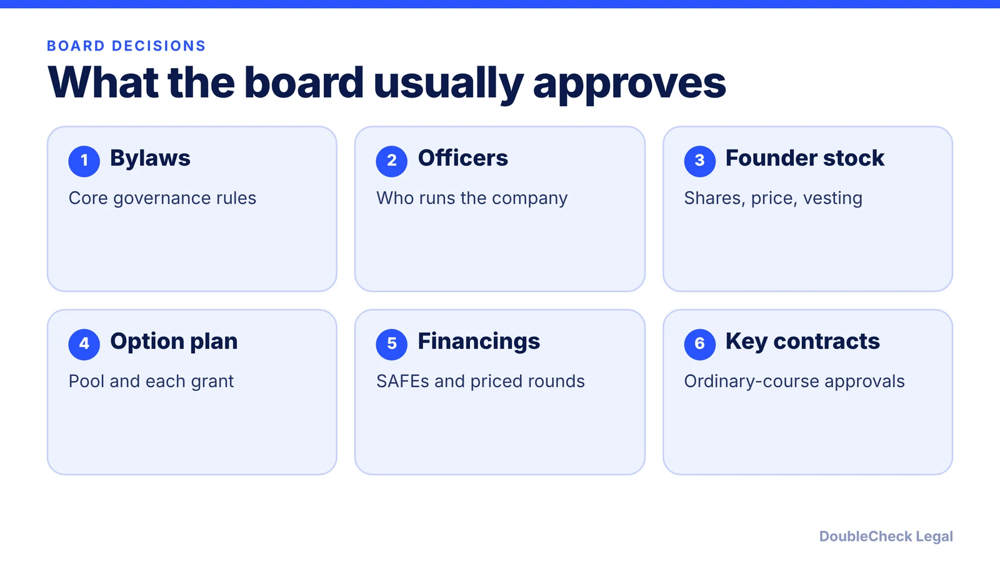

*Your first board is small, but its paperwork carries weight. Here is the setup sequence and how consents and meetings differ.*

**Key takeaways:**

- The incorporator typically signs a consent naming the initial directors, then resigns.
- The first board adopts bylaws, elects officers, and approves founder stock, often by unanimous written consent.
- Delaware Section 141(f) allows board action without a meeting only if all directors consent in writing or electronically.
- Meetings need a quorum of one-third of directors under the DGCL default; written consents must be unanimous.

## 1. The quick answer

**Quick answer:** After you incorporate, someone has to formally appoint the first directors, and the board then adopts bylaws, elects officers, and issues founder stock. Per Nolo, the incorporator typically signs a short consent naming the initial directors and then resigns. Per Cooley GO, the organizational meeting is often not held in person but documented by a unanimous written consent. Under Delaware law, a board can act without a meeting only if all directors consent in writing or electronically (Section 141(f)).

## 2. The first board and the organizational consent

Per Nolo, the typical sequence for a new corporation is:

1. The incorporator files the charter documents.
2. The incorporator signs a one-page consent that appoints the initial directors and then resigns. The incorporator may name themselves as a director in most states. (Whether the incorporator or the certificate names the first directors depends on how you incorporate, so check with whoever forms the company.)
3. The board approves the bylaws, unless the incorporator already did.
4. The board signs a "Written Consent in Lieu of an Organizational Meeting" that elects officers and issues stock, with a separate paragraph listing each shareholder, share count, and price per share.
5. The secretary keeps a minute book with the consents and a cap table.

Cooley GO lists typical items in an organizational consent: electing officers, authorizing stock issuance to founders, opening a bank account, and authorizing payment of incorporation expenses. DGCL Section 108 describes an organization meeting of the initial board where bylaws are adopted and the incorporator's actions ratified, often replaced by written consent, per the OpenCasebook excerpt.

For the incorporation step itself, see [how to incorporate a SaaS or AI startup as a Delaware C-corp](/blog/how-to-incorporate-saas-ai-startup-delaware-c-corp/) and [how to incorporate in Delaware step by step](/blog/how-to-incorporate-in-delaware-step-by-step/).

## 3. Meetings vs. written consents

Per [DLA Piper](https://www.dlapiper.com/en/insights/publications/accelerate/formation/board-action-meetings-vs-written-consents):

- **Meetings:** the DGCL has no prior-notice requirement for calling a meeting, a quorum is one-third of the directors, and actions pass by a majority of directors present at a meeting with a quorum. Meetings can be by phone if everyone can hear each other. DLA Piper recommends bylaws that require at least 24 hours' notice.
- **Written consents:** Section 141(f) lets the board act without a meeting if all directors consent in writing or by electronic transmission, including PDF, e-signature, or email. Consent must be unanimous and a director cannot abstain.

DLA Piper says written consents suit routine, time-sensitive matters like option grants, and that a divided board should hold a meeting, since minutes capture discussion and a director may refuse to sign.

## 4. Who should sit on the board, and what changes with investors

Early on, many startups have a board made up of the founders. Keep it small and odd-numbered if you can, so ties do not stall decisions, and have your co-founders agree in writing on who holds seats (see [co-founder agreement](/blog/co-founder-agreement-startups/)). Equity splits also drive voting; see [founder equity splits](/blog/founder-equity-split-how-to-divide/).

When you raise a priced round, investors often negotiate board seats, so board composition shows up in the [term sheet](/blog/term-sheet-key-terms-explained/). Control issues for larger holders are covered in [Delaware SB 21](/blog/delaware-sb-21-controlling-stockholder-startups/). A few habits help: keep signed consents in one minute book, record every option grant and stock issuance, and hold at least occasional meetings, even short calls, as DLA Piper suggests for board and management relations.

Requirements vary by state and by your charter and bylaws, so confirm with counsel which approvals your company needs.

## Where DoubleCheck fits

[DoubleCheck](https://www.contactdoublecheck.com) helps businesses and founders start legal work with AI, verify it, and, when professional advice is warranted, connect with an independent attorney, including for immigration questions. Attorney availability and practice areas vary. Attorneys on DoubleCheck are independent professionals; an attorney-client relationship forms only if an attorney accepts your engagement.

**Sources:** [Nolo, How to Use Written Consents to Appoint Your Initial Board of Directors and Issue Stock](https://www.nolo.com/legal-encyclopedia/how-to-use-written-consents-to-appoint-your-initial-board-of-directors-and-issue-stock.html); [Cooley GO, Organizational meeting](https://www.cooleygo.com/glossary/organizational-meeting/); [DLA Piper, Board action: meetings vs. written consents](https://www.dlapiper.com/en/insights/publications/accelerate/formation/board-action-meetings-vs-written-consents); [DGCL Section 108 (organization meeting), via OpenCasebook](https://opencasebook.org/casebooks/237-introduction-to-the-law-of-corporations-cases-and-materials/resources/2.2.7-dgcl-sec-108-organization-meeting/).

## FAQ

**Do I need a formal board meeting to start a corporation?**

Not necessarily. Per Cooley GO, the organizational meeting is often documented by unanimous written consent instead. Per the DGCL Section 108 excerpt, the board's first meeting is frequently replaced by written consent.

**Does a written consent need every director to sign?**

Yes under Delaware law. Per DLA Piper, Section 141(f) requires all directors to consent in writing or by electronic transmission, and a director cannot abstain.

**What is the quorum for a Delaware board meeting?**

Per DLA Piper, a quorum is one-third of the directors and actions pass by a simple majority of directors present at a meeting with a quorum. Bylaws can set different rules, so check yours.

**Who appoints the first directors?**

Per Nolo, the incorporator typically signs a consent naming the initial directors and then resigns, though if the certificate names them the process differs by state. Confirm with whoever files your formation documents.

---

*General information only. This article is not legal, tax, investment, or accounting advice.*
