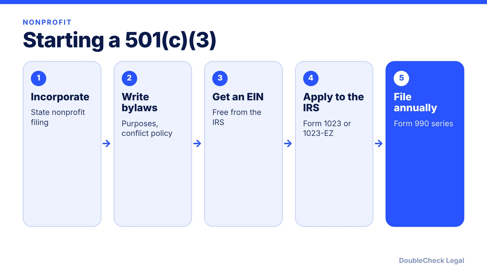
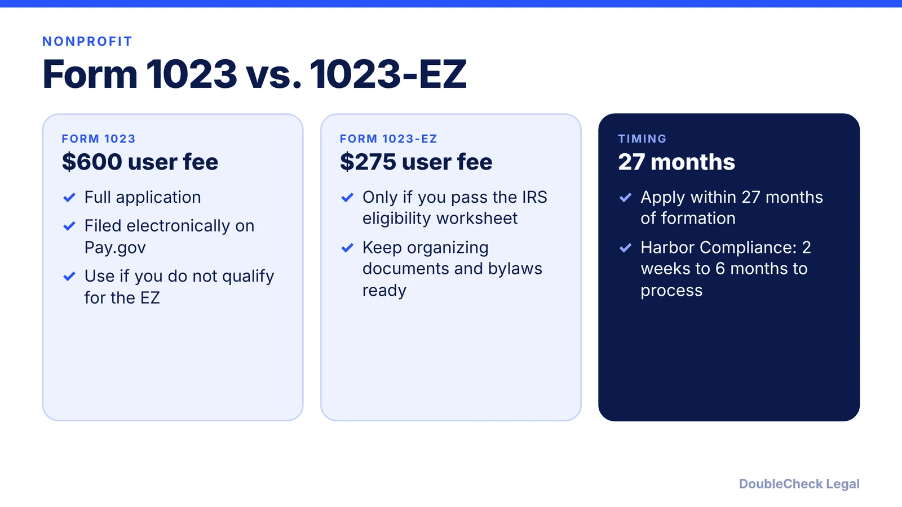

*Starting a nonprofit? Here is the order of steps, the IRS forms and fees, and the annual filings that keep your status.*

**Key takeaways:**

- Incorporate as a nonprofit in your state first, then apply to the IRS.
- The IRS user fee is $600 for Form 1023 and $275 for Form 1023-EZ.
- Apply within 27 months of formation to be exempt from the formation date.
- Failing to file annual returns three years in a row means automatic revocation.

## 1. The quick answer

**Quick answer:** To start a 501(c)(3), you first incorporate as a nonprofit under your state's law, with articles that limit your purposes to 501(c)(3) exempt purposes and include a dissolution clause. Then you apply to the IRS on Form 1023 ($600 user fee) or Form 1023-EZ ($275) if you qualify, through Pay.gov. Apply within 27 months of formation to be treated as exempt from your formation date.

## 2. What the IRS requires

Per the IRS, the organization must be organized and operated exclusively for exempt purposes and none of its earnings may benefit a private shareholder or individual. The entity can be a corporation, unincorporated association, fund, or foundation, but not an individual. The articles must limit purposes to 501(c)(3) purposes and dedicate assets to exempt purposes on dissolution. Excess-benefit transactions can trigger excise tax on the insider and approving managers. Harbor Compliance says the application should include a conflict of interest policy, and the IRS sample policy has the interested person disclose and leave the vote.

## 3. Public charity or private foundation

The IRS notes public charities draw support from a broad donor base and face lighter regulation, while private foundations are typically funded by one person or a small group and are regulated more heavily. Public support is measured over a rolling five-year period, with donations over 2% from a single donor excluded from the numerator under 509(a)(1).

## 4. Annual filings and what can go wrong

Form 990-N (the e-Postcard) is available if gross receipts are normally $50,000 or less and is due by the 15th day of the fifth month after year end. Private foundations file Form 990-PF. Failing to file a 990, 990-EZ, or 990-N for three consecutive years means automatic revocation of tax-exempt status. State incorporation fees and charitable-solicitation registration vary by state, so check yours. If a for-profit fits better, see [LLC vs. C corp](/blog/llc-vs-c-corp-startups/).

## Where DoubleCheck fits

[DoubleCheck](https://www.contactdoublecheck.com) helps businesses and founders start legal work with AI, verify it, and, when professional advice is warranted, connect with an independent attorney, including for immigration questions. Attorney availability and practice areas vary. Attorneys on DoubleCheck are independent professionals; an attorney-client relationship forms only if an attorney accepts your engagement.

**Sources:** [IRS: Exemption requirements](https://www.irs.gov/charities-non-profits/charitable-organizations/exemption-requirements-501c3-organizations); [IRS: Organizational test](https://www.irs.gov/charities-non-profits/charitable-organizations/organizational-test-internal-revenue-code-section-501c3); [IRS: Form 1023 fees](https://www.irs.gov/charities-non-profits/form-1023-and-1023-ez-amount-of-user-fee); [IRS: Application for recognition](https://www.irs.gov/charities-non-profits/application-for-recognition-of-exemption); [IRS: Form 990-N](https://www.irs.gov/charities-non-profits/annual-electronic-filing-requirement-for-small-exempt-organizations-form-990-n-e-postcard); [Harbor Compliance](https://www.harborcompliance.com/information/how-to-start-a-501c3).

## FAQ

**How much does it cost to apply for 501(c)(3) status?**

The IRS user fee is $600 for Form 1023 and $275 for Form 1023-EZ, paid on Pay.gov. State fees are separate.

**How long does the IRS take?**

Harbor Compliance says processing takes roughly two weeks to six months. Confirm with the IRS.

**Do I need to incorporate first?**

Yes. Harbor Compliance lists state-level incorporation as the first step, with purposes and a dissolution clause in the articles.

**What is the difference between a public charity and a private foundation?**

Public charities draw broad support and face lighter regulation; private foundations are typically funded by one person or a small group and file Form 990-PF.

---

*General information only. This article is not legal, tax, investment, or accounting advice.*
