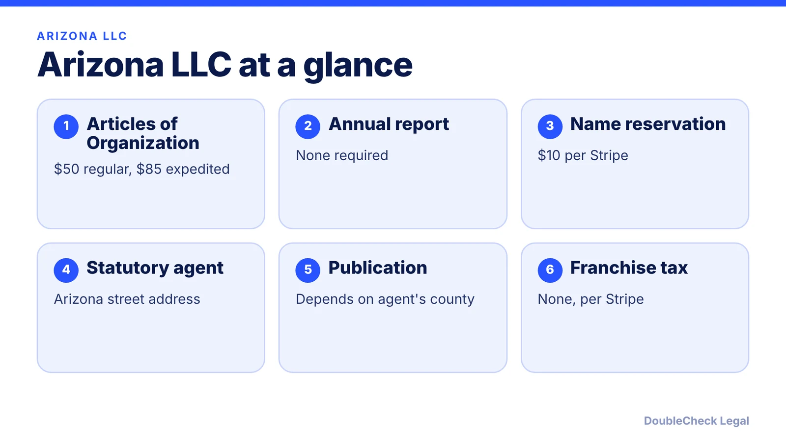
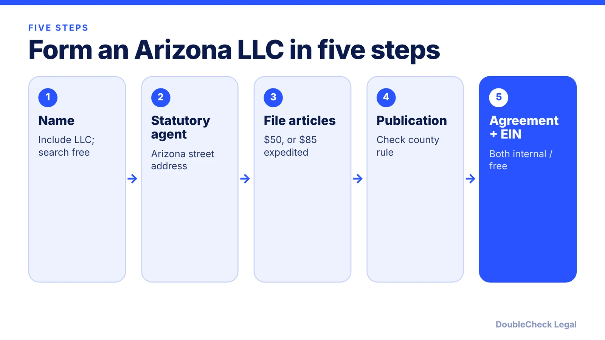

*How do you start an LLC in Arizona? The steps, the $50 filing fee, and the publication rule, as of November 2026.*

**Key takeaways:**

- The ACC filing fee is $50 regular or $85 expedited (confirm with the ACC).
- Arizona LLCs file no annual report.
- Publication was eliminated for Maricopa and Pima counties in 2016 but is still described as required elsewhere.
- The exact publication test depends on location, so confirm with the ACC before filing.

## 1. The quick answer

**Quick answer:** To start an LLC in Arizona, choose a name with an LLC designator, appoint a statutory agent with an Arizona street address, and file Articles of Organization with the Arizona Corporation Commission (ACC). The filing fee is $50, or $85 expedited (confirm with the ACC). Arizona LLCs do not file annual reports. The quirk is newspaper publication: the requirement was eliminated for entities in Maricopa and Pima counties but it may still apply elsewhere in the state, so where your statutory agent is located matters.

## 2. Step by step: name, agent, filing

**1. Choose and check your name.** The name must include "Limited Liability Company," "LLC," or "L.L.C." and be distinguishable from other names on file with the ACC. The online name search is free. A name reservation is optional and carries its own fee.

**2. Appoint a statutory agent.** Arizona's registered agent is called a statutory agent. The agent needs a physical Arizona street address (no P.O. box) and must be available during business hours. You can serve as your own agent, or pay a commercial service; commercial service prices vary.

**3. File Articles of Organization.** The ACC fee is $50 for regular processing or $85 for expedited.

**4. Handle publication if it applies** (see section 3).

**5. Operating agreement and EIN.** Arizona does not generally require an operating agreement, but without one default state law governs how profits and decisions work. See [LLC operating agreements with AI](/blog/llc-operating-agreement-with-ai/). The EIN is free; see [how to get an EIN for free](/blog/how-to-get-an-ein-for-your-business-free/).

## 3. Arizona's publication requirement

Arizona is one of a small number of states with an LLC newspaper publication rule, and its status is the most common point of confusion.

- **What changed:** HB 2447 (2016) took effect for new entities on December 31, 2016. It eliminated publication for entities in the state's largest counties, Maricopa and Pima.
- **Where it still applies:** LLCs outside Maricopa and Pima counties may need to publish a notice in a newspaper. The exact test (for example, the statutory agent's county or the business's place of business) should be confirmed with the ACC.
- **Cost:** it varies by newspaper and county, so get a quote.

Because the ACC's own page would not load for us, check the ACC's current publication instructions before you file. For a comparison with a state where the rule is more famous, see [New York's LLC publication requirement](/blog/new-york-llc-publication-requirement/).

## 4. Ongoing requirements and Arizona quirks

**No annual report.** Arizona LLCs do not file annual reports, and Arizona has no franchise tax, so there is no recurring state report fee. See [annual report requirements by state](/blog/annual-report-requirements-by-state-llc/) for how this compares.

What still applies:

- **Keep your statutory agent current.** If you change agent or address, update the ACC.
- **Local licenses and taxes** are separate; see [business license requirements](/blog/business-license-requirements-small-business/) and, if you sell across state lines, [sales tax nexus](/blog/sales-tax-nexus-small-business-online/).
- **Federal and personal taxes.** A single-member LLC is generally a disregarded entity by default; see [single-member LLC taxes](/blog/single-member-llc-taxes-disregarded-entity/).

Weighing Arizona against Delaware or another state? Read [which state to form an LLC in](/blog/best-state-to-form-an-llc-comparison/), and see [how to incorporate a company in the US](/blog/how-to-incorporate-a-company-in-the-us/) for the overall process.

## Where DoubleCheck fits

[DoubleCheck](https://www.contactdoublecheck.com) helps businesses and founders start legal work with AI, verify it, and, when professional advice is warranted, connect with an independent attorney, including for immigration questions. Attorney availability and practice areas vary. Attorneys on DoubleCheck are independent professionals; an attorney-client relationship forms only if an attorney accepts your engagement.

**Sources:** Arizona Corporation Commission (azcc.gov) filing and publication guidance. No linked sources were verified for this update; confirm fees, publication, and annual-report rules directly with the ACC.

## FAQ

**How much does it cost to start an LLC in Arizona?**

$50 for regular processing or $85 expedited, paid to the Arizona Corporation Commission (confirm current fees with the ACC). Publication, if it applies, is an extra cost that varies by newspaper.

**Does Arizona still require LLC publication?**

Partly. HB 2447 eliminated it for entities in Maricopa and Pima counties effective December 31, 2016. LLCs elsewhere in the state may still need to publish, and the test can depend on location, so confirm with the ACC.

**Does an Arizona LLC file an annual report?**

Generally no. Arizona LLCs do not file annual reports, and Arizona has no franchise tax. Confirm with the ACC and the Arizona Department of Revenue.

**Do I need an operating agreement in Arizona?**

Arizona does not generally require one, but without it default state law governs your LLC. A written agreement is still the usual way to set ownership and decision rules.

---

*General information only. This article is not legal, tax, investment, or accounting advice.*
