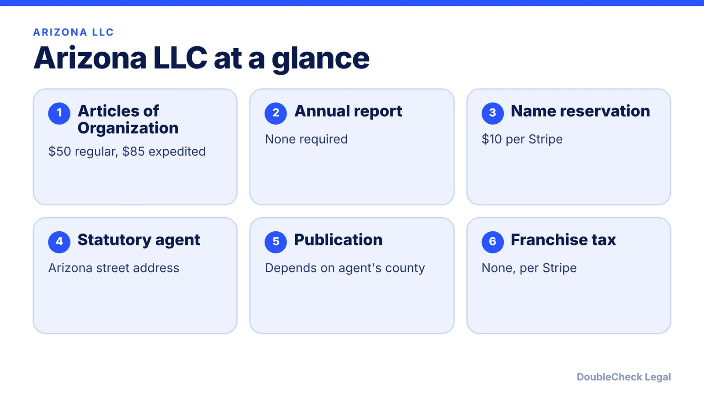
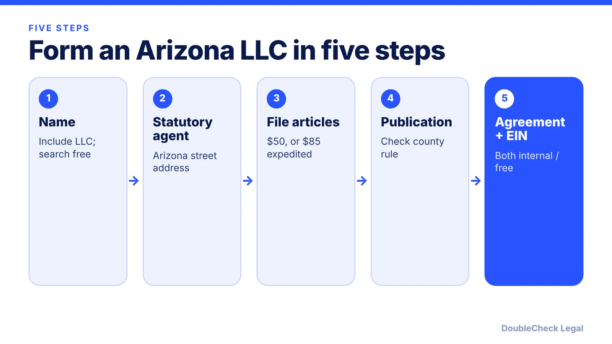

*How do you start an LLC in Arizona? The steps, the $50 filing fee, and the publication rule, as of November 2026.*

**Key takeaways:**

- The ACC filing fee is $50 regular or $85 expedited, per Stripe, Zenind, and LLC University.
- Arizona LLCs file no annual report, per Zenind and Stripe.
- Publication was eliminated for Maricopa and Pima counties in 2016 but is still described as required elsewhere.
- Sources differ on the exact publication test, so confirm with the ACC before filing.

## 1. The quick answer

**Quick answer:** To start an LLC in Arizona, choose a name with an LLC designator, appoint a statutory agent with an Arizona street address, and file Articles of Organization with the Arizona Corporation Commission (ACC). The filing fee is $50, or $85 expedited, per Stripe, Zenind, and LLC University. Arizona LLCs do not file annual reports. The quirk is newspaper publication: the requirement was eliminated for entities in Maricopa and Pima counties but, per the sources below, still applies elsewhere in the state, so where your statutory agent is located matters.

## 2. Step by step: name, agent, filing

**1. Choose and check your name.** Per Stripe, the name must include "Limited Liability Company," "LLC," or "L.L.C." and be distinguishable from other names on file with the ACC. The online name search is free. Stripe lists a $10 name reservation.

**2. Appoint a statutory agent.** Arizona's registered agent is called a statutory agent. Per Stripe, the agent needs a physical Arizona street address (no P.O. box) and must be available during business hours. You can serve as your own agent, or pay a commercial service; Stripe estimates $50 to $300 a year and LLC University about $125.

**3. File Articles of Organization.** Per Stripe, Zenind, and LLC University, the ACC fee is $50 for regular processing or $85 for expedited.

**4. Handle publication if it applies** (see section 3).

**5. Operating agreement and EIN.** Per Stripe, Arizona does not require an operating agreement, but without one default state law governs how profits and decisions work. See [LLC operating agreements with AI](/blog/llc-operating-agreement-with-ai/). The EIN is free; see [how to get an EIN for free](/blog/how-to-get-an-ein-for-your-business-free/).

## 3. Arizona's publication requirement

Arizona is one of a small number of states with an LLC newspaper publication rule, and its status is the most common point of confusion.

- **What changed:** per Keyt Law, HB 2447 was signed May 17, 2016 and took effect for new entities on December 31, 2016. It eliminated publication only for entities with a known place of business in counties with more than 800,000 people, which Keyt Law says means Maricopa and Pima. The ACC instead posts information on its database.
- **Where it still applies:** Stripe says LLCs with a place of business outside Maricopa and Pima must publish a notice in an ACC-approved newspaper, three times within 60 days. LLC University ties the test to the statutory agent's county: if the agent's street address is in Maricopa or Pima, no ad is needed.
- **Affidavit:** ZenBusiness (updated July 17, 2025) says Arizona dropped the requirement to record an affidavit of publication.
- **Cost:** it varies by newspaper. LLC University estimates about $60 to $120 in lower-cost counties and $200 or more in expensive ones. Stripe puts total startup costs under $200 including publication.

Sources differ on whether the test is the agent's county or the business's place of business, and on which agency handles it. Because the ACC's own page would not load for us, check the ACC's current publication instructions before you file. For a comparison with a state where the rule is more famous, see [New York's LLC publication requirement](/blog/new-york-llc-publication-requirement/).

## 4. Ongoing requirements and Arizona quirks

**No annual report.** Zenind and Stripe both say Arizona LLCs do not file annual reports, and Stripe adds that Arizona has no franchise tax, so there is no recurring state report fee. See [annual report requirements by state](/blog/annual-report-requirements-by-state-llc/) for how this compares.

What still applies:

- **Keep your statutory agent current.** If you change agent or address, update the ACC.
- **Local licenses and taxes** are separate; see [business license requirements](/blog/business-license-requirements-small-business/) and, if you sell across state lines, [sales tax nexus](/blog/sales-tax-nexus-small-business-online/).
- **Federal and personal taxes.** A single-member LLC is generally a disregarded entity by default; see [single-member LLC taxes](/blog/single-member-llc-taxes-disregarded-entity/).

Weighing Arizona against Delaware or another state? Read [which state to form an LLC in](/blog/best-state-to-form-an-llc-comparison/), and see [how to incorporate a company in the US](/blog/how-to-incorporate-a-company-in-the-us/) for the overall process.

## Where DoubleCheck fits

[DoubleCheck](https://www.contactdoublecheck.com) helps businesses and founders start legal work with AI, verify it, and, when professional advice is warranted, connect with an independent attorney, including for immigration questions. Attorney availability and practice areas vary. Attorneys on DoubleCheck are independent professionals; an attorney-client relationship forms only if an attorney accepts your engagement.

**Sources:** [Stripe, how to form an LLC in Arizona](https://stripe.com/resources/more/how-to-form-an-llc-in-arizona); [Zenind, Arizona LLC cost and publication](https://www.zenind.com/help/post/how-much-does-an-llc-cost-in-arizona-2026-filing-fees-publication-rules-and-zenind-support); [LLC University, Arizona LLC costs](https://www.llcuniversity.com/arizona-llc/costs/); [ZenBusiness, Arizona publication requirements](https://www.zenbusiness.com/arizona-publication-requirements/); [Keyt Law, newspaper publication](https://www.keytlaw.com/azllclaw/2016/05/newspaper-publication). The Arizona Corporation Commission site did not load, so confirm fees and publication there.

## FAQ

**How much does it cost to start an LLC in Arizona?**

$50 for regular processing or $85 expedited, paid to the Arizona Corporation Commission, per Stripe, Zenind, and LLC University. Publication, if it applies, is an extra cost that varies by newspaper.

**Does Arizona still require LLC publication?**

Partly. Keyt Law says HB 2447 eliminated it for entities in Maricopa and Pima counties effective December 31, 2016. Stripe and LLC University say LLCs elsewhere must still publish in an ACC-approved newspaper. Confirm with the ACC.

**Does an Arizona LLC file an annual report?**

No. Zenind and Stripe both say Arizona LLCs do not file annual reports, and Stripe says Arizona has no franchise tax.

**Do I need an operating agreement in Arizona?**

Stripe says Arizona does not require one, but without it default state law governs your LLC. A written agreement is still the usual way to set ownership and decision rules.

---

*General information only. This article is not legal, tax, investment, or accounting advice.*
