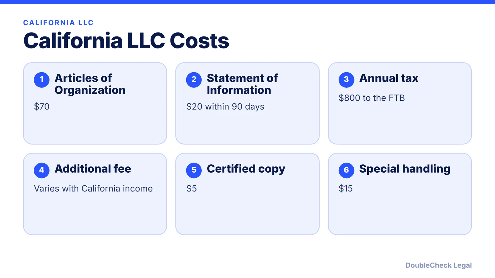
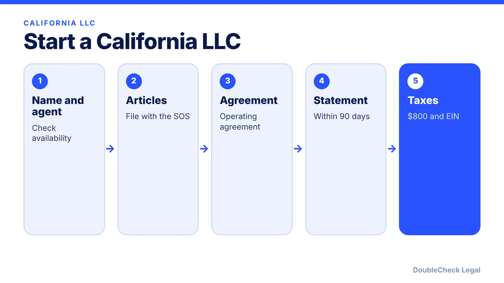

*Starting an LLC in California? Here are the steps, the filing fees, and the $800 annual tax that surprises new owners.*

**Key takeaways:**

- Articles of Organization cost $70 and the Statement of Information $20, per Zenind's 2026 summary.
- The $800 annual tax is generally first due by the 15th day of the fourth month after filing.
- An additional LLC fee varies with California income.
- Forming in another state does not avoid California if you operate here.

## 1. The quick answer

**Quick answer:** To start an LLC in California, you file Articles of Organization with the Secretary of State ($70 per Zenind's 2026 fee summary), file a Statement of Information ($20) within 90 days, get an EIN, and pay the $800 annual tax to the Franchise Tax Board. The first payment is generally due by the 15th day of the fourth month after you file. Expect an additional LLC fee if your California income is high.

## 2. Step by step

1. **Choose a name** and check availability with the Secretary of State.
2. **Appoint an agent** for service of process with a California address.
3. **File the Articles of Organization.**
4. **Write an operating agreement** ([LLC operating agreement with AI](/blog/llc-operating-agreement-with-ai/)).
5. **File the Statement of Information** within 90 days, then every two years.
6. **Get an EIN** ([free from the IRS](/blog/how-to-get-an-ein-for-your-business-free/)).
7. **Pay the $800 annual tax** and watch the additional fee ([California LLC annual tax and fee](/blog/california-llc-annual-tax-and-fee/)).

## 3. California LLC or Delaware?

If you operate in California, forming elsewhere does not avoid California registration or the $800 tax. Compare [California vs. Delaware for startups](/blog/incorporate-california-vs-delaware-startup/) and [a Delaware corporation doing business in California](/blog/delaware-corporation-doing-business-in-california/). If you plan to close it later, read [how to close a California LLC without the $800 tax surprise](/blog/close-california-llc-avoid-800-tax/).

## 4. Living outside California or the U.S.?

You can live elsewhere, including outside the U.S., and still form a California LLC, but a foreign owner has extra filings. See [how to start a U.S. company as a non-U.S. resident](/blog/start-us-company-as-non-us-resident/). San Francisco founders can also read [finding a startup lawyer in San Francisco](/blog/find-startup-lawyer-san-francisco/).

## Where DoubleCheck fits

[DoubleCheck](https://www.contactdoublecheck.com) helps businesses and founders start legal work with AI, verify it, and, when professional advice is warranted, connect with an independent attorney, including for immigration questions. Attorney availability and practice areas vary. Attorneys on DoubleCheck are independent professionals; an attorney-client relationship forms only if an attorney accepts your engagement.

**Sources:** [Zenind California LLC fees](https://www.zenind.com/en-US/help/post/california-llc-filing-fees-in-2026-what-it-really-costs-to-form-and-maintain-an-llc); [IRS Form SS-4 instructions](https://www.irs.gov/instructions/iss4).

## FAQ

**How much does it cost to start an LLC in California?**

Zenind's 2026 summary lists $70 for Articles of Organization, $20 for the Statement of Information, and an $800 annual tax, plus optional copy and rush fees.

**When is the first $800 California LLC tax due?**

Generally the 15th day of the fourth month after you file. Confirm with the Franchise Tax Board.

**Do I need a California address?**

You need an agent for service of process in California. Confirm requirements with the Secretary of State.

**Can a non-U.S. resident form a California LLC?**

Yes, with extra U.S. filings such as Form 5472 for a foreign-owned single-member LLC. See the non-resident guide.

---

*General information only. This article is not legal, tax, investment, or accounting advice.*
