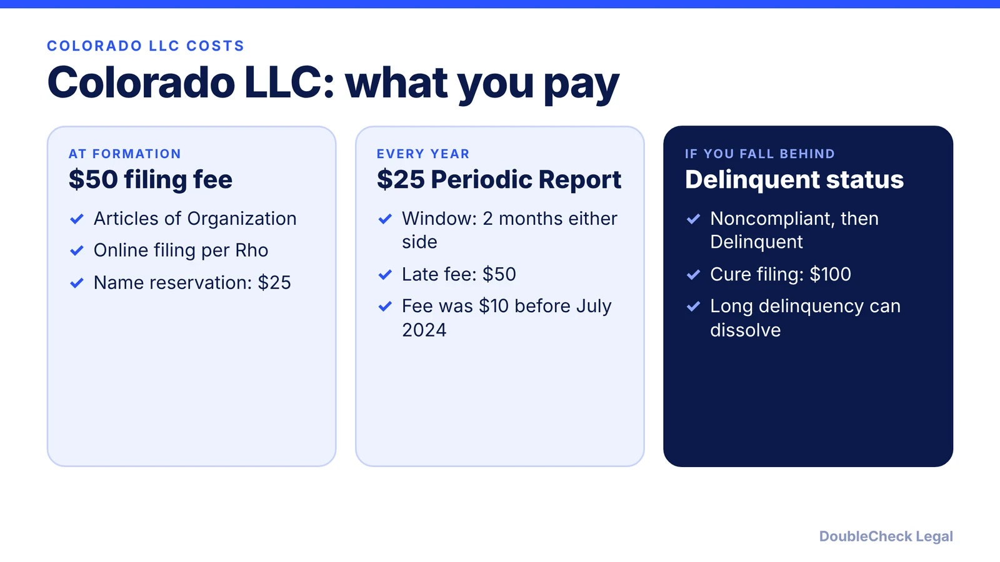
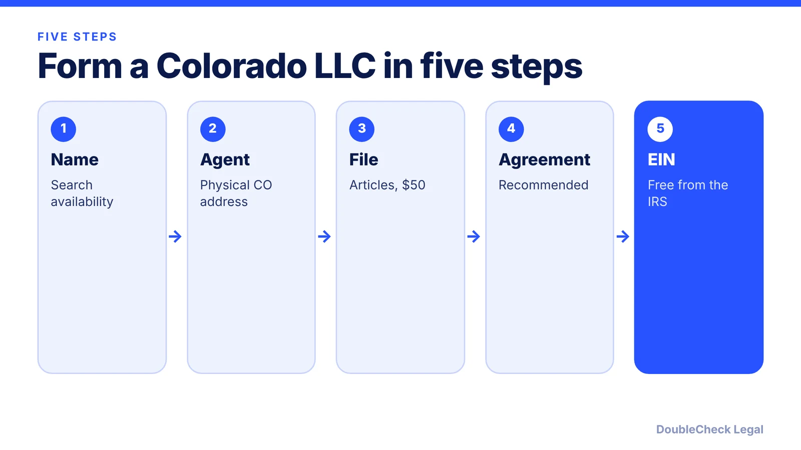

*How do you start an LLC in Colorado? The steps, the $50 filing fee, and the Periodic Report, as of November 2026.*

**Key takeaways:**

- Colorado Articles of Organization cost $50, per Rho, TRUiC, and LLC University.
- The Periodic Report is $25 (up from $10 on July 1, 2024), filed within two months either side of your anniversary month.
- A late report adds $50; staying noncompliant leads to Delinquent status and a $100 cure fee, per Rho.
- A registered agent with a physical Colorado street address is required; you may serve as your own.

## 1. The quick answer

**Quick answer:** To start an LLC in Colorado, check name availability, appoint a registered agent with a physical Colorado street address, and file Articles of Organization online with the Colorado Secretary of State for $50. Colorado then requires a Periodic Report every year, which is $25 after the fee rose from $10 on July 1, 2024 (per Rho and State Business Compliance). It can be filed from two months before to two months after your formation-anniversary month; a late report adds a $50 fee.

## 2. Step by step: name, agent, filing

**1. Check your name.** Per Rho, the name must include "Limited Liability Company," "LLC," "L.L.C.," or an approved variant, and cannot duplicate or closely resemble a name on file. Use the Secretary of State's name search. A 120-day reservation is $25, per Rho and TRUiC.

**2. Appoint a registered agent.** Per Rho, the agent must be a person or company with a physical Colorado street address (no P.O. boxes). An individual agent needs a current Colorado driver's license or state ID, or must separately verify Colorado residency with the Secretary of State. You can serve as your own agent at no cost, per TRUiC.

**3. File Articles of Organization.** The fee is $50, per Rho, TRUiC, and LLC University. Rho says Colorado accepts this filing online only, while TRUiC says online or by mail, so use the Secretary of State's site to see the current options.

**4. Write an operating agreement.** TRUiC says it is not legally required but is recommended. See [LLC operating agreements with AI](/blog/llc-operating-agreement-with-ai/).

**5. Get an EIN.** Free from the IRS; see [how to get an EIN for free](/blog/how-to-get-an-ein-for-your-business-free/).

## 3. The Colorado Periodic Report

Colorado calls its yearly filing a **Periodic Report**. Per Rho and State Business Compliance:

- **Fee:** $25 per year. State Business Compliance says it was raised from $10 on July 1, 2024, which explains why older guides (and one FAQ on TRUiC's page) still show $10.
- **Window:** you can file from two months before to two months after your Periodic Report Month, with no penalty. An LLC formed in March can file from January 1 through May 31.
- **Late:** Rho says a missed report makes the status Noncompliant and adds a $50 late fee.
- **Delinquent:** if the entity stays Noncompliant for about 60 more days it becomes Delinquent. Rho lists $100 to reinstate, and State Business Compliance warns that years of delinquency can lead to administrative dissolution.

Compare how other states do this in [annual report requirements by state](/blog/annual-report-requirements-by-state-llc/). If you eventually close the business, see [how to dissolve an LLC](/blog/how-to-dissolve-an-llc-step-by-step/).

## 4. Colorado quirks and what to check

- **Fee changes.** The jump from $10 to $25 in 2024 shows why to read the Secretary of State's current fee schedule, not an older guide.
- **Individual agent ID rule.** If you name yourself or an employee as agent, be ready for the driver's license or residency verification step, per Rho.
- **Trade names.** TRUiC lists $20 for a Trade Name Statement if you operate under a name other than the LLC's.
- **Local rules.** Cities and counties set their own business licenses; see [business license requirements](/blog/business-license-requirements-small-business/). Colorado's rules on AI in products may also matter to tech founders; see [AI regulation for startups](/blog/ai-regulation-startups-eu-ai-act-colorado/).

Considering another state? See [which state to form an LLC in](/blog/best-state-to-form-an-llc-comparison/), [single-member LLC taxes](/blog/single-member-llc-taxes-disregarded-entity/), and [how to incorporate a company in the US](/blog/how-to-incorporate-a-company-in-the-us/).

## Where DoubleCheck fits

[DoubleCheck](https://www.contactdoublecheck.com) helps businesses and founders start legal work with AI, verify it, and, when professional advice is warranted, connect with an independent attorney, including for immigration questions. Attorney availability and practice areas vary. Attorneys on DoubleCheck are independent professionals; an attorney-client relationship forms only if an attorney accepts your engagement.

**Sources:** [Rho, how to start an LLC in Colorado](https://www.rho.co/blog/how-to-start-an-llc-in-colorado); [State Business Compliance, Colorado LLC taxes and fees 2026](https://www.statebusinesscompliance.com/blog/colorado-llc-taxes-fees-2026); [TRUiC, cost to form a Colorado LLC](https://www.howtostartanllc.com/colorado-llc/cost-to-form); [LLC University, Colorado LLC fees](https://www.llcuniversity.com/colorado-llc-fees/). The Colorado Secretary of State site did not load, so confirm current fees there.

## FAQ

**How much does it cost to start an LLC in Colorado?**

$50 to file Articles of Organization, per Rho, TRUiC, and LLC University. A 120-day name reservation is an optional $25.

**How much is the Colorado LLC Periodic Report?**

$25 per year, per Rho and State Business Compliance, which says it was raised from $10 on July 1, 2024. Some older pages still show $10.

**When is the Colorado Periodic Report due?**

You can file from two months before to two months after your Periodic Report Month without a penalty, per Rho and State Business Compliance. A late report adds a $50 fee.

**What happens if I miss the Colorado Periodic Report?**

Per Rho, the LLC becomes Noncompliant with a $50 late fee, and after about 60 more days it becomes Delinquent. Reinstatement costs $100, and long delinquency can lead to administrative dissolution.

---

*General information only. This article is not legal, tax, investment, or accounting advice.*
