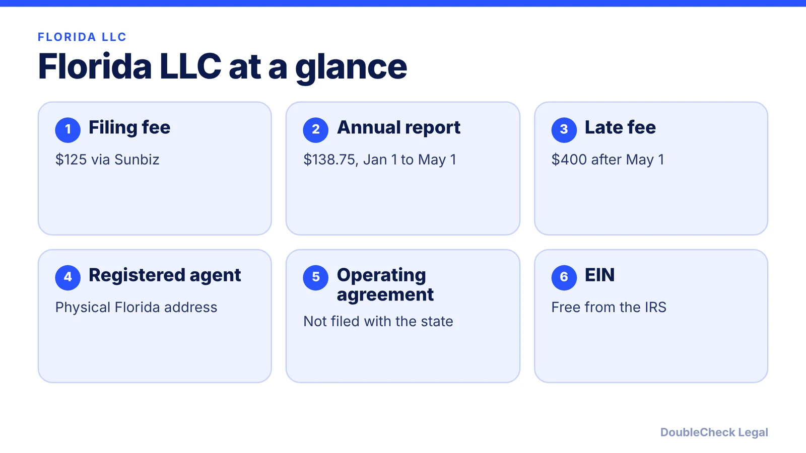
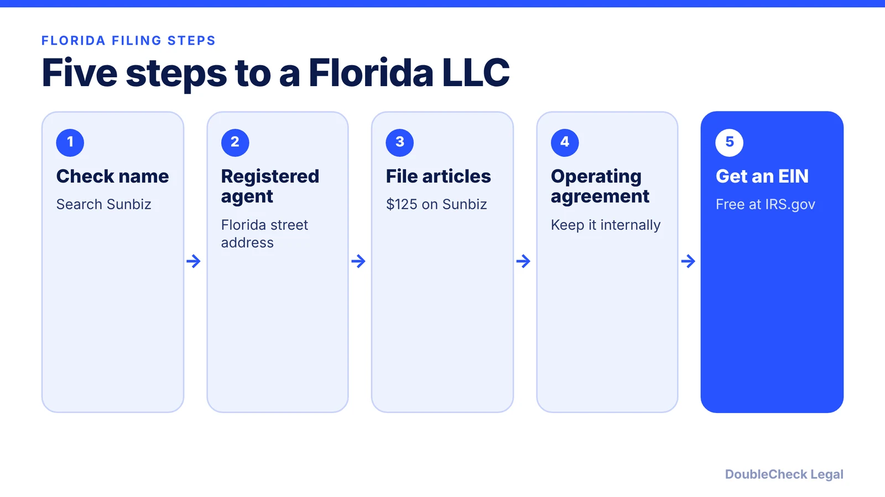

*How do you start an LLC in Florida? Here are the steps, state fees, and the annual report deadline, as of November 2026.*

**Key takeaways:**

- Florida's LLC filing fee is $125 per Stripe; confirm on Sunbiz.
- A registered agent with a physical Florida street address is required.
- The annual report costs $138.75 and is due January 1 to May 1; a $400 late fee applies after.
- Florida has no state personal income tax, but federal taxes still apply.

## 1. The quick answer

**Quick answer:** To start an LLC in Florida, check that your name is available on Sunbiz, name a registered agent with a physical Florida street address, and file Articles of Organization online. Per Stripe's Florida guide, the state filing fee is $125. After that, adopt an operating agreement, get a free EIN from the IRS, and file an annual report between January 1 and May 1 each year, starting the year after formation. The annual report costs $138.75 on time and a $400 late fee applies after May 1.

## 2. Step by step: name, agent, and filing

**1. Check your name.** Search the Sunbiz business name database. Per Stripe, the name must include "LLC" or "L.L.C." and be distinguishable from other entities on file. Florida does not require a name reservation.

**2. Pick a registered agent.** The agent needs a physical Florida street address; PO boxes are not accepted. You can serve as your own agent if you live in Florida, or hire a commercial agent. Pricing varies by provider.

**3. File Articles of Organization.** File through Sunbiz. The state fee is $125, per Stripe's guide. Confirm the current amount on the Sunbiz page before paying.

**4. Write an operating agreement.** It is not filed with the state, but Stripe calls it best practice and most important for multi-member LLCs. See [LLC operating agreements with AI](/blog/llc-operating-agreement-with-ai/) for a way to draft and then verify one.

**5. Get an EIN.** The IRS issues it free; see [how to get an EIN for free](/blog/how-to-get-an-ein-for-your-business-free/). Applicants without an SSN should read [getting an EIN as a foreign founder](/blog/get-ein-without-ssn-foreign-founder/).

## 3. Ongoing costs and the May 1 deadline

Florida's recurring obligation is the annual report. Per Stripe:

- **Window:** January 1 to May 1, beginning the year after formation.
- **Fee:** $138.75 if filed on time.
- **Late fee:** $400 if filed after May 1, with no grace period.
- **Risk:** an unfiled report can lead to administrative dissolution, which removes liability protection.

Sunbiz does not send physical reminders by default, so set a calendar reminder. For a state-by-state view, see [annual report requirements by state](/blog/annual-report-requirements-by-state-llc/).

## 4. Florida quirks and what to compare

Florida has no state personal income tax, so pass-through LLC profits are not taxed again at the state level, per Stripe. That does not remove federal taxes. A single-member LLC is usually a disregarded entity for federal purposes; see [single-member LLC taxes](/blog/single-member-llc-taxes-disregarded-entity/).

If you sell taxable goods or services, you may need a sales tax certificate from the Florida Department of Revenue, per Stripe. Local licenses are separate; read [business license requirements](/blog/business-license-requirements-small-business/).

Comparing states? The [LLC formation cost comparison](/blog/llc-formation-cost-california-texas-florida-new-york/) and [best state to form an LLC](/blog/best-state-to-form-an-llc-comparison/) put Florida next to other states. For the broader picture, see [how to incorporate a company in the US](/blog/how-to-incorporate-a-company-in-the-us/). Compare sibling guides for [Georgia](/blog/how-to-start-an-llc-in-georgia/) and [New York](/blog/how-to-start-an-llc-in-new-york/).

## Where DoubleCheck fits

[DoubleCheck](https://www.contactdoublecheck.com) helps businesses and founders start legal work with AI, verify it, and, when professional advice is warranted, connect with an independent attorney, including for immigration questions. Attorney availability and practice areas vary. Attorneys on DoubleCheck are independent professionals; an attorney-client relationship forms only if an attorney accepts your engagement.

**Sources:** [Stripe: How to start an LLC in Florida](https://stripe.com/resources/more/how-to-start-an-llc-in-florida); [Sunbiz (Florida Division of Corporations)](https://dos.fl.gov/sunbiz/).

## FAQ

**How much does it cost to start an LLC in Florida?**

Per Stripe's Florida guide, the Articles of Organization state fee is $125. The annual report then costs $138.75 if filed on time. Registered agent pricing varies by provider.

**When is the Florida LLC annual report due?**

Between January 1 and May 1 each year, beginning the year after formation, per Stripe. A $400 late fee applies if filed after May 1.

**Do I need an operating agreement in Florida?**

It is not filed with the state. Stripe calls it best practice and most important for multi-member LLCs, since it sets ownership and decision rules.

**Do I need a Florida registered agent?**

Yes. The agent needs a physical Florida street address, and PO boxes are not accepted, per Stripe. You may serve as your own agent or hire a commercial one.

---

*General information only. This article is not legal, tax, investment, or accounting advice.*
