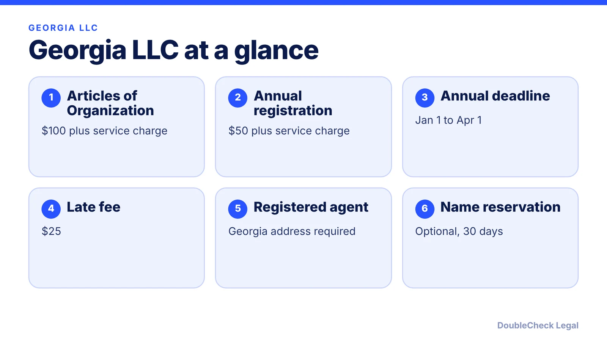
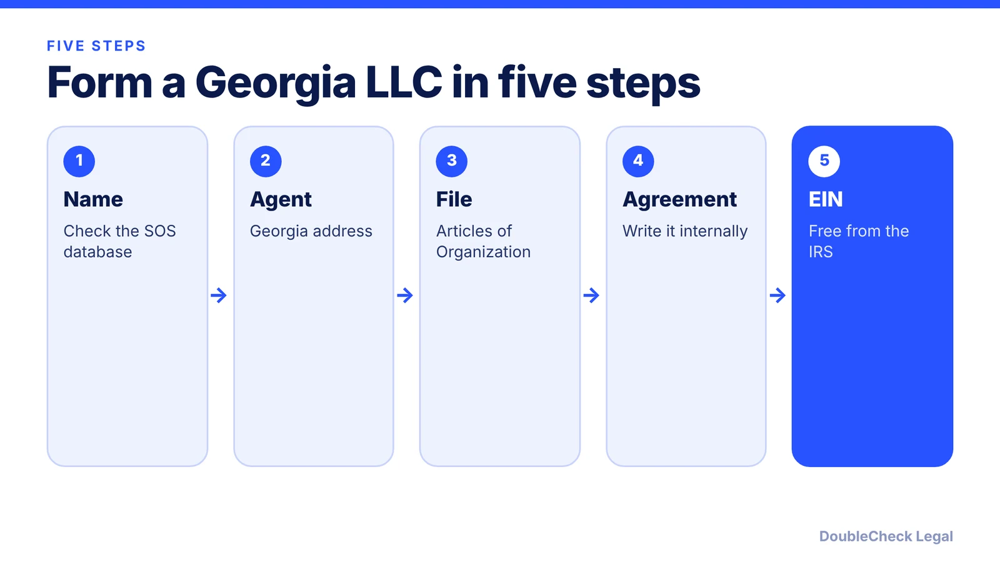

*How do you start an LLC in Georgia? The steps, the filing cost, and the annual registration deadline, as of November 2026.*

**Key takeaways:**

- Georgia's Articles of Organization cost $100 plus a service charge, about $110 total per ZenBusiness and Zenind.
- Every Georgia LLC needs a registered agent with a Georgia address; you may serve as your own.
- The annual registration is $50 plus any service charge, due January 1 to April 1, with a $25 late fee.
- Secondary pages differ by a few dollars, so confirm the final total with the Secretary of State.

## 1. The quick answer

**Quick answer:** To start an LLC in Georgia, pick a name, appoint a Georgia registered agent, and file Articles of Organization with the Georgia Secretary of State. Per LegalZoom and Zenind, the filing fee is $100 plus a service charge, for a total of about $110 (ZenBusiness lists $110 with a $5 online charge, so check the total at checkout). Georgia then requires an annual registration between January 1 and April 1 each year, starting the year after you form, at $50 plus a service charge, with a $25 late fee.

## 2. Step by step: name, agent, filing

**1. Choose and check your name.** Search the Georgia Secretary of State business database for a name that is distinguishable from others on file and carries an LLC designator. Name reservation is optional: LegalZoom lists $25 and says it holds a name for up to 30 days, while Zenind shows $35 including its service charge. It is not required to register an LLC.

**2. Appoint a registered agent.** Per LegalZoom, every Georgia LLC must have a registered agent in Georgia. You can act as your own agent, or name a friend, family member, or employee; commercial services typically charge their own annual fee (LegalZoom estimates $100 to $300 a year).

**3. File Articles of Organization.** The state filing fee is $100, plus a service charge: ZenBusiness reports $110 in total, and LegalZoom says mail or in-person filing adds $10 to the online $100 fee. Zenind reports the same $110 total for either route. Because secondary sources differ by a few dollars, confirm the final amount on the Secretary of State's filing screen.

**4. Write an operating agreement.** Georgia sources we reviewed did not list this as a state filing, so treat it as an internal document that sets ownership, voting, and profit splits. See [LLC operating agreements with AI](/blog/llc-operating-agreement-with-ai/) and [adding a member to an LLC](/blog/how-to-add-a-member-to-an-llc/).

**5. Get an EIN.** The IRS issues it free; see [how to get an EIN for free](/blog/how-to-get-an-ein-for-your-business-free/). Foreign founders without an SSN should read [getting an EIN without an SSN](/blog/get-ein-without-ssn-foreign-founder/).

## 3. Georgia's annual registration

Georgia calls its yearly filing an **annual registration**, not an annual report. Per ZenBusiness and Zenind:

- **When:** between January 1 and April 1 each year. The first one is due in the year after your LLC was formed, so an LLC formed in 2026 first registers between January 1 and April 1, 2027.
- **Fee:** $50, plus a $10 service charge on some filing routes (LegalZoom lists $60 total for a mailed filing; Zenind lists $60 total).
- **Late fee:** $25 if you miss the deadline. Zenind warns that repeated noncompliance can lead to administrative dissolution.

Put the April 1 date in your calendar the day you form. If you are comparing states, see [annual report requirements by state](/blog/annual-report-requirements-by-state-llc/) for how other states handle it. Closing the company later is covered in [how to dissolve an LLC](/blog/how-to-dissolve-an-llc-step-by-step/).

## 4. Georgia quirks and what to check

A few points specific to Georgia:

- **Calendar-year rhythm.** Unlike states that tie the report to your formation month, Georgia uses the same January 1 to April 1 window for everyone, per Zenind.
- **Pages disagree by a few dollars.** Secondary pages split the $110 total differently between a state fee and a service charge. Treat the Secretary of State's checkout as final.
- **Local licenses are separate.** City and county business licenses are not covered by the state filing. See [business license requirements](/blog/business-license-requirements-small-business/).
- **Taxes are a separate question.** An LLC with one owner is usually taxed as a disregarded entity by default; see [single-member LLC taxes](/blog/single-member-llc-taxes-disregarded-entity/).

If you are weighing Georgia against Delaware or another state, read [which state to form an LLC in](/blog/best-state-to-form-an-llc-comparison/). For the big picture, see [how to incorporate a company in the US](/blog/how-to-incorporate-a-company-in-the-us/).

## Where DoubleCheck fits

[DoubleCheck](https://www.contactdoublecheck.com) helps businesses and founders start legal work with AI, verify it, and, when professional advice is warranted, connect with an independent attorney, including for immigration questions. Attorney availability and practice areas vary. Attorneys on DoubleCheck are independent professionals; an attorney-client relationship forms only if an attorney accepts your engagement.

**Sources:** [ZenBusiness, Georgia LLC cost](https://www.zenbusiness.com/georgia-filing-fees); [LegalZoom, how much is an LLC in Georgia](https://www.legalzoom.com/articles/how-much-is-an-llc-in-georgia); [Zenind, Georgia LLC cost in 2026](https://www.zenind.com/help/post/georgia-llc-cost-in-2026-filing-fees-annual-costs-and-hidden-expenses).

## FAQ

**How much does it cost to start an LLC in Georgia?**

The filing fee is $100 plus a service charge, about $110 in total, per ZenBusiness and Zenind. LegalZoom says mail or in-person filing adds $10 to the $100 online fee. Confirm the total on the Secretary of State's checkout.

**When is the Georgia LLC annual registration due?**

Between January 1 and April 1 each year, starting the year after formation, per ZenBusiness. The fee is $50 plus any service charge, and a late filing adds $25.

**Do I need a registered agent in Georgia?**

Yes. LegalZoom says every Georgia LLC must have a Georgia registered agent. You can serve as your own agent or hire a commercial service.

**Is an operating agreement required in Georgia?**

The Georgia sources we reviewed list it as an internal document, not a state filing. It is still worth having to set ownership and decision rules; check with an attorney for your situation.

---

*General information only. This article is not legal, tax, investment, or accounting advice.*
