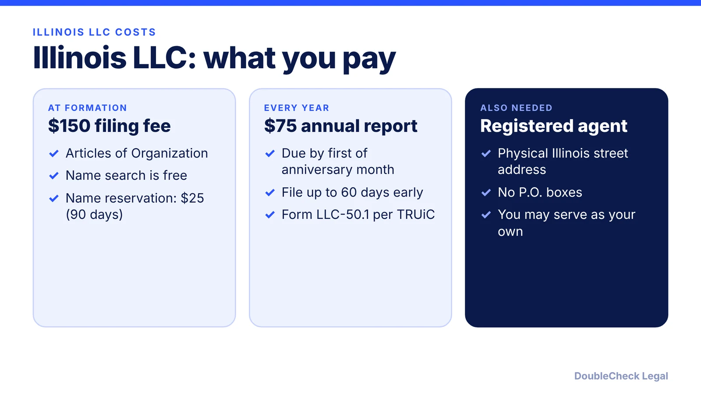
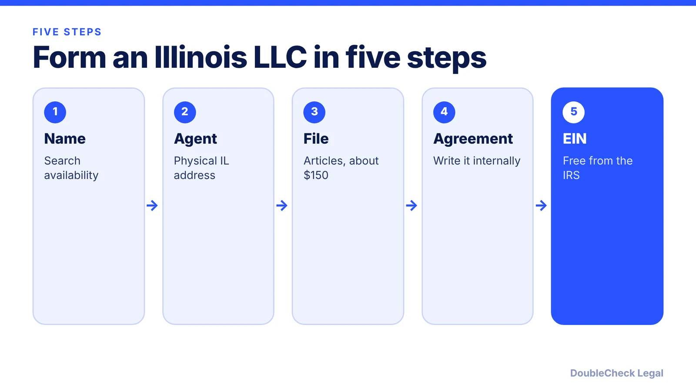

*How do you start an LLC in Illinois? The steps, the $150 filing fee, and the annual report deadline, as of November 2026.*

**Key takeaways:**

- TRUiC and LegalZoom list $150 for Illinois Articles of Organization; Zenind lists $154.
- An Illinois registered agent needs a physical street address; you may serve as your own.
- The annual report is $75, due by the first day of your anniversary month, fileable up to 60 days early.
- Name search is free, and a 90-day name reservation is $25.

## 1. The quick answer

**Quick answer:** To start an LLC in Illinois, check that your name is available, appoint a registered agent with a physical Illinois street address, and file Articles of Organization with the Illinois Secretary of State. Per TRUiC and LegalZoom, the filing fee is $150 (Zenind lists $154). Illinois then requires an annual report at $75, due by the first day of your LLC's anniversary month and fileable up to 60 days earlier, per TRUiC.

## 2. Step by step: name, agent, filing

**1. Check your name.** Per TRUiC, the name must be distinguishable from other businesses in Illinois. Use the Secretary of State's name availability search, which carries no fee. If you want to hold a name before filing, TRUiC and LegalZoom list a $25 reservation for 90 days.

**2. Appoint a registered agent.** Per TRUiC, the agent needs a physical street address in Illinois, and P.O. boxes are not allowed. You can serve as your own agent at no cost (LegalZoom). Commercial agents charge their own fees; LegalZoom estimates $40 to $500 a year. Zenind lists $25 to change agents later.

**3. File Articles of Organization.** The fee is $150 per TRUiC and LegalZoom. Zenind lists $154, which it says includes a processing fee, so confirm the total at filing. TRUiC lists expedited processing at $25 per document extra.

**4. Write an operating agreement.** None of the Illinois sources we reviewed list it as a state filing, so treat it as an internal document. See [LLC operating agreements with AI](/blog/llc-operating-agreement-with-ai/).

**5. Get an EIN.** Free from the IRS; see [how to get an EIN for free](/blog/how-to-get-an-ein-for-your-business-free/).

## 3. The Illinois annual report

Illinois requires every LLC to file an annual report, which TRUiC lists as Form LLC-50.1 at **$75**, filed online or by mail. Per TRUiC and LegalZoom:

- **Due date:** the first day of the month your LLC was formed (its anniversary month). Zenind phrases it as within the 60 days before that first day, matching TRUiC's note that you can file up to 60 days early.
- **Late consequences:** Zenind warns that late filing can bring late fees and eventually administrative dissolution. TRUiC mentions a $100 penalty for reports filed more than 60 days late; confirm the current amount with the Secretary of State.

Compare other states in [annual report requirements by state](/blog/annual-report-requirements-by-state-llc/). If you later close the company, see [how to dissolve an LLC](/blog/how-to-dissolve-an-llc-step-by-step/).

## 4. Illinois quirks and what to check

- **Assumed names.** If you operate under a name other than the LLC's, Zenind lists an Assumed Name filing at $150. Check the Secretary of State before using a trade name.
- **Anniversary-month deadline.** Illinois ties the report to your formation month, so a December formation means a December 1 deadline. Put it on your calendar when you form.
- **Pages differ by a few dollars.** The $150 versus $154 gap is a good reminder to read the final total on the state's own screen.
- **Local rules.** City and county licenses are separate from the state filing; see [business license requirements](/blog/business-license-requirements-small-business/). If you plan to raise venture money later, see [LLC vs C-corp for startups](/blog/llc-vs-c-corp-startups/).

Choosing between Illinois and another state? Read [which state to form an LLC in](/blog/best-state-to-form-an-llc-comparison/), and for the overall process [how to incorporate a company in the US](/blog/how-to-incorporate-a-company-in-the-us/).

## Where DoubleCheck fits

[DoubleCheck](https://www.contactdoublecheck.com) helps businesses and founders start legal work with AI, verify it, and, when professional advice is warranted, connect with an independent attorney, including for immigration questions. Attorney availability and practice areas vary. Attorneys on DoubleCheck are independent professionals; an attorney-client relationship forms only if an attorney accepts your engagement.

**Sources:** [TRUiC, cost to form an LLC in Illinois](https://howtostartanllc.com/illinois-llc/cost-to-form); [LegalZoom, how much is an LLC in Illinois](https://usaa.legalzoom.com/articles/how-much-is-an-llc-in-illinois); [Zenind, Illinois LLC filing fees](https://www.zenind.com/help/post/illinois-llc-filing-fees-and-requirements-a-complete-guide-for-entrepreneurs). The Illinois Secretary of State site blocked automated access, so figures are from these secondary pages.

## FAQ

**How much does it cost to start an LLC in Illinois?**

$150 for Articles of Organization per TRUiC and LegalZoom. Zenind lists $154 including a processing fee, so confirm the total at filing.

**How much is the Illinois LLC annual report?**

$75 per TRUiC and LegalZoom, due by the first day of the month the LLC was formed. TRUiC says you can file up to 60 days early.

**Do I need a registered agent in Illinois?**

Yes. Per TRUiC, the agent must have a physical Illinois street address, and you can serve as your own agent at no cost.

**Can I reserve an LLC name in Illinois?**

Yes. TRUiC and LegalZoom list a $25 reservation that holds a name for 90 days. The name availability search itself is free.

---

*General information only. This article is not legal, tax, investment, or accounting advice.*
