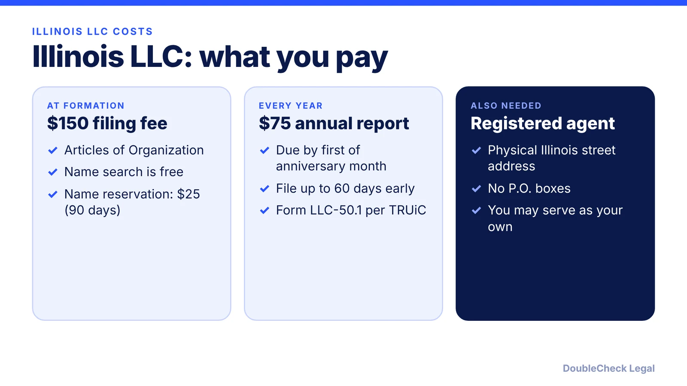
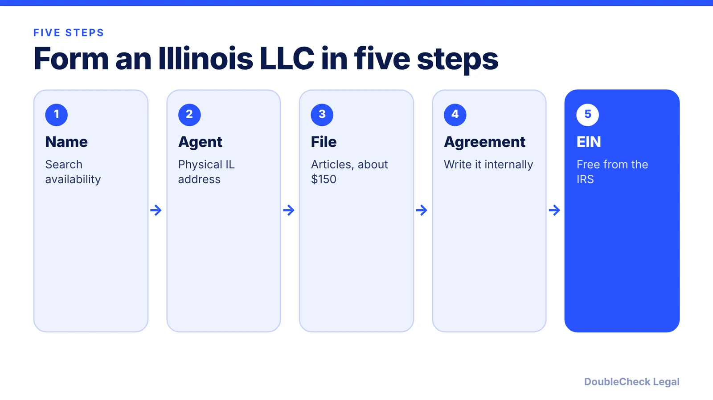

*How do you start an LLC in Illinois? The steps, the $150 filing fee, and the annual report deadline, as of November 2026.*

**Key takeaways:**

- The Illinois LLC Act sets the Articles of Organization filing fee at $150.
- An Illinois LLC must keep a registered agent, who is an Illinois resident individual or an entity authorized to do business there, with a street address in the state.
- The annual report is $75, due by the first day of your anniversary month, fileable up to 60 days early.
- Illinois sets a $25 fee for reserving a name before you file.

## 1. The quick answer

**Quick answer:** To start an LLC in Illinois, check that your name is available, appoint a registered agent with an Illinois street address, and file Articles of Organization with the Illinois Secretary of State. Under the Illinois Limited Liability Company Act, the filing fee is $150. Illinois then requires an annual report at $75, due by the first day of your LLC's anniversary month and fileable in the 60 days before that month.

## 2. Step by step: name, agent, filing

**1. Check your name.** The name must be distinguishable from other businesses in Illinois, so use the Secretary of State's name availability search before filing. If you want to hold a name before filing, the Act sets a $25 name reservation fee; confirm the reservation period with the Secretary of State.

**2. Appoint a registered agent.** Under the Act, the agent must be an individual resident of Illinois or an entity authorized to transact business there, and the registered office is identified by street, number, and city. An eligible individual, including you, can serve as agent. Commercial agents charge their own fees, so compare them before choosing.

**3. File Articles of Organization.** The fee is $150 under the Act (a higher $400 fee applies to an LLC with series). Confirm the total, and any expedite option, on the Secretary of State's screen at filing.

**4. Write an operating agreement.** None of the Illinois sources we reviewed list it as a state filing, so treat it as an internal document. See [LLC operating agreements with AI](/blog/llc-operating-agreement-with-ai/).

**5. Get an EIN.** Free from the IRS; see [how to get an EIN for free](/blog/how-to-get-an-ein-for-your-business-free/).

## 3. The Illinois annual report

Illinois requires every LLC to file an annual report, which the Act prices at **$75** (plus $50 for each series, if any). The Secretary of State's form is LLC-50.1. Under the statute:

- **Due date:** the first day of the month your LLC was formed (its anniversary month). The report must be delivered within the 60 days preceding that first day.
- **Late consequences:** a late report can bring a $100 penalty plus $100 for each year or fraction of a year starting with the second year of delinquency. The Secretary of State also will not file other documents for a delinquent LLC and can show it as not in good standing.

Compare other states in [annual report requirements by state](/blog/annual-report-requirements-by-state-llc/). If you later close the company, see [how to dissolve an LLC](/blog/how-to-dissolve-an-llc-step-by-step/).

## 4. Illinois quirks and what to check

- **Assumed names.** If you operate under a name other than the LLC's, check the Secretary of State's assumed name requirements and fees before using a trade name.
- **Anniversary-month deadline.** Illinois ties the report to your formation month, so a December formation means a December 1 deadline. Put it on your calendar when you form.
- **Fees change.** Statutory fees can be amended, so read the final total on the state's own screen.
- **Local rules.** City and county licenses are separate from the state filing; see [business license requirements](/blog/business-license-requirements-small-business/). If you plan to raise venture money later, see [LLC vs C-corp for startups](/blog/llc-vs-c-corp-startups/).

Choosing between Illinois and another state? Read [which state to form an LLC in](/blog/best-state-to-form-an-llc-comparison/), and for the overall process [how to incorporate a company in the US](/blog/how-to-incorporate-a-company-in-the-us/).

## Where DoubleCheck fits

[DoubleCheck](https://www.contactdoublecheck.com) helps businesses and founders start legal work with AI, verify it, and, when professional advice is warranted, connect with an independent attorney, including for immigration questions. Attorney availability and practice areas vary. Attorneys on DoubleCheck are independent professionals; an attorney-client relationship forms only if an attorney accepts your engagement.

**Sources:** [805 ILCS 180/50-10, fees (Illinois Limited Liability Company Act, via Justia)](https://law.justia.com/codes/illinois/chapter-805/act-805-ilcs-180/article-50/); [805 ILCS 180/50-1, annual report (ILGA)](https://ilga.gov/legislation/ilcs/documents/080501800K50-1.htm); [805 ILCS 180/50-15, delinquency penalties (ILGA)](https://ilga.gov/legislation/ilcs/documents/080501800K50-15.htm); [805 ILCS 180/1-35, registered agent (ILGA)](https://ilga.gov/legislation/ilcs/documents/080501800K1-35.htm). Confirm current forms and fees with the Illinois Secretary of State.

## FAQ

**How much does it cost to start an LLC in Illinois?**

$150 for Articles of Organization under the Illinois LLC Act (805 ILCS 180/50-10). Confirm the total at filing.

**How much is the Illinois LLC annual report?**

$75 under the Illinois LLC Act, due by the first day of the month the LLC was formed. You can file within the 60 days before that date.

**Do I need a registered agent in Illinois?**

Yes. The Illinois LLC Act requires a registered agent, who must be an Illinois resident individual or an entity authorized to do business in Illinois, and an eligible individual can be you.

**Can I reserve an LLC name in Illinois?**

Yes. The Illinois LLC Act sets a $25 name reservation fee. Confirm the reservation period with the Secretary of State.

---

*General information only. This article is not legal, tax, investment, or accounting advice.*
