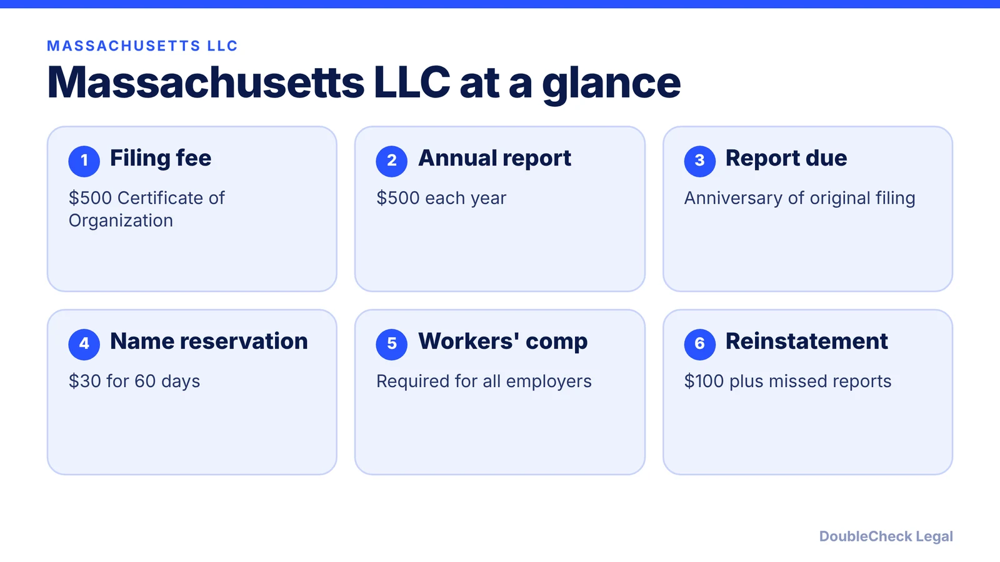
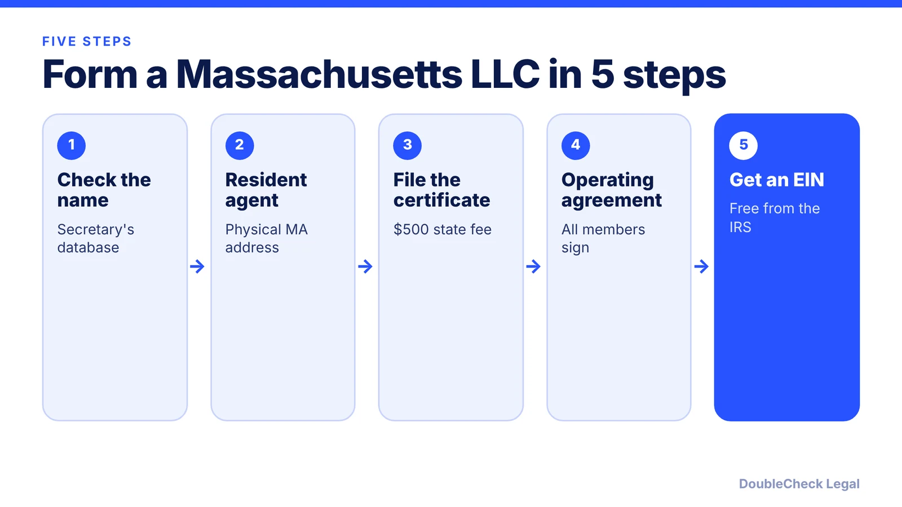

*How do you start an LLC in Massachusetts? Here are the steps, the $500 fees, and the annual report rule, as of November 2026.*

**Key takeaways:**

- Per Mass.gov, the Certificate of Organization fee is $500 and the LLC exists only after the state approves it.
- The annual report also costs $500 and is due by the anniversary of your original filing.
- Workers' compensation is required for all Massachusetts employers, including working owners.
- Delinquency over two years can lead to administrative dissolution, per Terms.law.

## 1. The quick answer

**Quick answer:** To start an LLC in Massachusetts, search the Secretary of the Commonwealth's database to confirm your name, appoint a resident agent, and file a Certificate of Organization. Per Mass.gov, the fee is $500, and the LLC exists only after the state approves the certificate. Adopt an operating agreement, get a free EIN, and file an annual report each year by the anniversary of your original filing. Mass.gov lists that fee at $500 as well, which is notably higher than most states.

## 2. Step by step: name, agent, and filing

**1. Check your name.** Per Mass.gov, search the Secretary of the Commonwealth's business entity database, and look for similar names too. Per Terms.law, the name needs a designator such as "LLC" and cannot imply government affiliation. A name reservation costs $30 for 60 days, per Terms.law.

**2. Appoint a resident agent.** Per Terms.law, the agent needs a physical Massachusetts street address (no PO box), must be available in business hours, and consents in writing within the Certificate of Organization. It can be a resident or an agent company.

**3. File the Certificate of Organization.** The fee is $500, paid to the Secretary of the Commonwealth, per Mass.gov. Terms.law adds a $20 fee for online filing, for $520 total; confirm on the state site.

**4. Write an operating agreement.** Per Mass.gov, it is a contract that sets out how the business runs and that all members sign. See [LLC operating agreements with AI](/blog/llc-operating-agreement-with-ai/).

**5. Get an EIN.** Free from the IRS. Mass.gov says many LLCs need one, while some single-member LLCs can use the owner's SSN. See [how to get an EIN for free](/blog/how-to-get-an-ein-for-your-business-free/).

## 3. Ongoing: the $500 annual report

The Massachusetts annual report is the cost that surprises founders. Per Mass.gov, the fee is $500 and it is due by the anniversary of the LLC's original filing. Terms.law adds a $20 online fee, for $520 total.

- **Late filing:** Terms.law says there is no separate monetary penalty for a late report.
- **Dissolution risk:** an LLC delinquent for more than two years may be administratively dissolved, which ends liability protection there. Reinstatement costs $100 plus all outstanding reports, per Terms.law.

Terms.law is a law-firm marketing page, so confirm with the Secretary of the Commonwealth. A $500 annual fee is a real input when you compare states; see [annual report requirements by state](/blog/annual-report-requirements-by-state-llc/).

## 4. Massachusetts quirks and what to compare

Per Mass.gov, a few extra items apply:

- **DBA:** if you operate under a name other than the legal name, file a business certificate in the city or town where the business is located.
- **MassTaxConnect:** register if the business collects or pays state taxes.
- **Workers' compensation:** all Massachusetts employers must carry it regardless of employee count, including owners who work in the business.
- **Beneficial ownership:** Mass.gov says U.S.-created businesses are exempt from FinCEN BOI reporting; businesses created outside the U.S. must file after state filing.

For federal taxes, a one-owner LLC is usually disregarded; see [single-member LLC taxes](/blog/single-member-llc-taxes-disregarded-entity/). Weigh the $500 yearly cost with [best state to form an LLC](/blog/best-state-to-form-an-llc-comparison/), read [business license requirements](/blog/business-license-requirements-small-business/), and see [how to incorporate a company in the US](/blog/how-to-incorporate-a-company-in-the-us/).

## Where DoubleCheck fits

[DoubleCheck](https://www.contactdoublecheck.com) helps businesses and founders start legal work with AI, verify it, and, when professional advice is warranted, connect with an independent attorney, including for immigration questions. Attorney availability and practice areas vary. Attorneys on DoubleCheck are independent professionals; an attorney-client relationship forms only if an attorney accepts your engagement.

**Sources:** [Mass.gov: Starting an LLC in Massachusetts](https://www.mass.gov/info-details/starting-a-limited-liability-company-llc-in-massachusetts); [Terms.law: How to start an LLC in Massachusetts](https://terms.law/2025/09/11/how-to-start-an-llc-in-massachusetts/).

## FAQ

**How much does it cost to start an LLC in Massachusetts?**

Per Mass.gov, the Certificate of Organization fee is $500. Terms.law adds a $20 online filing fee, for $520 total, and a $30 optional name reservation.

**What is the Massachusetts LLC annual report fee?**

$500, due by the anniversary of the LLC's original filing, per Mass.gov. Terms.law lists a $20 online fee on top of that.

**Does Massachusetts require a registered agent?**

Yes, called a resident agent. Per Terms.law, it needs a physical Massachusetts street address, no PO box, and can be a resident or a registered agent company.

**Do I need an operating agreement in Massachusetts?**

Not by law, and it is not filed with the state, per Terms.law. Mass.gov describes it as the contract that sets out how the business runs, signed by all members.

---

*General information only. This article is not legal, tax, investment, or accounting advice.*
