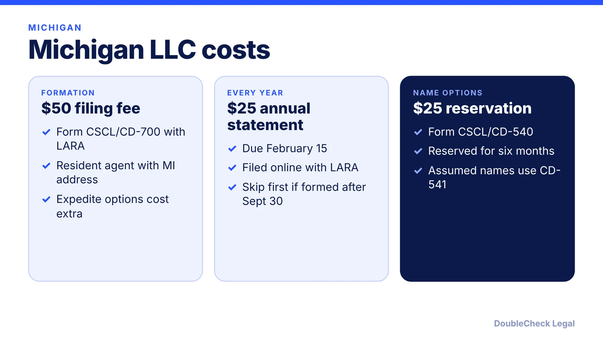
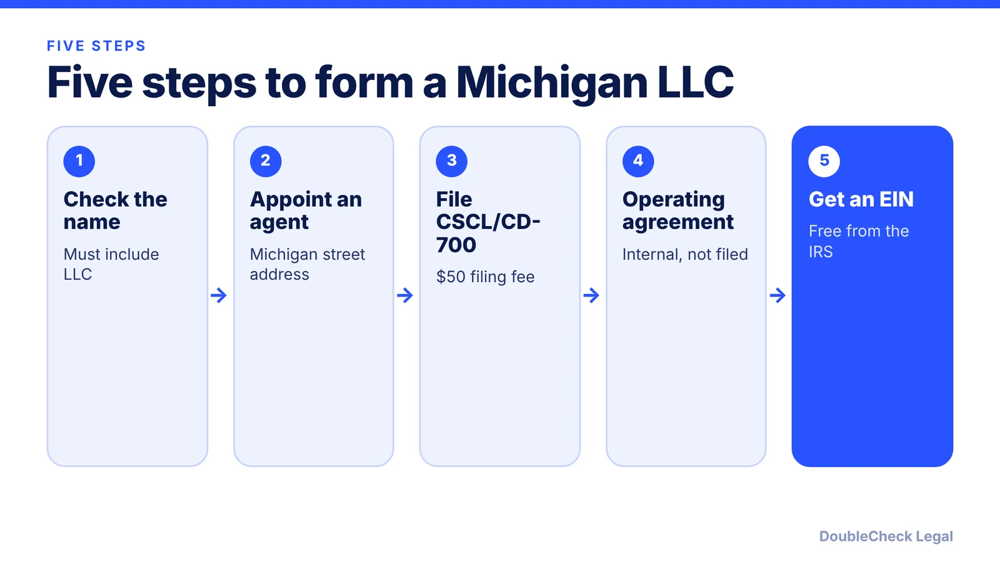

*How do you start an LLC in Michigan? Here are the steps, state fees, and the February 15 deadline, as of November 2026.*

**Key takeaways:**

- Michigan's Articles of Organization (CSCL/CD-700) cost $50 per Terms.law; confirm with LARA.
- The annual statement costs $25 for an LLC and is due February 15.
- An LLC formed after September 30 can skip the first annual statement, per LARA.
- A resident agent with a Michigan street address is required.

## 1. The quick answer

**Quick answer:** To start an LLC in Michigan, choose a name with "LLC" or an equivalent, name a resident agent with a Michigan street address, and file Articles of Organization (Form CSCL/CD-700) with LARA. Per Terms.law, the fee is $50. Then adopt an operating agreement, get a free EIN, and file an annual statement by February 15 each year. Per Michigan LARA, the annual statement fee is $25 for an LLC, and the first one can be skipped if you formed after September 30.

## 2. Step by step: name, agent, and filing

**1. Check your name.** Per Terms.law, the name must include "LLC," "L.L.C.," "LC," or "L.C." A name reservation (Form CSCL/CD-540) costs $25 and holds the name for six months.

**2. Pick a resident agent.** Michigan's term for a registered agent. Provide a Michigan street address and an agent available during business hours. Changing the agent or office (CSCL/CD-520) costs $5, per Terms.law.

**3. File Articles of Organization.** File Form CSCL/CD-700 online, by mail, or in person; Terms.law lists the fee as $50. The default effective date is the filing date, and it may be delayed up to 90 days. Terms.law lists expedited options: 24 hours for $50, same day for $100, two hours for $500, and one hour for $1,000. Confirm current amounts with LARA.

**4. Write an operating agreement.** Michigan does not require one, but Terms.law says banks, judges, and investors expect it. See [LLC operating agreements with AI](/blog/llc-operating-agreement-with-ai/).

**5. Get an EIN.** The IRS issues it free; see [how to get an EIN for free](/blog/how-to-get-an-ein-for-your-business-free/). Without an SSN, read [getting an EIN as a foreign founder](/blog/get-ein-without-ssn-foreign-founder/).

## 3. Ongoing costs: the February 15 annual statement

Michigan calls its yearly filing an annual statement. Per the LARA annual reports page:

- **Fee:** $25 for an LLC ($75 for a professional LLC).
- **Due date:** February 15 each year after organization.
- **First statement:** an LLC formed or qualified after September 30 does not have to file on February 15 of the following year.
- **How:** online through the MiBusiness Registry Portal, with filing opening October 15.
- **Risk:** after a two-year grace period an LLC can face dissolution, revocation, or loss of good standing, and may lose rights to its business names.

Terms.law mentions a $50 late fee, but LARA's page lists that penalty only for professional LLCs, so confirm the late fee for a regular LLC with LARA. Terms.law also warns that private mailings from look-alike "filing" companies demand fees; verify status through the official Business Entity Search before paying. Compare other states in [annual report requirements by state](/blog/annual-report-requirements-by-state-llc/).

## 4. Michigan quirks and what to compare

Per Terms.law, default federal treatment is disregarded entity for a single-member LLC and partnership for a multi-member LLC, and Michigan offers an optional 4.25% entity-level Flow-Through Entity tax whose election is binding for three years unless revoked with Treasury approval. Michigan business tax registration uses Form 518. See [single-member LLC taxes](/blog/single-member-llc-taxes-disregarded-entity/) and [business license requirements](/blog/business-license-requirements-small-business/).

Comparing states? The [best state to form an LLC](/blog/best-state-to-form-an-llc-comparison/) and [how to incorporate a company in the US](/blog/how-to-incorporate-a-company-in-the-us/) give the wider view. Sibling guides: [Ohio](/blog/how-to-start-an-llc-in-ohio/) and [Illinois](/blog/how-to-start-an-llc-in-illinois/).

## Where DoubleCheck fits

[DoubleCheck](https://www.contactdoublecheck.com) helps businesses and founders start legal work with AI, verify it, and, when professional advice is warranted, connect with an independent attorney, including for immigration questions. Attorney availability and practice areas vary. Attorneys on DoubleCheck are independent professionals; an attorney-client relationship forms only if an attorney accepts your engagement.

**Sources:** [Terms.law: How to Start an LLC in Michigan](https://terms.law/2025/07/03/how-to-start-an-llc-in-michigan/); [Michigan LARA: Annual reports and annual statements](https://michigan.gov/lara/bureau-list/cscl/corps/michigan-business-roadmap/annual-reports-and-annual-statements).

## FAQ

**How much does it cost to start an LLC in Michigan?**

Per Terms.law, the Articles of Organization fee is $50, with optional expedited service costing more. LARA lists the yearly annual statement at $25 for an LLC.

**When is the Michigan LLC annual statement due?**

February 15 each year, per LARA. An LLC formed or qualified after September 30 does not have to file on February 15 of the year right after formation.

**Do I need an operating agreement in Michigan?**

Not by law. Terms.law says banks, judges, and investors expect one, and suggests it assign who files the February 15 statement.

**Do I need a Michigan resident agent?**

Yes. Provide a Michigan street address and an agent available during business hours, per Terms.law. You can use a commercial agent or list your own location.

---

*General information only. This article is not legal, tax, investment, or accounting advice.*
