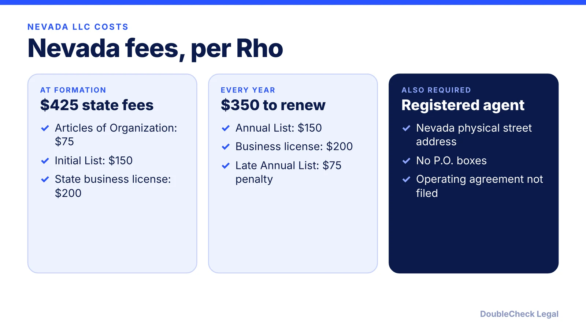
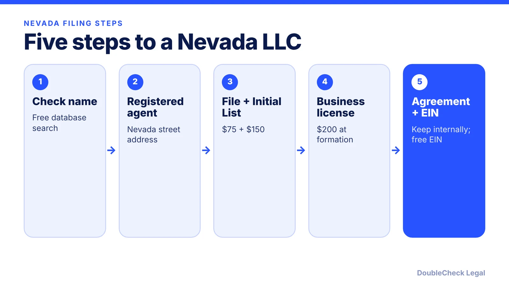

*How do you start an LLC in Nevada? The steps, real first-year costs, and the myths to check, as of November 2026.*

**Key takeaways:**

- Rho lists mandatory Nevada state fees at formation at $425: $75 articles, $150 Initial List, $200 business license.
- Annual cost is about $350: the $150 Annual List plus the $200 business license.
- A registered agent with a Nevada physical street address is required.
- Nevada's lack of income tax helps only if you live and operate there.

## 1. The quick answer

**Quick answer:** To start an LLC in Nevada, check your name, appoint a registered agent with a Nevada physical street address, and file Articles of Organization ($75 per Rho) together with the Initial List ($150) and a state business license ($200). Rho puts mandatory state fees at formation at $425, and the recurring annual cost at $350: the $150 Annual List plus the $200 business license renewal. Nevada has no state personal income tax, but that benefit applies only if you actually live and operate there.

## 2. Step by step: name, agent, and filings

**1. Check your name.** Search the Secretary of State's business database. The name needs an approved designator such as "LLC" and cannot duplicate or closely resemble an existing name. Reservation costs $25, per Rho.

**2. Appoint a registered agent.** Required for the life of the LLC, with a Nevada physical street address, per Rho and Wolters Kluwer. The agent must sign a Certificate of Acceptance.

**3. File Articles of Organization and the Initial List.** Per Rho: $75 standard plus the $150 Initial List. Expedited options add $125 (24-hour), $500 (2-hour), or $1,000 (1-hour).

**4. Get the state business license.** $200 at formation, renewed annually, per Rho. Wolters Kluwer notes some businesses may be exempt and local licenses may also apply.

**5. Operating agreement and EIN.** The agreement is not filed with the state; see [LLC operating agreements with AI](/blog/llc-operating-agreement-with-ai/). The EIN is free; see [how to get an EIN for free](/blog/how-to-get-an-ein-for-your-business-free/).

## 3. Ongoing costs and deadlines

Each year the LLC files the Annual List ($150) and renews the state business license ($200), for about $350 in state fees, per Rho. The Annual List is due by the last day of the month marking the formation anniversary, per Wolters Kluwer. Rho lists a $75 late penalty and $300 to reinstate a revoked LLC.

The Nevada Commerce Tax and Modified Business Tax apply only above thresholds set by the Nevada Department of Taxation, per Rho; check the Department of Taxation for current thresholds. See also [annual report requirements by state](/blog/annual-report-requirements-by-state-llc/).

## 4. Nevada myths to check

**Myth: a Nevada LLC avoids tax everywhere.** Rho states Nevada has no state personal income tax and no traditional corporate income tax, but the benefits apply only if you live and operate in Nevada. Forming there while working in another state does not exempt you from that state's tax.

**Myth: it is cheap.** The $75 filing fee is only part of the cost. Mandatory state fees at formation total $425, and renewals about $350 a year, per Rho. Compare against your home state in [best state to form an LLC](/blog/best-state-to-form-an-llc-comparison/) and [LLC formation cost by state](/blog/llc-formation-cost-california-texas-florida-new-york/).

Wolters Kluwer notes Nevada does not impose a franchise tax on LLCs. If you sell across state lines, also read [sales tax nexus](/blog/sales-tax-nexus-small-business-online/). For the full process, see [how to incorporate a company in the US](/blog/how-to-incorporate-a-company-in-the-us/); compare [Wyoming](/blog/how-to-start-an-llc-in-wyoming/).

## Where DoubleCheck fits

[DoubleCheck](https://www.contactdoublecheck.com) helps businesses and founders start legal work with AI, verify it, and, when professional advice is warranted, connect with an independent attorney, including for immigration questions. Attorney availability and practice areas vary. Attorneys on DoubleCheck are independent professionals; an attorney-client relationship forms only if an attorney accepts your engagement.

**Sources:** [Rho: How to start an LLC in Nevada](https://www.rho.co/blog/how-to-start-an-llc-in-nevada); [Wolters Kluwer: Nevada LLC requirements](https://www.wolterskluwer.com/en/solutions/bizfilings/state-guides/nevada-llc-requirements).

## FAQ

**How much does it cost to start an LLC in Nevada?**

Per Rho, mandatory state fees at formation total $425: $75 for Articles of Organization, $150 for the Initial List, and $200 for the state business license. Registered agent costs vary.

**What does a Nevada LLC cost each year?**

About $350 in state fees per Rho: a $150 Annual List and a $200 business license renewal. A missed Annual List adds a $75 penalty.

**Does a Nevada LLC avoid state income tax?**

Nevada has no state personal income tax, per Rho, but the benefit applies only if you live and operate in Nevada. Forming there while working in another state does not exempt you from that state's tax.

**Do I need a registered agent in Nevada?**

Yes, for the life of the LLC, with a Nevada physical street address and no P.O. boxes, per Rho and Wolters Kluwer.

---

*General information only. This article is not legal, tax, investment, or accounting advice.*
