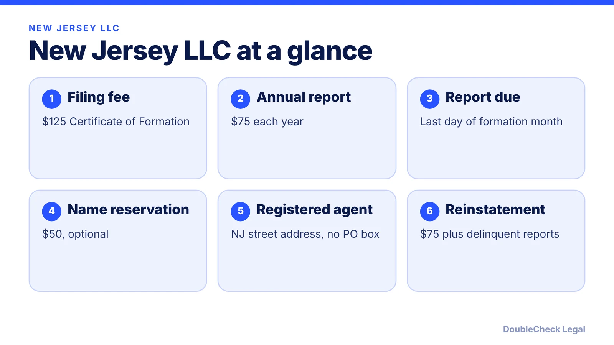
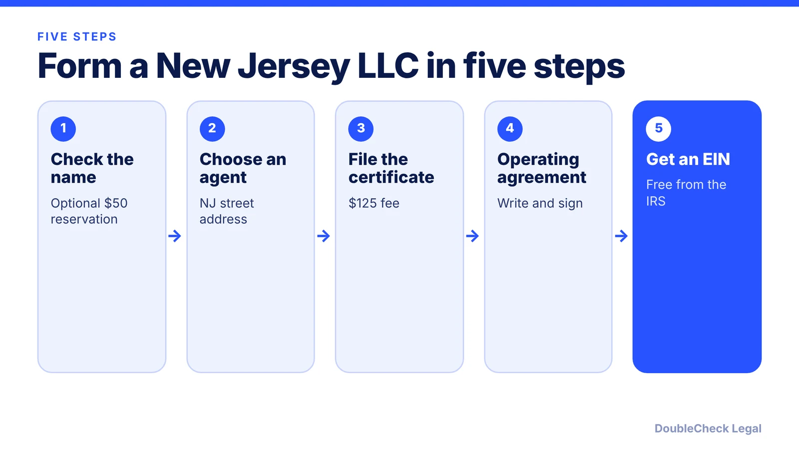

*How do you start an LLC in New Jersey? Here are the steps, state fees, and the annual report rule, as of November 2026.*

**Key takeaways:**

- New Jersey's LLC filing fee is $125 per Zenind; confirm with the state before paying.
- The registered agent needs a New Jersey street address; a PO box alone is not enough.
- The annual report costs $75 and is due by the last day of your formation month.
- Missing two consecutive reports can put a domestic LLC on the inactive list.

## 1. The quick answer

**Quick answer:** To start an LLC in New Jersey, check that your name is available, name a registered agent with a New Jersey street address, and file a Certificate of Formation. Per Zenind's 2026 cost guide, the filing fee is $125. Then adopt an operating agreement, get a free EIN, and file a $75 annual report every year. Per Business Anywhere, the report is due by the last day of the month in which the LLC was formed.

## 2. Step by step: name, agent, and filing

**1. Check your name.** Search the state business records for a name that is not already taken. Per Zenind, you can pay $50 to reserve a name before forming, but this is optional.

**2. Pick a registered agent.** Per Zenind, the agent needs a New Jersey street address; a PO box alone is not enough. The agent can be an individual, or a corporation in good standing with the State Treasurer. Serving as your own agent has no state fee.

**3. File the Certificate of Formation.** Zenind lists the domestic LLC filing fee as $125. Confirm the current amount on the New Jersey Division of Revenue and Enterprise Services site before paying.

**4. Write an operating agreement.** Use it to set ownership, voting, and exit rules; see [LLC operating agreements with AI](/blog/llc-operating-agreement-with-ai/).

**5. Get an EIN.** The IRS issues it free; see [how to get an EIN for free](/blog/how-to-get-an-ein-for-your-business-free/) and [EIN without an SSN](/blog/get-ein-without-ssn-foreign-founder/).

## 3. Ongoing: the $75 annual report

New Jersey's recurring duty is the annual report. Per Business Anywhere's guide:

- **Fee:** $75 for domestic and foreign LLCs, filed online through the state portal.
- **Due date:** the last day of the month the business was formed. An LLC formed in March files by March 31 each year.
- **Missing two consecutive years:** a domestic LLC can be moved to an inactive list, its name becomes available to others, and it can only wind up. Members keep their liability protection, per that page.
- **Reinstatement:** $75, plus each delinquent report and its fee, plus a late fee (the amount was not stated).

That page gave no dollar amount for a late report, so check the state portal for penalties. Other states differ widely; see [annual report requirements by state](/blog/annual-report-requirements-by-state-llc/).

## 4. New Jersey quirks and what to compare

New Jersey ties the annual report to your formation month, not a single statewide date, so form in a month you will remember. Zenind also lists other fees you may meet later: $25 to change the registered office or agent, $100 for an amendment, and $25 for a certified copy.

Your federal tax treatment depends on members and elections; a one-owner LLC is usually disregarded, see [single-member LLC taxes](/blog/single-member-llc-taxes-disregarded-entity/). For licenses and local rules, read [business license requirements](/blog/business-license-requirements-small-business/).

Comparing states? See [best state to form an LLC](/blog/best-state-to-form-an-llc-comparison/), the [LLC formation cost comparison](/blog/llc-formation-cost-california-texas-florida-new-york/), and the broader [how to incorporate a company in the US](/blog/how-to-incorporate-a-company-in-the-us/). Sibling guides: [New York](/blog/how-to-start-an-llc-in-new-york/) and [Pennsylvania](/blog/how-to-start-an-llc-in-pennsylvania/).

## Where DoubleCheck fits

[DoubleCheck](https://www.contactdoublecheck.com) helps businesses and founders start legal work with AI, verify it, and, when professional advice is warranted, connect with an independent attorney, including for immigration questions. Attorney availability and practice areas vary. Attorneys on DoubleCheck are independent professionals; an attorney-client relationship forms only if an attorney accepts your engagement.

**Sources:** [Zenind: New Jersey LLC costs in 2026](https://www.zenind.com/help/post/new-jersey-llc-costs-in-2026-filing-fees-annual-reports-and-registered-agent-expenses); [Business Anywhere: New Jersey LLC annual report](https://businessanywhere.io/new-jersey-llc-annual-report/).

## FAQ

**How much does it cost to start an LLC in New Jersey?**

Per Zenind's 2026 guide, the Certificate of Formation fee is $125, with an optional $50 name reservation. The annual report then costs $75. Registered agent pricing varies by provider.

**When is the New Jersey LLC annual report due?**

By the last day of the month in which the LLC was formed, per Business Anywhere. An LLC formed in March files by March 31 each year.

**Does New Jersey require a registered agent?**

Yes. Zenind says the agent needs a New Jersey street address, and a PO box alone is not enough. It can be an individual, or a corporation in good standing with the State Treasurer.

**What happens if I miss the New Jersey annual report?**

Per Business Anywhere, a domestic LLC that misses two consecutive years can be moved to an inactive list and lose its name; members keep liability protection. Reinstatement costs $75 plus delinquent reports and a late fee.

---

*General information only. This article is not legal, tax, investment, or accounting advice.*
