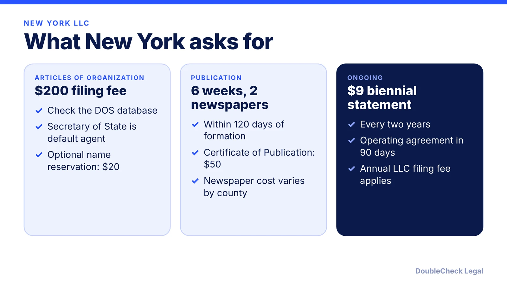
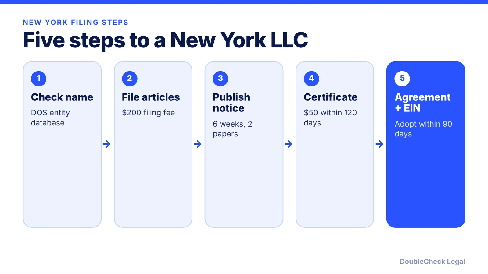

*How do you start an LLC in New York? The steps, the $200 filing fee, and the publication requirement most states do not have, as of November 2026.*

**Key takeaways:**

- The Articles of Organization fee is $200; confirm with the Department of State.
- New York requires publishing in two newspapers for six weeks within 120 days, then a $50 Certificate of Publication.
- A written operating agreement is required and must be adopted within 90 days of filing.
- The biennial statement costs $9, and an annual LLC filing fee may apply.

## 1. The quick answer

**Quick answer:** To start an LLC in New York, check name availability in the Department of State database, file Articles of Organization ($200 per Rho and NerdWallet), adopt a written operating agreement within 90 days, get a free EIN, and complete New York's unusual publication requirement: publish notice once a week for six consecutive weeks in two newspapers within 120 days, then file a Certificate of Publication ($50). Skipping publication can lead the state to suspend the LLC's authority to do business in New York.

## 2. Step by step: name, agent, and articles

**1. Check your name.** Search the Department of State's Corporation and Business Entity Database. The name must include "LLC," "L.L.C.," or "Limited Liability Company," per Rho. A name reservation under LLC Law Section 205 is optional and costs $20.

**2. Registered agent.** The Secretary of State is automatically designated as agent for service of process, per Rho. You may add a private agent or name an individual or attorney, per NerdWallet.

**3. File the Articles of Organization.** The fee is $200, one time and nonrefundable, per NerdWallet. Expedited handling costs extra (Rho lists +$25 for 24-hour, +$75 same-day, +$150 two-hour).

**4. Adopt an operating agreement.** New York LLC Law section 417 requires one. Members adopt it before, at, or within 90 days after filing, and it is not filed with the state. See [LLC operating agreements with AI](/blog/llc-operating-agreement-with-ai/).

**5. Get an EIN.** Free from the IRS via Form SS-4; see [how to get an EIN for free](/blog/how-to-get-an-ein-for-your-business-free/).

## 3. The publication requirement

Most states do not require this, so it surprises founders. Per Rho and NerdWallet:

- **Deadline:** within 120 days after the articles take effect.
- **Duration:** once a week for six consecutive weeks.
- **Where:** two newspapers designated by the county clerk of the county where the LLC's office is located.
- **Proof:** file a Certificate of Publication with the affidavits of publication; the fee is $50.
- **Cost:** set by each newspaper, so it varies by county. NerdWallet estimates a simple New York LLC with publication costs roughly $250, though newspaper charges differ.

For deeper coverage, read [the New York LLC publication requirement](/blog/new-york-llc-publication-requirement/).

## 4. Ongoing costs and related rules

Every two years the LLC files a biennial statement with the Department of State; Rho and NerdWallet list a $9 fee. NerdWallet also notes that New York assesses an annual filing fee on most LLCs, ranging from $25 to $4,500 depending on income. Confirm current rules with the Department of State and the Department of Taxation and Finance.

New York also has a beneficial ownership disclosure law for LLCs; see [the NY LLC Transparency Act explainer](/blog/new-york-llc-transparency-act-beneficial-ownership/). Costs compared with other states are in [LLC formation cost: California, Texas, Florida, New York](/blog/llc-formation-cost-california-texas-florida-new-york/). For the full process, see [how to incorporate a company in the US](/blog/how-to-incorporate-a-company-in-the-us/), and compare [Florida](/blog/how-to-start-an-llc-in-florida/).

## Where DoubleCheck fits

[DoubleCheck](https://www.contactdoublecheck.com) helps businesses and founders start legal work with AI, verify it, and, when professional advice is warranted, connect with an independent attorney, including for immigration questions. Attorney availability and practice areas vary. Attorneys on DoubleCheck are independent professionals; an attorney-client relationship forms only if an attorney accepts your engagement.

**Sources:** [Rho: How to start an LLC in New York](https://www.rho.co/blog/how-to-start-an-llc-in-new-york); [NerdWallet: How to form an LLC in New York](https://www.nerdwallet.com/article/small-business/how-to-form-llc-ny).

## FAQ

**How much does it cost to start an LLC in New York?**

The Articles of Organization fee is $200, per NerdWallet and Rho. Add publication costs set by local newspapers and a $50 Certificate of Publication fee. NerdWallet estimates roughly $250 for a simple filing with publication.

**What is New York's LLC publication requirement?**

Within 120 days of formation you must publish notice once a week for six consecutive weeks in two newspapers designated by the county clerk, then file a Certificate of Publication ($50), per Rho.

**What happens if I skip publication?**

Per Rho and NerdWallet, the state can suspend the LLC's authority to conduct business in New York.

**Do I need an operating agreement in New York?**

Yes. LLC Law section 417 requires one, adopted before, at, or within 90 days after filing. It is not filed with the state, per Rho.

---

*General information only. This article is not legal, tax, investment, or accounting advice.*
