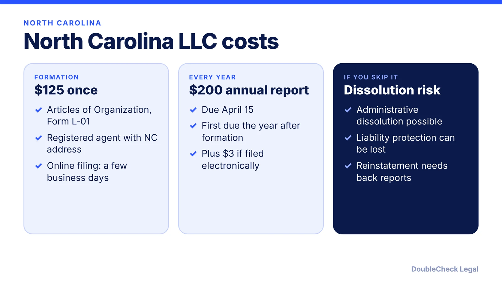
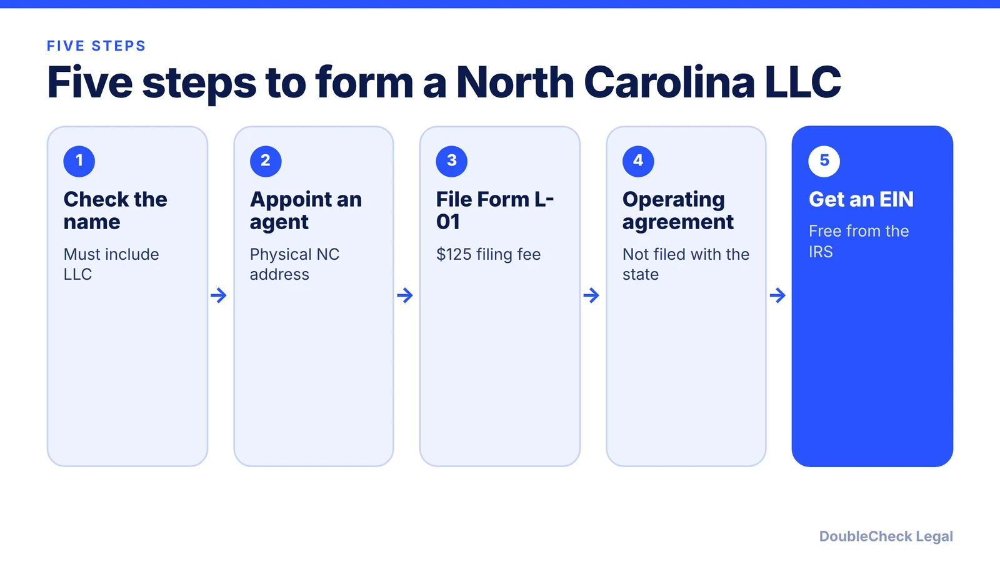

*How do you start an LLC in North Carolina? Here are the steps, state fees, and the April 15 report deadline, as of November 2026.*

**Key takeaways:**

- North Carolina's Articles of Organization (Form L-01) cost $125 per Stripe; confirm with the Secretary of State.
- The annual report costs $200 (plus $3 if filed electronically) and is due April 15.
- A registered agent with a physical North Carolina street address is required.
- You must choose member-managed or manager-managed on the filing.

## 1. The quick answer

**Quick answer:** To start an LLC in North Carolina, check that your name is distinguishable on the Secretary of State's records, name a registered agent with a physical North Carolina street address, and file Articles of Organization (Form L-01). Per Stripe, the fee is $125. Then adopt an operating agreement, get a free EIN, and file the annual report by April 15 each year, starting the year after formation. The North Carolina Secretary of State lists the annual report fee at $200, plus a $3 electronic filing fee.

## 2. Step by step: name, agent, and filing

**1. Check your name.** Per Stripe, the name must include "LLC," "L.L.C.," or "Limited Liability Company" and be distinguishable from other names on file with the NC Secretary of State. Words like "bank" or "insurance" need approval from the relevant agency. A name can be reserved for 120 days.

**2. Pick a registered agent.** The agent needs a physical North Carolina street address, not a PO box, and someone must be there during business hours to accept legal and tax documents. It can be you, another member, or a service.

**3. File Articles of Organization.** Use Form L-01. Stripe lists the fee as $125, paid once, and says online filings typically process in a few business days while mailed ones can take a couple of weeks. You must also choose member-managed or manager-managed on the filing, per Stripe.

**4. Write an operating agreement.** It is not filed with the state, but Stripe recommends one because default state rules otherwise govern profit splits and disputes. See [LLC operating agreements with AI](/blog/llc-operating-agreement-with-ai/).

**5. Get an EIN.** The IRS issues it free online; see [how to get an EIN for free](/blog/how-to-get-an-ein-for-your-business-free/). If you lack an SSN, read [getting an EIN as a foreign founder](/blog/get-ein-without-ssn-foreign-founder/).

## 3. Ongoing costs: the April 15 annual report

North Carolina's recurring obligation is a true annual report. Per the NC Secretary of State's maintaining-registration guide:

- **Fee:** $200, with a $3 transaction fee for electronic filing.
- **Due date:** April 15 each year; the first is due April 15 of the year after the LLC's creation year.
- **Who files:** domestic and foreign LLCs, except professional entities formed under Chapter 55B. The report is required even if the company is not actively doing business.
- **Risk:** failing to file may be grounds for administrative dissolution or revocation of authority to do business. The page lists no specific late penalty.

Stripe adds that reinstatement requires back reports and accumulated fees. Set a calendar reminder, and compare other states in [annual report requirements by state](/blog/annual-report-requirements-by-state-llc/).

## 4. North Carolina quirks and what to compare

Per Stripe, LLC profits pass through to your personal return by default, and you register with the NC Department of Revenue if you sell taxable goods or services. City or county privilege licenses and zoning vary by municipality, and the state filing does not check them. Professional or occupational licenses may apply regardless of the LLC. See [business license requirements](/blog/business-license-requirements-small-business/).

Stripe also warns that commingling personal and business funds can let courts pierce the LLC veil, so keep a separate bank account. For federal tax treatment, read [single-member LLC taxes](/blog/single-member-llc-taxes-disregarded-entity/).

Comparing states? See the [best state to form an LLC](/blog/best-state-to-form-an-llc-comparison/) and [how to incorporate a company in the US](/blog/how-to-incorporate-a-company-in-the-us/). Sibling guides: [Virginia](/blog/how-to-start-an-llc-in-virginia/) and [Georgia](/blog/how-to-start-an-llc-in-georgia/).

## Where DoubleCheck fits

[DoubleCheck](https://www.contactdoublecheck.com) helps businesses and founders start legal work with AI, verify it, and, when professional advice is warranted, connect with an independent attorney, including for immigration questions. Attorney availability and practice areas vary. Attorneys on DoubleCheck are independent professionals; an attorney-client relationship forms only if an attorney accepts your engagement.

**Sources:** [Stripe: How to start an LLC in North Carolina](https://stripe.com/resources/more/how-to-start-an-llc-in-north-carolina); [NC Secretary of State: Maintaining Registration](https://sosnc.gov/Guides/launching_a_business/maintaining_registration).

## FAQ

**How much does it cost to start an LLC in North Carolina?**

Per Stripe, Articles of Organization cost $125, paid once. The NC Secretary of State lists the annual report at $200, plus a $3 fee for electronic filing.

**When is the North Carolina LLC annual report due?**

April 15 each year, with the first due April 15 of the year after the LLC's creation year, per the NC Secretary of State. Not filing may lead to administrative dissolution.

**Do I need an operating agreement in North Carolina?**

It is not filed with the state. Stripe recommends one because without it, state default rules govern profit splits and disputes.

**Do I need a North Carolina registered agent?**

Yes. The agent needs a physical North Carolina street address, not a PO box, and must be available during business hours, per Stripe.

---

*General information only. This article is not legal, tax, investment, or accounting advice.*
