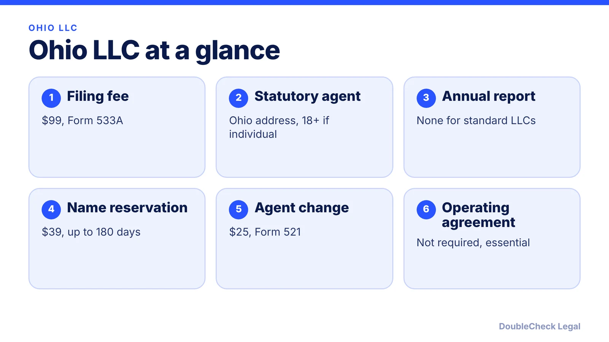
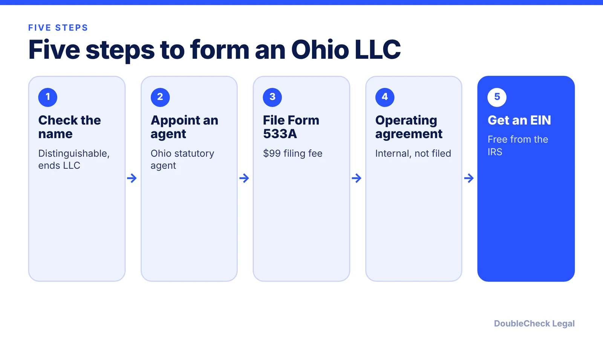

*How do you start an LLC in Ohio? Here are the steps, state fees, and what ongoing costs to expect, as of November 2026.*

**Key takeaways:**

- Ohio's Articles of Organization (Form 533A) cost $99 per NerdWallet; confirm with the Secretary of State.
- Standard Ohio LLCs do not file an annual report or pay an annual fee.
- Ohio calls the registered agent a statutory agent; changing it costs $25.
- The Commercial Activity Tax can still apply based on gross receipts.

## 1. The quick answer

**Quick answer:** To start an LLC in Ohio, choose a name that is distinguishable from other Ohio businesses, appoint a statutory agent, and file Articles of Organization (Form 533A). Per NerdWallet, the fee is $99. Then adopt an operating agreement and get a free EIN. Unlike most states, Ohio does not require standard LLCs to file an annual report or pay an annual fee, per NerdWallet and Discern, though the Commercial Activity Tax may still apply based on gross receipts.

## 2. Step by step: name, agent, and filing

**1. Check your name.** Per NerdWallet (updated February 2026), the name must be distinguishable from other registered Ohio businesses and end with a term such as "LLC," "L.L.C.," "Ltd." or "Limited Liability Company." "Bank" and "trust" need special state permission. A reservation (Form 534B) costs $39 and lasts up to 180 days.

**2. Pick a statutory agent.** Ohio's term for a registered agent. An individual must be at least 18, an Ohio resident, and available at a physical address during business hours; a company agent needs an Ohio business address. Changing the agent (Form 521) costs $25. Discern notes the agent is free if you serve yourself, and commercial agents typically run $100 to $300 per year.

**3. File Articles of Organization.** Form 533A costs $99, online or by mail, per Discern. NerdWallet puts processing at three to seven business days. Discern lists expedite add-ons of $100 for two business days; confirm other tiers with the Secretary of State.

**4. Write an operating agreement.** Ohio does not require one or file it, but NerdWallet calls it essential. See [LLC operating agreements with AI](/blog/llc-operating-agreement-with-ai/).

**5. Get an EIN.** NerdWallet says you need one if you have employees, multiple owners, or corporate tax treatment. It is free from the IRS; see [how to get an EIN for free](/blog/how-to-get-an-ein-for-your-business-free/).

## 3. Ongoing costs: no annual report, but other taxes

Ohio's biggest quirk is what it does not ask for. Per NerdWallet, "Unlike most states, Ohio LLCs are not required to file an annual report or pay an annual fee." Discern adds that there is no franchise tax on LLCs, though professional associations, LLPs, and nonprofits have periodic reporting duties.

That does not mean zero ongoing obligations:

- **Commercial Activity Tax (CAT):** based on gross receipts and applies to LLCs and corporations. NerdWallet says it is owed only if taxable gross receipts exceed $6 million.
- **Employer accounts:** employers must set up an unemployment compensation tax account, per NerdWallet, and report new hires within 20 days.
- **Sales tax:** taxable sales require a vendor's license.

Since fees can change, verify with the Ohio Secretary of State. See [annual report requirements by state](/blog/annual-report-requirements-by-state-llc/) for how Ohio compares.

## 4. Ohio quirks and what to compare

Per NerdWallet, Ohio workers' compensation is bought from the state's Bureau of Workers' Compensation rather than a private insurer, and articles can set an effective date up to 90 days after filing. Local licenses vary by city and industry; read [business license requirements](/blog/business-license-requirements-small-business/).

For federal treatment of one-owner LLCs, see [single-member LLC taxes](/blog/single-member-llc-taxes-disregarded-entity/). Comparing states? The [best state to form an LLC](/blog/best-state-to-form-an-llc-comparison/) and [how to incorporate a company in the US](/blog/how-to-incorporate-a-company-in-the-us/) give the wider picture. Sibling guides: [Michigan](/blog/how-to-start-an-llc-in-michigan/) and [Pennsylvania](/blog/how-to-start-an-llc-in-pennsylvania/).

## Where DoubleCheck fits

[DoubleCheck](https://www.contactdoublecheck.com) helps businesses and founders start legal work with AI, verify it, and, when professional advice is warranted, connect with an independent attorney, including for immigration questions. Attorney availability and practice areas vary. Attorneys on DoubleCheck are independent professionals; an attorney-client relationship forms only if an attorney accepts your engagement.

**Sources:** [NerdWallet: Forming an LLC in Ohio](https://www.nerdwallet.com/business/legal/learn/starting-an-llc-in-ohio); [Discern: Ohio LLC filing fees](https://www.discern.com/resources/ohio-llc-filing-fee).

## FAQ

**How much does it cost to start an LLC in Ohio?**

Per NerdWallet and Discern, the Articles of Organization fee is $99. A statutory agent is free if you serve as your own; commercial agents typically cost $100 to $300 per year, per Discern.

**Does Ohio require an LLC annual report?**

No for standard LLCs. NerdWallet states Ohio LLCs are not required to file an annual report or pay an annual fee. Professional associations, LLPs, and nonprofits have periodic duties, per Discern.

**Do I need an operating agreement in Ohio?**

Not by state law, and it is not filed. NerdWallet calls it essential, especially with multiple owners, so keep it with your records.

**What is an Ohio statutory agent?**

It is Ohio's registered agent: the person or company that receives legal papers for your LLC. Individuals must be 18 or older, Ohio residents, and available at a physical address, per NerdWallet.

---

*General information only. This article is not legal, tax, investment, or accounting advice.*
