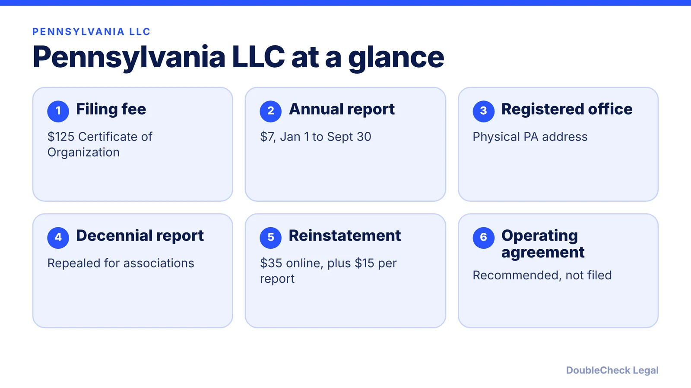
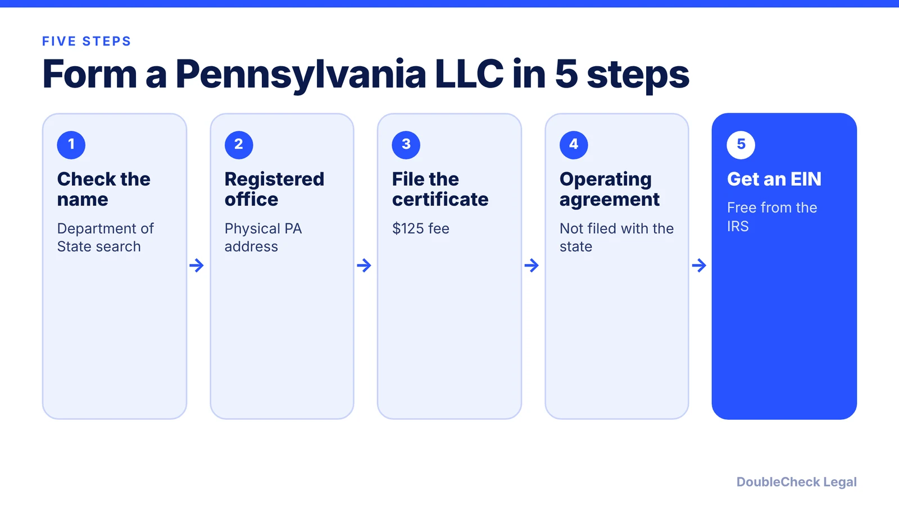

*How do you start an LLC in Pennsylvania? Here are the steps, state fees, and the annual report that replaced the decennial report, as of November 2026.*

**Key takeaways:**

- The Certificate of Organization fee is $125 per LegalZoom and Startup Savant; confirm with the Department of State.
- The annual report costs $7 and is filed January 1 through September 30, per the Department of State.
- The decennial report has been repealed for associations.
- Pennsylvania eliminated its LLC franchise tax after 2016, per LegalZoom.

## 1. The quick answer

**Quick answer:** To start an LLC in Pennsylvania, check your name with the Department of State, list a registered office, and file a Certificate of Organization. Per LegalZoom and Startup Savant, the filing fee is $125. Then adopt an operating agreement and get a free EIN. Per the Pennsylvania Department of State, LLCs file an annual report with a $7 fee between January 1 and September 30, and the old decennial report has been repealed for associations.

## 2. Step by step: name, office, and filing

**1. Check your name.** Per Startup Savant, the name must include "limited liability company," "limited company," "LLC," or "L.L.C.," be distinguishable from other registered entities, and avoid words like "bank" or "doctor." Use the Department of State's name search.

**2. List a registered office.** Pennsylvania uses "registered office" for the address where legal papers are delivered. Per Startup Savant, someone must be there during normal business hours. Per LegalZoom, a PO box cannot be used, and an agent service costs $50 to $300 a year.

**3. File the Certificate of Organization.** The fee is $125. LegalZoom lists optional expedited processing at an extra $100 to $1,000, depending on speed. Confirm with the Department of State.

**4. Write an operating agreement.** Startup Savant recommends one even for single-member LLCs, covering member duties, admission, transfers, and profit distribution. See [LLC operating agreements with AI](/blog/llc-operating-agreement-with-ai/).

**5. Get an EIN.** Free from the IRS; see [how to get an EIN for free](/blog/how-to-get-an-ein-for-your-business-free/).

## 3. Ongoing: the annual report replaced the decennial

Pennsylvania used to require a decennial report every ten years. Per the Department of State, that report has been repealed for associations (it still applies to certain insignia and marks). An annual report replaced it.

Per the Department of State's annual report page:

- **Fee:** $7 for an LLC; $0 for LLCs with a not-for-profit purpose.
- **Window:** January 1 through September 30.
- **Consequences:** failure to file can lead to administrative dissolution and loss of the name. For reports due in 2027 and later, dissolution applies six months after the due date.
- **Reinstatement:** $35 online or $40 on paper, plus $15 for each missing annual report.

Sources differ on the first year the annual report applied, so check the Department of State page for your entity. For other states, see [annual report requirements by state](/blog/annual-report-requirements-by-state-llc/).

## 4. Pennsylvania quirks and what to compare

**Publishing.** Pennsylvania's newspaper-publication rules are often mentioned alongside LLCs. In the sources we checked, we could not confirm that a new LLC must publish. What Harbor Compliance does describe is fictitious-name publishing: a business using a name other than its legal name notifies the public in two newspapers in the county of its principal office, one a legal newspaper, per PA Code 17.208(a), at roughly $200. If you plan to use a trade name, confirm the current rule with the Department of State or an attorney.

**Taxes.** Per LegalZoom, Pennsylvania eliminated its franchise tax for LLCs after 2016. A seller's permit may be needed if you sell physical products, and employers register for withholding and unemployment tax, per Startup Savant.

A one-owner LLC is usually disregarded federally; see [single-member LLC taxes](/blog/single-member-llc-taxes-disregarded-entity/). Compare with [best state to form an LLC](/blog/best-state-to-form-an-llc-comparison/), check [business license requirements](/blog/business-license-requirements-small-business/), and see [how to incorporate a company in the US](/blog/how-to-incorporate-a-company-in-the-us/). Sibling guides: [New Jersey](/blog/how-to-start-an-llc-in-new-jersey/) and [New York](/blog/how-to-start-an-llc-in-new-york/).

## Where DoubleCheck fits

[DoubleCheck](https://www.contactdoublecheck.com) helps businesses and founders start legal work with AI, verify it, and, when professional advice is warranted, connect with an independent attorney, including for immigration questions. Attorney availability and practice areas vary. Attorneys on DoubleCheck are independent professionals; an attorney-client relationship forms only if an attorney accepts your engagement.

**Sources:** [Pennsylvania Department of State: Annual reports](https://pa.gov/agencies/dos/programs/business/types-of-filings-and-registrations/annual-reports.html); [LegalZoom: LLC cost in Pennsylvania](https://www.legalzoom.com/articles/how-much-is-an-llc-in-pennsylvania); [Startup Savant: Pennsylvania LLC](https://www.startupsavant.com/how-to-start-an-llc/pennsylvania); [Harbor Compliance: PA publishing requirement](https://www.harborcompliance.com/information/pa-publishing-requirement).

## FAQ

**How much does it cost to start an LLC in Pennsylvania?**

Per LegalZoom and Startup Savant, the Certificate of Organization fee is $125. Expedited processing costs an extra $100 to $1,000 per LegalZoom, and registered office services run $50 to $300 a year.

**What is the Pennsylvania LLC annual report fee and deadline?**

$7 for an LLC, filed between January 1 and September 30, per the Pennsylvania Department of State. LLCs with a not-for-profit purpose pay $0.

**Does Pennsylvania still require the decennial report?**

No for associations. The Department of State says it is repealed for them, though it still applies to certain insignia and marks. The annual report replaced it.

**Do I need to publish a notice to form a Pennsylvania LLC?**

We could not confirm a publication requirement for forming an LLC in the sources checked. Fictitious-name publishing does exist, per Harbor Compliance, so confirm with the Department of State or an attorney.

---

*General information only. This article is not legal, tax, investment, or accounting advice.*
