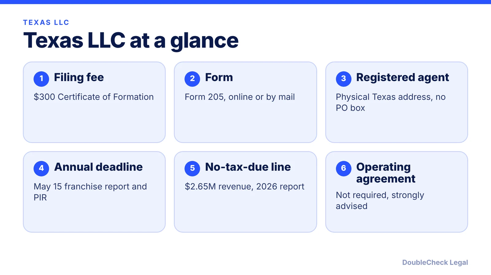
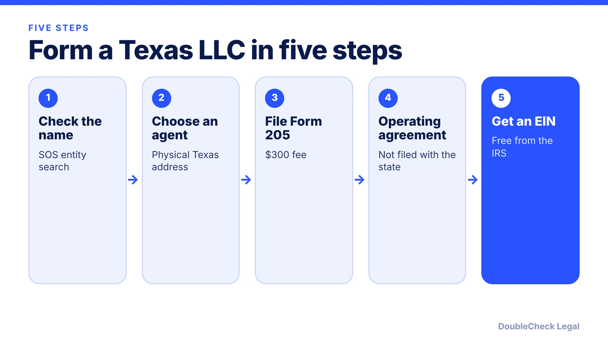

*How do you start an LLC in Texas? Here are the steps, the state fee, and the May 15 franchise tax deadline, as of November 2026.*

**Key takeaways:**

- Texas's Certificate of Formation (Form 205) costs $300 per Mosey; confirm on the Secretary of State site.
- A registered agent with a physical Texas address is required; PO boxes are not accepted.
- Franchise tax report and Public Information Report are due May 15 each year.
- The 2026 no-tax-due threshold is $2.65 million in annualized revenue, but the report is still filed.

## 1. The quick answer

**Quick answer:** To start an LLC in Texas, confirm your name is available with the Texas Secretary of State, name a registered agent with a physical Texas address, and file a Certificate of Formation (Form 205). Per Mosey's Texas guide, the filing fee is $300. Then adopt an operating agreement, get a free EIN, and each year by May 15 file the franchise tax report and Public Information Report. For the 2026 report year, the no-tax-due threshold is $2.65 million in annualized total revenue, per VJM Global's summary of the Comptroller's instructions.

## 2. Step by step: name, agent, and filing

**1. Check your name.** Use the Secretary of State's taxable entity search. Per Mosey, the name should include "LLC" or a similar designation and be unique on the record.

**2. Pick a registered agent.** The agent needs a physical Texas address (not a P.O. box) and must be available during standard business hours. Per Mosey, an owner or employee can serve at no cost, and third-party services typically run about $150 a year.

**3. File the Certificate of Formation.** File Form 205 through SOSDirect or by mail. The fee is $300. Mosey puts online processing at roughly 10 to 12 business days; check the Secretary of State page for current timing. Fee and form details are in [Texas Certificate of Formation fees and forms](/blog/texas-certificate-of-formation-fees-forms/).

**4. Write an operating agreement.** Mosey says Texas does not legally require one but calls it crucial, since it sets management, profit distribution, and dispute rules. See [LLC operating agreements with AI](/blog/llc-operating-agreement-with-ai/).

**5. Get an EIN.** The IRS issues it free, and Mosey notes online applicants typically get it the same day. See [how to get an EIN for free](/blog/how-to-get-an-ein-for-your-business-free/), or [EIN without an SSN](/blog/get-ein-without-ssn-foreign-founder/) for foreign founders.

## 3. Ongoing: franchise tax and the May 15 deadline

Texas has no separate LLC annual report fee in the sources we checked. Instead, the recurring work is the Comptroller's franchise tax report. Per Mosey and VJM Global:

- **Due date:** May 15 each year, for both the franchise tax report and the Public Information Report (PIR, Form 05-102).
- **No-tax-due threshold:** $2.65 million in annualized total revenue for the 2026 report year. At or below it, no tax is owed, but entities generally still file the PIR or an Ownership Information Report.
- **Rates above the threshold:** 0.75% for most entities, 0.375% for qualifying retail or wholesale, and 0.331% under the EZ Computation (revenue up to $20 million).
- **Extensions:** an extension gives more time to file, not to pay.

Confirm the figures on the Comptroller's page each year. The full explanation is in [Texas franchise tax for LLCs and corporations](/blog/texas-franchise-tax-llc-corporation/), and other states compare in [annual report requirements by state](/blog/annual-report-requirements-by-state-llc/).

## 4. Texas quirks and what to compare

Two things trip up new Texas owners. First, a small LLC usually owes no franchise tax but still has a May 15 filing. Missing it is the common mistake, so put it on a calendar. Second, "LLC" does not cover trade names: if you operate under a different name, read [Texas assumed name (DBA) for sole proprietors](/blog/texas-assumed-name-dba-sole-proprietor/) and [business license requirements](/blog/business-license-requirements-small-business/).

A single-member LLC is usually taxed as a disregarded entity federally; see [single-member LLC taxes](/blog/single-member-llc-taxes-disregarded-entity/). Comparing states? Use [best state to form an LLC](/blog/best-state-to-form-an-llc-comparison/) and [LLC formation cost in California, Texas, Florida, and New York](/blog/llc-formation-cost-california-texas-florida-new-york/). For the full picture, see [how to incorporate a company in the US](/blog/how-to-incorporate-a-company-in-the-us/).

## Where DoubleCheck fits

[DoubleCheck](https://www.contactdoublecheck.com) helps businesses and founders start legal work with AI, verify it, and, when professional advice is warranted, connect with an independent attorney, including for immigration questions. Attorney availability and practice areas vary. Attorneys on DoubleCheck are independent professionals; an attorney-client relationship forms only if an attorney accepts your engagement.

**Sources:** [Mosey: How to start a Texas LLC](https://mosey.com/blog/llc-in-texas/); [VJM Global: Texas franchise tax threshold 2026](https://www.vjmglobal.com/feeds/blog/franchise-tax-threshold-2026-tx); [Texas Comptroller: 2026 franchise tax](https://comptroller.texas.gov/taxes/franchise/forms/2026-franchise.php).

## FAQ

**How much does it cost to start an LLC in Texas?**

Per Mosey's Texas guide, the Certificate of Formation filing fee is $300. A third-party registered agent typically adds about $150 a year, while an owner can serve as agent at no cost.

**Do Texas LLCs pay franchise tax?**

Only above the no-tax-due threshold, which is $2.65 million in annualized total revenue for the 2026 report year per VJM Global's summary of the Comptroller's instructions. Entities under it generally still file a report. Confirm with the Comptroller.

**When is the Texas LLC report due?**

May 15 each year for both the franchise tax report and the Public Information Report, per Mosey and VJM Global. An extension gives more time to file, not to pay.

**Do I need an operating agreement in Texas?**

Mosey says it is not legally required but calls it crucial. It is not filed with the state, and it sets management, distributions, and dispute rules.

---

*General information only. This article is not legal, tax, investment, or accounting advice.*
