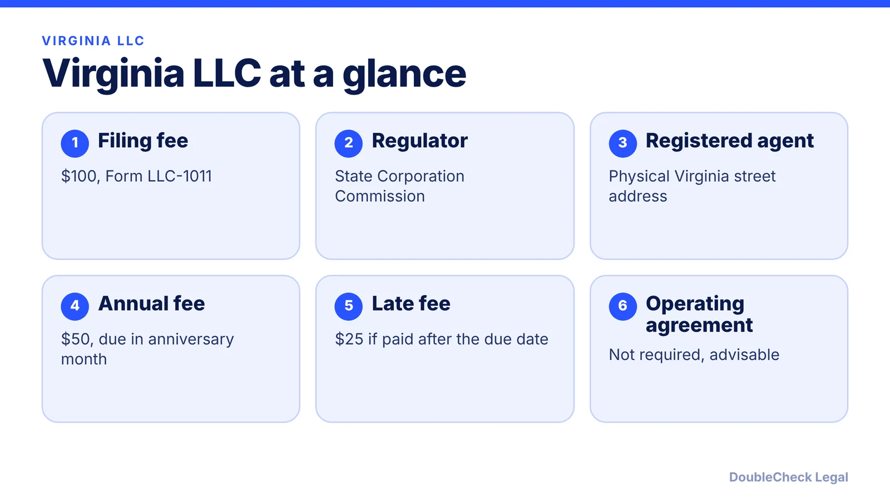
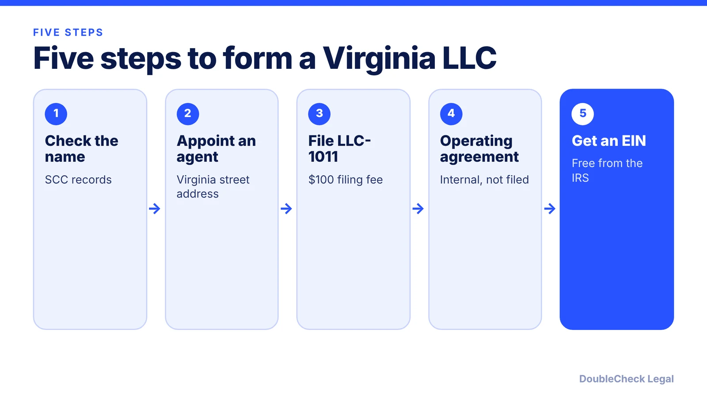

*How do you start an LLC in Virginia? Here are the steps, state fees, and the annual fee deadline, as of November 2026.*

**Key takeaways:**

- Virginia's Articles of Organization (Form LLC-1011) cost $100 per Nolo; confirm on the SCC site.
- A registered agent with a physical Virginia street address is required.
- The annual registration fee is $50, due by the last day of your anniversary month; $25 late penalty.
- No operating agreement is required, but Nolo calls one highly advisable.

## 1. The quick answer

**Quick answer:** To start an LLC in Virginia, pick a name that is distinguishable from entities on file with the State Corporation Commission (SCC), appoint a registered agent with a physical Virginia street address, and file Articles of Organization (Form LLC-1011). Per Nolo, the filing fee is $100. Afterward, adopt an operating agreement, get a free EIN, and pay the $50 annual registration fee, which per State Business Compliance is due by the last day of your LLC's anniversary month.

## 2. Step by step: name, agent, and filing

**1. Check your name.** Per Nolo, the name must include "Limited Liability Company," "Limited Company," or an abbreviation such as LLC or L.L.C., and must be distinguishable from other entities on file with the SCC. You can reserve a name for 120 days with Form SCC631, which Nolo says must be filed by mail.

**2. Pick a registered agent.** Every Virginia LLC needs an agent for service of process, who may be an individual or a business entity. The agent must have a physical street address in Virginia, per Nolo.

**3. File Articles of Organization.** File Form LLC-1011 with the SCC, online or by mail. Nolo lists the fee as $100. Confirm the amount on the SCC site before paying.

**4. Write an operating agreement.** Virginia does not require one, but Nolo calls it "highly advisable"; without one, state LLC law governs how the company runs. See [LLC operating agreements with AI](/blog/llc-operating-agreement-with-ai/).

**5. Get an EIN.** The IRS issues it free; see [how to get an EIN for free](/blog/how-to-get-an-ein-for-your-business-free/). Per Nolo, a multi-member LLC must get one; a one-member LLC needs one only if it has employees or elects corporate taxation. Without an SSN, read [getting an EIN as a foreign founder](/blog/get-ein-without-ssn-foreign-founder/).

## 3. Ongoing costs: the annual registration fee

Virginia's recurring obligation is a flat fee rather than a long report. Nolo puts the annual registration fee at $50 for domestic and foreign LLCs. Per State Business Compliance:

- **Due date:** the last day of the month in which the LLC was originally organized or registered.
- **Late penalty:** $25 on top of the $50 if payment is not received by the due date.
- **Risk:** the LLC loses good standing, and the SCC can cancel it, typically after the third month past the due date. A cancelled LLC cannot legally transact business in Virginia.
- **How:** online through the SCC Clerk's Information System, by card, with no information form.

Fees can change, so verify at scc.virginia.gov. For other states' deadlines, see [annual report requirements by state](/blog/annual-report-requirements-by-state-llc/).

## 4. Virginia quirks and what to compare

Nolo notes that local business licenses come from the city or county where your main place of business is located, and that state license information sits on Virginia's Business OneStop site. Registration with the Virginia Department of Taxation is generally needed if you have employees or will collect sales tax.

Nolo's page did not mention a publication requirement for Virginia LLCs, so none is described here; confirm with the SCC. For local rules, read [business license requirements](/blog/business-license-requirements-small-business/).

Single-member owners should also read [single-member LLC taxes](/blog/single-member-llc-taxes-disregarded-entity/). Comparing states? See the [best state to form an LLC](/blog/best-state-to-form-an-llc-comparison/) and the wider [guide to incorporating in the US](/blog/how-to-incorporate-a-company-in-the-us/). Neighboring sibling guides: [North Carolina](/blog/how-to-start-an-llc-in-north-carolina/) and [Pennsylvania](/blog/how-to-start-an-llc-in-pennsylvania/).

## Where DoubleCheck fits

[DoubleCheck](https://www.contactdoublecheck.com) helps businesses and founders start legal work with AI, verify it, and, when professional advice is warranted, connect with an independent attorney, including for immigration questions. Attorney availability and practice areas vary. Attorneys on DoubleCheck are independent professionals; an attorney-client relationship forms only if an attorney accepts your engagement.

**Sources:** [Nolo: How to Form an LLC in Virginia](https://www.nolo.com/legal-encyclopedia/virginia-form-llc-31855.html); [State Business Compliance: Virginia LLC annual registration](https://www.statebusinesscompliance.com/blog/virginia-llc-annual-registration-2026).

## FAQ

**How much does it cost to start an LLC in Virginia?**

Per Nolo, the Articles of Organization filing fee is $100. The annual registration fee is then $50. Registered agent pricing varies by provider.

**When is the Virginia LLC annual registration fee due?**

By the last day of the month in which the LLC was originally organized or registered, per State Business Compliance. A $25 penalty applies if payment is late.

**Do I need an operating agreement in Virginia?**

Not by law. Nolo calls one highly advisable because, without it, state LLC law governs how the company operates.

**Do I need a Virginia registered agent?**

Yes. The agent must have a physical street address in Virginia and can be an individual or a business entity, per Nolo.

---

*General information only. This article is not legal, tax, investment, or accounting advice.*
