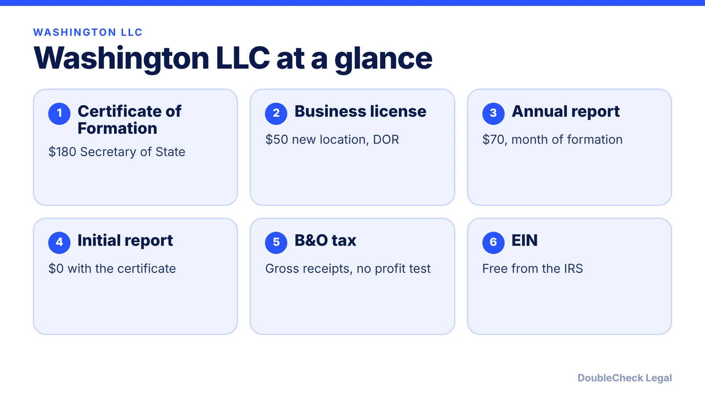
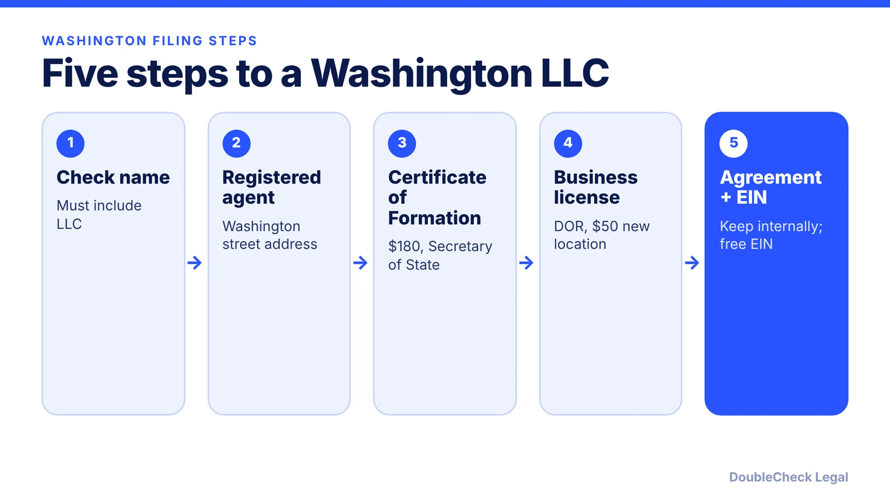

*How do you start an LLC in Washington State? The steps, fees, business license, and B&O tax, as of November 2026.*

**Key takeaways:**

- Per Rho (figures as of October 17, 2026), the Certificate of Formation is $180 and the annual report is $70.
- Washington also requires a business license through the Department of Revenue: $50 for a new location.
- The B&O tax is a gross-receipts tax that applies even without a profit.
- A missed annual report adds a $25 delinquency fee.

## 1. The quick answer

**Quick answer:** To start an LLC in Washington, check your name, appoint a registered agent with a physical Washington street address, and file a Certificate of Formation with the Secretary of State ($180 per Rho, figures as of October 17, 2026). Then get a Washington business license from the Department of Revenue ($50 for a new business location per Rho), adopt an operating agreement, and get a free EIN. The annual report costs $70. Washington also charges the B&O tax, a gross-receipts tax that applies even without a profit.

## 2. Step by step: name, agent, and filing

**1. Check your name.** It must include "LLC" or "L.L.C." A reservation costs $30 and lasts 180 days, per Rho.

**2. Registered agent.** Requires a physical Washington street address; PO boxes and private mailboxes do not qualify. Free if you serve yourself, per Rho.

**3. File the Certificate of Formation.** $180 with the Secretary of State. Expedited service is $100 extra (about 3 business days) and same-day is $150, per Rho. File the initial report with it ($0), or later for $10, due within 120 days of formation.

**4. Operating agreement.** Not filed with the state. See [LLC operating agreements with AI](/blog/llc-operating-agreement-with-ai/).

**5. EIN.** Free; usually issued the same day when applied for online, per Rho. See [how to get an EIN for free](/blog/how-to-get-an-ein-for-your-business-free/).

## 3. Washington's business license and B&O tax

Washington's quirk is the business license through the Department of Revenue. Per Rho:

- **New business location:** $50 (new UBI number); $10 for most other filings; $0 for an additional location. Endorsement fees are separate and variable.
- **Processing:** about 10 business days online, with 2 to 3 more weeks for endorsements. Renewal is $5 plus any endorsement fee.
- **B&O tax:** a gross-receipts tax on revenue with no expense deduction, applying even without a profit. Rates and classifications are set by the Department of Revenue, so check them for your activity.

Rho estimates a self-managed year-one total of about $230 ($180 plus $50), excluding B&O tax and endorsements. See also [business license requirements](/blog/business-license-requirements-small-business/) and [sales tax nexus](/blog/sales-tax-nexus-small-business-online/).

## 4. Annual report and ongoing steps

The annual report costs $70 and is due by the last day of the month the LLC was formed. It can be filed up to 180 days early, and a missed deadline adds a $25 delinquency fee, per Rho. Calendar it; see [annual report requirements by state](/blog/annual-report-requirements-by-state-llc/).

For costs across states, see [LLC formation cost by state](/blog/llc-formation-cost-california-texas-florida-new-york/) and [best state to form an LLC](/blog/best-state-to-form-an-llc-comparison/). A Washington founder with a single owner should also review [single-member LLC taxes](/blog/single-member-llc-taxes-disregarded-entity/). For the overall process, read [how to incorporate a company in the US](/blog/how-to-incorporate-a-company-in-the-us/); compare [Nevada](/blog/how-to-start-an-llc-in-nevada/).

## Where DoubleCheck fits

[DoubleCheck](https://www.contactdoublecheck.com) helps businesses and founders start legal work with AI, verify it, and, when professional advice is warranted, connect with an independent attorney, including for immigration questions. Attorney availability and practice areas vary. Attorneys on DoubleCheck are independent professionals; an attorney-client relationship forms only if an attorney accepts your engagement.

**Sources:** [Rho: How to start an LLC in Washington](https://www.rho.co/blog/how-to-start-an-llc-in-washington); [Washington Secretary of State](https://www.sos.wa.gov/corporations-charities).

## FAQ

**How much does it cost to start an LLC in Washington?**

Per Rho, the Certificate of Formation is $180 and the business license is $50 for a new location, about $230 in year one before B&O tax and endorsement fees.

**Does a Washington LLC need a business license?**

Yes. Rho lists a Department of Revenue business license at $50 for a new business location, with separate endorsement fees where relevant.

**What is the Washington B&O tax?**

Per Rho, it is a gross-receipts tax on revenue with no expense deduction, so it applies even without a profit. Check the Department of Revenue for rates.

**When is the Washington LLC annual report due?**

By the last day of the month the LLC was formed, at $70, and it can be filed up to 180 days early. A missed deadline adds a $25 fee, per Rho.

---

*General information only. This article is not legal, tax, investment, or accounting advice.*
