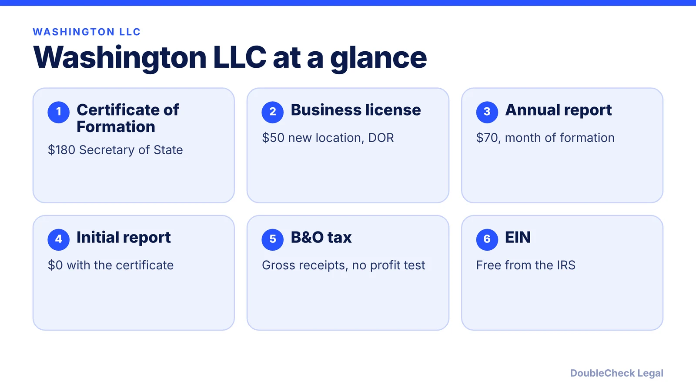
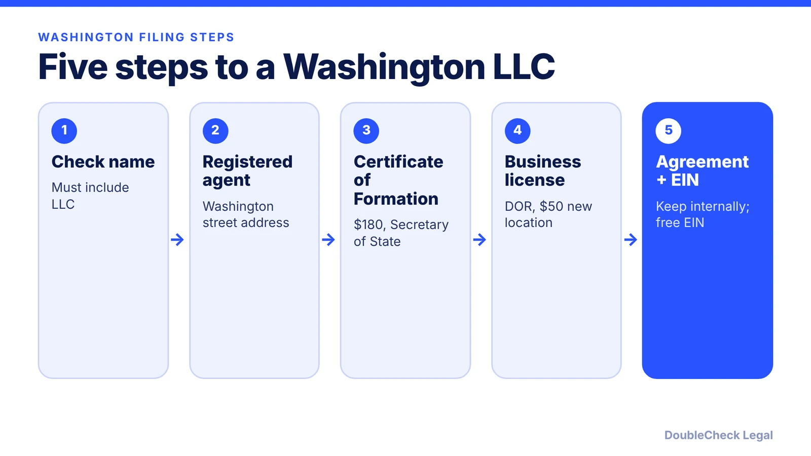

*How do you start an LLC in Washington State? The steps, fees, business license, and B&O tax, as of November 2026.*

**Key takeaways:**

- Per the Washington Secretary of State, the Certificate of Formation is $180 and the annual report is $70.
- Washington also requires a business license through the Department of Revenue: $50 for a new location.
- The B&O tax is a gross-receipts tax that applies even without a profit.
- A missed annual report adds a $25 delinquency fee.

## 1. The quick answer

**Quick answer:** To start an LLC in Washington, check your name, appoint a registered agent with a physical Washington street address, and file a Certificate of Formation with the Secretary of State ($180 per the Washington Secretary of State fee schedule). Then get a Washington business license from the Department of Revenue (check the Department of Revenue for the current fee), adopt an operating agreement, and get a free EIN. The annual report costs $70. Washington also charges the B&O tax, a gross-receipts tax that applies even without a profit.

## 2. Step by step: name, agent, and filing

**1. Check your name.** It must include "LLC" or "L.L.C." A name reservation costs $30, per the Washington Secretary of State fee schedule.

**2. Registered agent.** Requires a physical Washington street address; PO boxes and private mailboxes do not qualify. Per the Secretary of State, the agent must have a physical Washington address and consent to serve; if you do not have one, you can hire a commercial registered agent.

**3. File the Certificate of Formation.** $180 with the Secretary of State. Per the fee schedule, expedited service is $100 (generally about three working days) and same-day counter service is $150. An initial report is listed at $10; check the Secretary of State's initial report page for timing.

**4. Operating agreement.** Not filed with the state. See [LLC operating agreements with AI](/blog/llc-operating-agreement-with-ai/).

**5. EIN.** Free to apply for through the IRS. See [how to get an EIN for free](/blog/how-to-get-an-ein-for-your-business-free/).

## 3. Washington's business license and B&O tax

Washington's quirk is the business license through the Department of Revenue. Check the Department of Revenue for current figures:

- **Business license:** issued by the Department of Revenue, with separate endorsement fees where relevant. Fees and processing times change, so check the current amounts.
- **B&O tax:** a gross-receipts tax on revenue with no expense deduction, which can apply even without a profit. Rates and classifications are set by the Department of Revenue, so check them for your activity.

Budget for the $180 state filing fee plus the business license, B&O tax and any endorsements. See also [business license requirements](/blog/business-license-requirements-small-business/) and [sales tax nexus](/blog/sales-tax-nexus-small-business-online/).

## 4. Annual report and ongoing steps

The annual report costs $70 and is due by the last day of the month the LLC was formed. It can be filed up to 180 days early, and a missed deadline makes the LLC delinquent, with a delinquency fee (the fee schedule lists $95 total for a late report) and a risk of administrative dissolution, per the Washington Secretary of State. Calendar it; see [annual report requirements by state](/blog/annual-report-requirements-by-state-llc/).

For costs across states, see [LLC formation cost by state](/blog/llc-formation-cost-california-texas-florida-new-york/) and [best state to form an LLC](/blog/best-state-to-form-an-llc-comparison/). A Washington founder with a single owner should also review [single-member LLC taxes](/blog/single-member-llc-taxes-disregarded-entity/). For the overall process, read [how to incorporate a company in the US](/blog/how-to-incorporate-a-company-in-the-us/); compare [Nevada](/blog/how-to-start-an-llc-in-nevada/).

## Where DoubleCheck fits

[DoubleCheck](https://www.contactdoublecheck.com) helps businesses and founders start legal work with AI, verify it, and, when professional advice is warranted, connect with an independent attorney, including for immigration questions. Attorney availability and practice areas vary. Attorneys on DoubleCheck are independent professionals; an attorney-client relationship forms only if an attorney accepts your engagement.

**Sources:** [Washington Secretary of State fee schedule](https://www.sos.wa.gov/corporations-charities/frequently-asked-questions-faqs/fee-schedules-priority-services); [Washington Secretary of State, annual reports](https://www.sos.wa.gov/corporations-charities/business-entities/maintain-business-compliance/annual-reports); [Washington Secretary of State, registered agents](https://www.sos.wa.gov/corporations-charities/business-entities/maintain-business-compliance/registered-agents); [Washington Secretary of State, Corporations and Charities](https://www.sos.wa.gov/corporations-charities). Business license and B&O details: confirm with the Washington Department of Revenue.

## FAQ

**How much does it cost to start an LLC in Washington?**

Per the Washington Secretary of State, the Certificate of Formation is $180. A Washington business license from the Department of Revenue is a separate cost, plus any B&O tax and endorsement fees; check the Department of Revenue for current amounts.

**Does a Washington LLC need a business license?**

Yes. Washington requires a business license through the Department of Revenue, with separate endorsement fees where relevant. Check the Department of Revenue for the current fee.

**What is the Washington B&O tax?**

It is Washington's gross-receipts tax on revenue, and it can apply even without a profit. Check the Department of Revenue for rates and classifications.

**When is the Washington LLC annual report due?**

By the last day of the month the LLC was formed, at $70, and it can be filed up to 180 days early, per the Washington Secretary of State. A late report adds a delinquency fee (the fee schedule lists $95 total) and can lead to administrative dissolution.

---

*General information only. This article is not legal, tax, investment, or accounting advice.*
