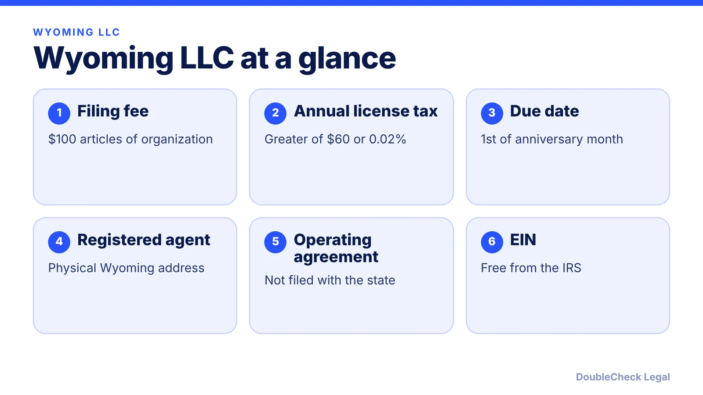
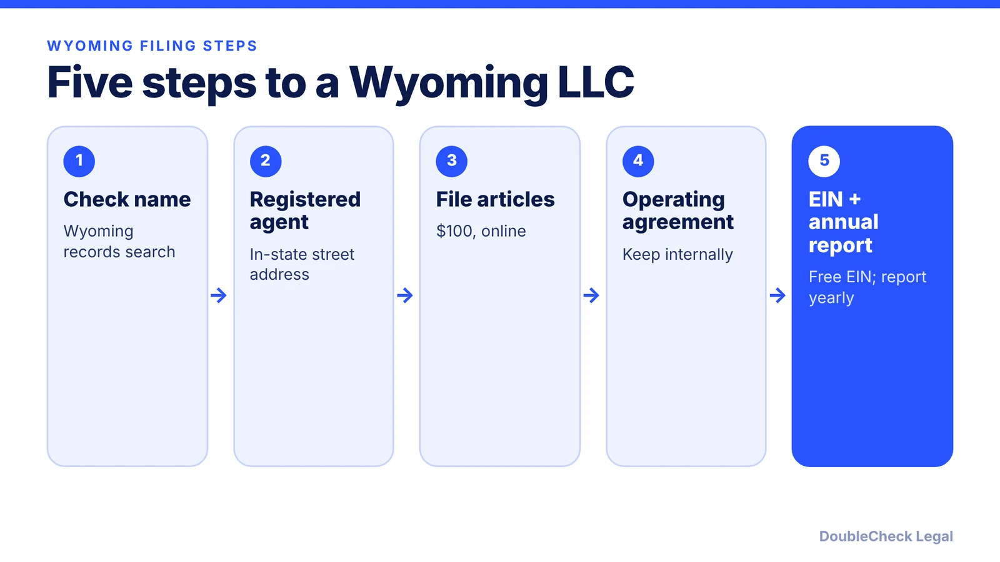

*How do you start an LLC in Wyoming? The steps, the $100 filing fee, and the annual license tax, as of November 2026.*

**Key takeaways:**

- The Wyoming Secretary of State lists $100 for Articles of Organization, effective July 1, 2026.
- A registered agent with a physical Wyoming street address is required.
- The annual report license tax is the greater of $60 or 0.02% of Wyoming-located assets.
- A low filing fee does not settle whether Wyoming is right for your situation.

## 1. The quick answer

**Quick answer:** To start an LLC in Wyoming, check your name in the Wyoming business records database, appoint a registered agent with a physical Wyoming street address, and file Articles of Organization. The Secretary of State's fee schedule effective July 1, 2026 lists $100 for the articles. Wyoming then charges an annual report license tax of the greater of $60 or 0.02% of Wyoming-located and -employed assets, due each year on the first day of the anniversary month, per Zenind.

## 2. Step by step: name, agent, and filing

**1. Check your name.** Search the Wyoming business records database. The name must include an approved designator such as "LLC" and be distinguishable from other registered entities, per Zenind.

**2. Appoint a registered agent.** Every Wyoming LLC needs one with a physical street address in Wyoming; a P.O. box or mailbox service does not qualify, per Zenind. Per the Secretary of State's fee schedule, appointing a new agent and office costs $5, and reinstatement after losing an agent is $350.

**3. File Articles of Organization.** The fee is $100 and can be filed electronically, per the Wyoming Secretary of State (effective July 1, 2026). Expedited service is $700 for next business day or $1,400 for same day.

**4. Adopt an operating agreement.** Keep it internally; see [LLC operating agreements with AI](/blog/llc-operating-agreement-with-ai/).

**5. Get an EIN.** Free from the IRS; see [how to get an EIN for free](/blog/how-to-get-an-ein-for-your-business-free/).

## 3. Annual report and ongoing costs

Wyoming has no separate LLC annual report fee in the Secretary of State schedule; instead the annual report license tax applies: the greater of $60 or 0.02% ($.0002) of the company's Wyoming-located and -employed assets.

Per Zenind:

- Reports are due on the first day of the anniversary month of formation.
- You can usually file up to 120 days early.
- If the report is not paid within 60 days after the due date, the LLC can be subject to dissolution.

Budget for the registered agent too; commercial agents charge their own fees. See [annual report requirements by state](/blog/annual-report-requirements-by-state-llc/).

## 4. Wyoming myths and what to check

Wyoming is popular for its low filing fee, but a cheap filing is not the same as the right choice. Two checks matter:

- **Operating location.** The license tax is based on Wyoming-located assets, and the fee is only part of total cost. If you live or work elsewhere, that state's rules still need review; see [best state to form an LLC](/blog/best-state-to-form-an-llc-comparison/).
- **Local licenses.** Zenind says whether you need a Wyoming business license depends on industry, location, and operations. See [business license requirements](/blog/business-license-requirements-small-business/).

Zenind's Wyoming guide makes no privacy or anonymity claims, so do not assume any without checking the current statute with an attorney. For an overview, read [how to incorporate a company in the US](/blog/how-to-incorporate-a-company-in-the-us/) and compare [Nevada](/blog/how-to-start-an-llc-in-nevada/).

## Where DoubleCheck fits

[DoubleCheck](https://www.contactdoublecheck.com) helps businesses and founders start legal work with AI, verify it, and, when professional advice is warranted, connect with an independent attorney, including for immigration questions. Attorney availability and practice areas vary. Attorneys on DoubleCheck are independent professionals; an attorney-client relationship forms only if an attorney accepts your engagement.

**Sources:** [Wyoming Secretary of State business fees](https://sos.wyo.gov/Business/docs/BusinessFees.pdf); [Zenind: Wyoming LLC fees, licenses, and filing requirements](https://www.zenind.com/help/post/wyoming-llc-fees-licenses-and-filing-requirements-2026-guide).

## FAQ

**How much does it cost to start an LLC in Wyoming?**

The Wyoming Secretary of State fee schedule (effective July 1, 2026) lists $100 for Articles of Organization. Expedited service costs $700 (next business day) or $1,400 (same day).

**What is the Wyoming annual report license tax?**

Per the Secretary of State, it is the greater of $60 or 0.02% of the company's Wyoming-located and -employed assets. No separate LLC annual report fee is listed.

**When is the Wyoming LLC annual report due?**

On the first day of the anniversary month of formation, per Zenind. An LLC not paid within 60 days after the due date can be subject to dissolution.

**Do I need a registered agent in Wyoming?**

Yes, with a physical Wyoming street address; a P.O. box or mailbox service does not qualify, per Zenind. The Secretary of State charges $5 to appoint a new agent and office.

---

*General information only. This article is not legal, tax, investment, or accounting advice.*
