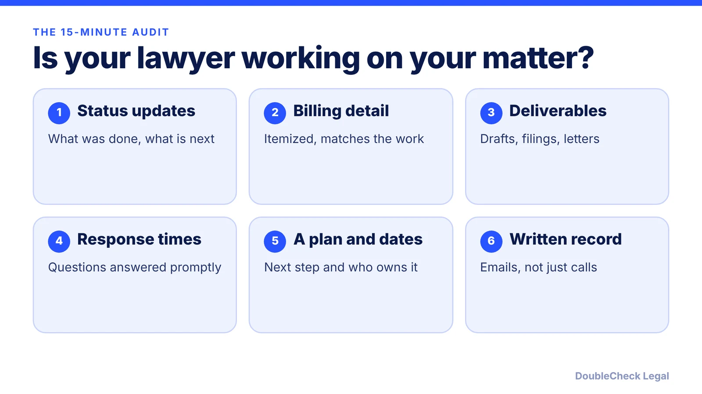
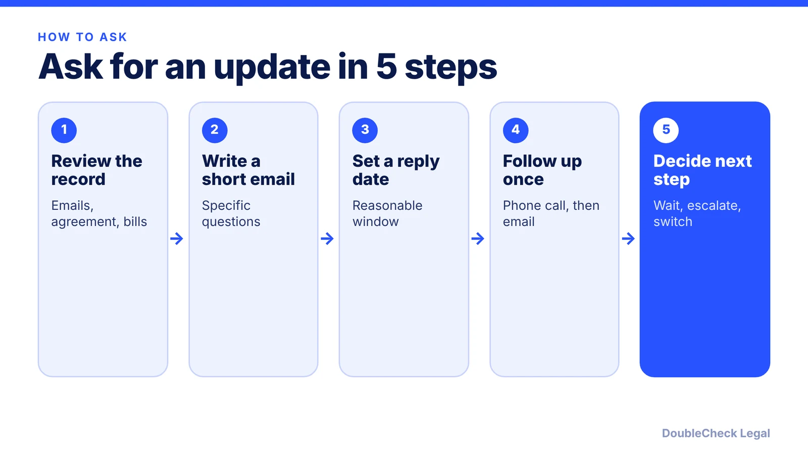

*A 15-minute audit of updates, bills, deliverables and response times, plus how to ask, when to switch and where to turn for fee disputes.*

**Key takeaways:**

- Check five things: status updates, itemized bills, deliverables, response times and a dated plan.
- Ask in writing with three specific questions and a reply date; follow up once.
- Billing shows what was recorded, not whether the work is good.
- Know your options: discuss, switch, or use a state bar fee dispute or assistance program.

## 1. The quick answer

**Quick answer:** To tell if your lawyer is actually working on your matter, check five things: whether you get status updates that say what was done and what is next, whether bills are itemized and match the work, whether you can see deliverables (drafts, filings, correspondence), whether your questions get answered in a reasonable time, and whether there is a plan with dates. Silence alone is not proof of neglect, and a busy week is not abandonment. A pattern of unanswered questions, vague bills and nothing to show is a reason to ask directly, in writing.

This is a practical audit you can run in about 15 minutes. For the warning signs and what to do about them, see [signs your lawyer is not working for you](/blog/signs-your-lawyer-is-not-working-for-you-what-to-do/); for choosing counsel in the first place, see [how do I know if my lawyer is good](/blog/how-do-i-know-if-my-lawyer-is-good/).

## 2. Check updates, deliverables and response times

**Status updates.** New York's published client rights (NYSBA page dated December 19, 2022, drawing on Section 1210.1 of the Appellate Division rules) say you are entitled to be kept reasonably informed of the status of your matter and to receive prompt replies to letters, calls and emails. The Texas courts self-help site says a lawyer must keep the client reasonably informed, and that if a reasonable time has passed without word, or a deadline is near, you may check in. FindLaw adds that updates can be as simple as "nothing is happening."

**Deliverables.** Ask what exists now. A working matter usually leaves a trail: a draft, a filed document, a letter sent, a call scheduled, a request to you for information. NYSBA says you can ask for copies of relevant papers and your attorney must promptly comply with reasonable requests. If a month passes and there is nothing to see, that is worth a direct question.

**Response times.** No source we found sets a universal number of hours. FindLaw says a lawyer should tell you when to expect updates, so ask at the start: "How quickly do you usually reply, and who covers when you are out?" Then measure against that answer, not against your own anxiety.

**Quick test:** can you answer these without chasing anyone?

- What is the next step, and who owns it?
- What is the next date or deadline?
- What did the lawyer do in the last 30 days?
- What do they need from me?

## 3. Read the bill and ask the right way

**Billing detail.** NYSBA says you may request a written, itemized bill at reasonable intervals and that fees should be explained at the start of the engagement. The Texas site says you should understand the basis for the fees before agreeing, and notes that on hourly billing each call or email may add to your bill. FindLaw says a lawyer should tell you if brief contacts such as calls and emails are charged. Things to look for on a bill:

- **Dates and descriptions** that tell you what was done ("draft revised, 1.2 hours"), not just "attention to file".
- **Who did the work** (partner, associate, paralegal) and at what rate, compared with your fee agreement.
- **Flat-fee or retainer matters:** what is included, what is billed separately, and how unused advance fees are handled. North Carolina's client rights page says clients can expect to discuss how the lawyer will bill, and recommends written fee agreements.

Billing alone cannot prove the work is good. It shows what was recorded. See [how much a startup lawyer costs, flat fee vs hourly](/blog/how-much-does-a-startup-business-lawyer-cost-flat-fee-vs-hourly/).

**How to ask without souring the relationship.** Send one short email:

1. Name the matter and the date of your last update.
2. Ask three specific questions: current status, next step with a date, and what the lawyer needs from you.
3. Ask for an itemized bill or time summary if you do not have one.
4. Say when you would like a reply, and that a short call is fine.

Keep it factual and keep a copy. If you are preparing for a new lawyer, see [how to prepare for a first meeting with a startup lawyer](/blog/how-to-prepare-for-first-meeting-with-startup-lawyer/).

## 4. When to switch, and fee disputes and bar resources

**Talk first.** The Texas courts site says to start by talking to the lawyer about your concerns. Often the cause is a mismatch in expectations, not neglect.

**Switching.** FindLaw says you are in charge of the attorney-client relationship and suggests a lawyer referral service to find a new attorney if you are dissatisfied. NYSBA says you may discharge your attorney at any time, but that court approval may be required in some matters and the lawyer may have a claim for the value of services up to that point. Before you switch, get your file, check what you owe, and avoid missing a deadline; a litigation deadline can make timing critical, so ask the new lawyer first. Consider switching when answers stay vague after you have asked in writing, a deadline was missed, or trust is gone. See [how to get a lawyer referral](/blog/how-to-get-lawyer-referral/) and [verify a lawyer license with the state bar](/blog/verify-california-attorney-license-state-bar/).

**Fee disputes and bar resources.**

- **Texas:** the State Bar of Texas Client Attorney Assistance Program, at 1-800-932-1900, handles fee disputes and minor relationship issues, not misconduct; serious misconduct goes to the Chief Disciplinary Counsel (per the Texas courts self-help site).
- **California:** per the State Bar, fee arbitration is required for an attorney if a client requests it, but a notice of client right to fee arbitration usually carries a 30-day window to file, and arbitration cannot award malpractice damages.
- **Elsewhere:** many state bars and local bar associations run fee dispute programs. Search your state bar site; rules and deadlines differ.

**Handle it yourself vs. get another attorney.** For a short check-in or a billing question, handle it yourself with the email above. If a deadline, a court filing or a large amount of money is involved, get a second attorney to review the file before you decide. A second set of eyes can tell you whether the pace is normal for that type of matter.

**Related reading:** [Lawyer not returning calls: what to do](/blog/lawyer-not-returning-calls-what-you-can-do-before-you-switch/)

## Where DoubleCheck fits

[DoubleCheck](https://www.contactdoublecheck.com) helps businesses and founders start legal work with AI, verify it, and, when professional advice is warranted, connect with an independent attorney, including for immigration questions. Attorney availability and practice areas vary. Attorneys on DoubleCheck are independent professionals; an attorney-client relationship forms only if an attorney accepts your engagement.

**Sources:** [NYSBA, Client Rights and Responsibilities (Dec. 19, 2022)](https://nysba.org/client-rights-and-responsibilities/); [Texas Court Help, How do I work with my lawyer](https://texascourthelp.gov/civil/how-do-i-work-with-my-lawyer/); [FindLaw, What to expect from your lawyer](https://www.findlaw.com/hirealawyer/attorney-fees-and-agreements/what-to-expect-from-your-lawyer.html); [North Carolina State Bar, Client rights and responsibilities (undated)](https://www.ncbar.gov/for-the-public/client-rights-responsibilities); [State Bar of California, Frequently asked questions: fee disputes](https://www.calbar.ca.gov/public/concerns-about-attorney/resolving-fee-disputes-your-attorney/frequently-asked-questions-fee-disputes).

## FAQ

**How can I tell if my lawyer is actually working on my case?**

Look for specific updates, itemized bills that match the work, visible deliverables, replies within the window the lawyer gave you, and a next step with a date. If you cannot answer what happened in the last 30 days, ask in writing.

**How long should a lawyer take to respond?**

No source we found sets a universal time. FindLaw says a lawyer should tell you when to expect updates, so ask at the start how fast replies usually come, and then hold the lawyer to that.

**Can I ask my lawyer for an itemized bill?**

Yes. NYSBA published client rights say you may request and receive a written, itemized bill at reasonable intervals. Ask by email and name the period you want covered.

**Where can I go for a fee dispute with my lawyer?**

Start with your state bar. For example, the State Bar of Texas Client Attorney Assistance Program handles fee disputes, and the State Bar of California runs fee arbitration. Programs and deadlines vary by state.

---

*General information only. This article is not legal, tax, investment, or accounting advice.*
