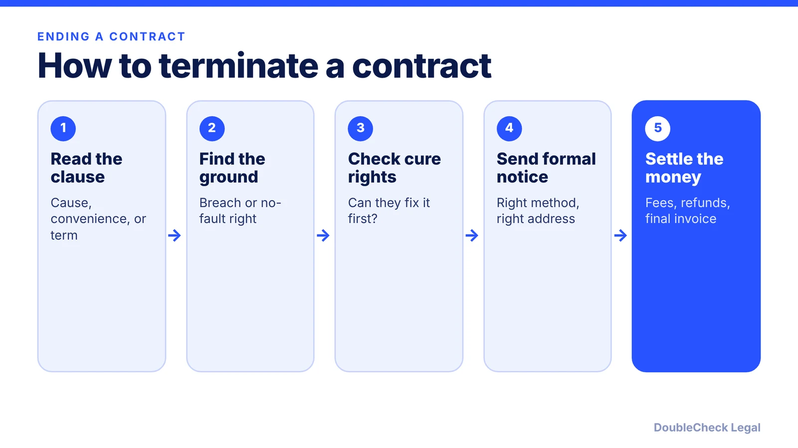
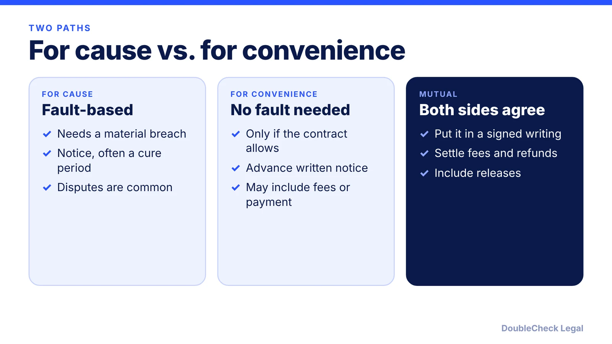

*Read the clause, find your ground, follow the notice rules exactly. Here is how early termination works.*

**Key takeaways:**

- Check the termination clause first: cause, convenience, or mutual agreement.
- For cause usually needs a material breach; many contracts add a cure period.
- Notice periods run from about 30 days to over six months per Morgan Lewis; follow the delivery method exactly.
- Watch early-termination fees and auto-renewal deadlines.

## 1. The quick answer

**Quick answer:** To end a contract early, start with the termination clause. It usually lets you leave in one of three ways: for cause (the other side materially breached), for convenience (no fault needed, if the contract grants it), or by mutual agreement. Per Morgan Lewis, notice periods range from about 30 days to more than six months, and failing to give required notice may leave you obligated to keep performing past your intended end date. Follow the notice method exactly and check for cure periods and fees.

## 2. For cause vs. for convenience

**Termination for cause.** Per [Morgan Lewis](https://www.morganlewis.com/de/blogs/sourcingatmorganlewis/2023/02/contract-corner-key-terms-when-it-comes-time-to-terminate), nearly all agreements include a for-cause right, usually triggered by a material breach. The terminating party must show the other side's conduct meets the contract's definition of cause, and the other party may dispute it. Per [Lizerbram Law](https://www.lizerbramlaw.com/blog/how-to-terminate-a-contract/), a material breach is usually required and a minor one, like a payment a day late, typically isn't enough.

**Cure periods.** Many for-cause rights let the breaching party fix the problem within a set window; if it does, the termination right no longer exists, per Morgan Lewis.

**Termination for convenience.** This lets a party end the agreement without showing fault. Per Morgan Lewis, some agreements give it to both parties, some to only one, and some omit it entirely, so check rather than assume. [Sirion](https://www.sirion.ai/library/legal/termination-for-convenience/) notes the right is exercised through the contract's notice and compensation terms, and that terminating mainly to re-source work more cheaply can be challenged as bad faith.

## 3. Notice, fees, and auto-renewals

- **Notice:** confirm the period (for example 30 days), who receives it, and the accepted delivery method. Per Lizerbram, methods may include mail, courier, email, or fax. Send it the way the contract says, and keep proof.
- **Fees:** look for early termination fees or liquidated damages. Per Morgan Lewis, termination may require payment for services through the termination date or for the rest of a term, and agreements may require refunds or credits of amounts already paid.
- **Auto-renewal:** some contracts renew unless you give notice not to renew, per Lizerbram. Calendar the deadline now. See [auto-renewal clauses in business contracts](/blog/auto-renewal-clauses-business-contracts/).
- **No termination clause?** Per Lizerbram, other grounds can include frustration (performance is impossible) or a force majeure clause, but unprofitability does not count as impossibility.

Consumer subscriptions have separate federal and state cancellation rules; see our post on [FTC click-to-cancel rules for SaaS](/blog/ftc-click-to-cancel-subscription-rules-saas/).

## 4. Mistakes that turn an exit into a lawsuit

Walking away without following the contract is the usual mistake. Terminating on a weak basis, such as a deal that simply is not profitable, may not hold up, per Lizerbram, and it can expose you to a breach claim yourself.

Before you send notice:

1. Re-read the termination, notice, and dispute-resolution sections, and any amendments or SOWs. See [MSA and SOW basics](/blog/master-services-agreement-and-sow-small-business/).
2. Document the breach with dates, emails, and missed deliverables.
3. Check for liability caps and indemnities that affect a dispute. See [limitation of liability clauses](/blog/limitation-of-liability-clause-explained/).
4. Keep performing what you owe until termination takes effect.
5. Have an attorney review a high-value termination notice. AI can summarize the clause and draft a notice for you to verify; see [AI contract review for small business](/blog/ai-contract-review-small-business/) and [contract red flags](/blog/contract-red-flags-small-business/).

## Where DoubleCheck fits

[DoubleCheck](https://www.contactdoublecheck.com) helps businesses and founders start legal work with AI, verify it, and, when professional advice is warranted, connect with an independent attorney, including for immigration questions. Attorney availability and practice areas vary. Attorneys on DoubleCheck are independent professionals; an attorney-client relationship forms only if an attorney accepts your engagement.

**Sources:** [Morgan Lewis, Key Terms When It Comes Time to Terminate](https://www.morganlewis.com/de/blogs/sourcingatmorganlewis/2023/02/contract-corner-key-terms-when-it-comes-time-to-terminate); [Lizerbram Law, How to Terminate a Contract](https://www.lizerbramlaw.com/blog/how-to-terminate-a-contract/); [Sirion, Termination for Convenience](https://www.sirion.ai/library/legal/termination-for-convenience/).

## FAQ

**Can I terminate a contract early?**

Only if the contract or the facts allow it. Per Lizerbram Law, first read the termination clauses to see whether the contract allows termination for cause, for convenience, or based on time.

**What is termination for cause?**

Ending the contract because the other side materially breached. Per Morgan Lewis, the terminating party must show the conduct meets the contract's definition of cause, and many contracts give the breaching party a window to cure.

**What is termination for convenience?**

A right to end the contract without showing fault. Per Morgan Lewis, some agreements give it to both parties, some to one, and some omit it, so check the text rather than assume.

**What happens if I don't give proper notice?**

Per Morgan Lewis, failing to give required notice may leave you obligated to keep performing past your intended end date. Follow the contract's notice period and delivery method and keep proof of delivery.

---

*General information only. This article is not legal, tax, investment, or accounting advice.*
