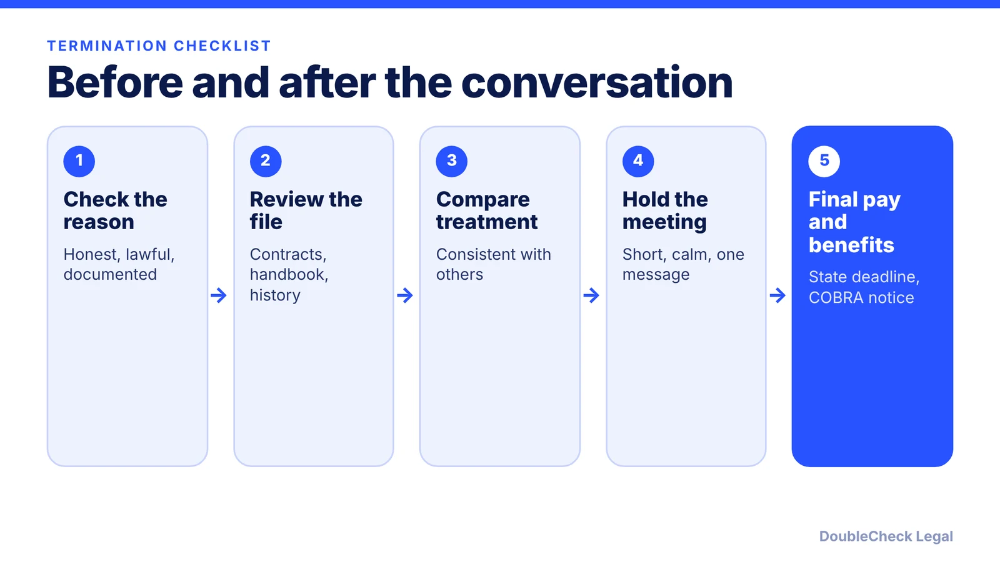
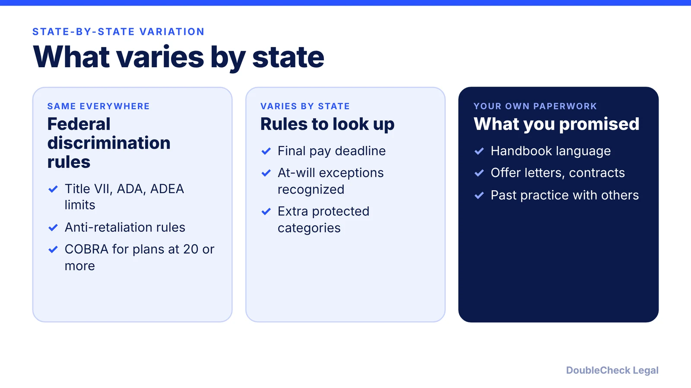

*At-will employment is the default, but the exceptions, final pay timing, and paperwork are where small businesses get into trouble.*

**Key takeaways:**

- Every state except Montana is at-will, per Homebase, but discrimination, retaliation, and contract promises still limit firing.
- Final pay deadlines are set by states and vary widely; federal law sets none.
- Document the reason, treat employees consistently, and check your handbook promises.
- Consult an employment attorney for recent complainers, protected groups, contracts, or severance.

## 1. The quick answer

**Quick answer:** In most of the U.S. you can end employment at will, meaning for any reason that is not barred by law. Homebase says every state except Montana follows the at-will rule. The legal risk is in the exceptions: discrimination, retaliation, public policy, and contract or handbook promises. A defensible termination has a real, documented reason, consistent treatment, correct final pay under your state's deadline, and benefits notices. Before acting on a hard case, talk to an employment attorney.

## 2. The limits on at-will termination

At-will does not mean any reason. The main limits:

- **Discrimination.** Per Homebase and Nolo, federal law protects race, color, religion, sex (including pregnancy, sexual orientation, and gender identity per Homebase), national origin, age 40 and over, disability, and genetic information. Title VII and the ADA apply to employers with 15 or more employees, and the ADEA to 20 or more, per Lorman and Nolo. State laws can cover smaller employers or more categories.
- **Retaliation.** You cannot fire someone for filing a complaint, taking part in an investigation, or requesting an accommodation, per Homebase.
- **Public policy.** Firing someone for filing a workers' comp claim or refusing to do something illegal can create a claim. Homebase says some states, including New York and Florida, do not recognize this exception, so it varies by state.
- **Implied contract.** Statements or a handbook that promise job security or a required process may bind you. Homebase lists states that do not recognize this theory, including Texas and Pennsylvania, so again check your state.
- **Good faith and fair dealing.** Homebase lists 16 states recognizing it, including California and Massachusetts.
- **Written contracts and union agreements,** which can require cause or a process. Business Management Daily notes contracted and union employees are exceptions to at-will.

Misclassifying a worker is its own issue: see [employee vs. contractor](/blog/employee-vs-independent-contractor-classification-startups/). Your [handbook](/blog/employee-handbook-small-business-what-to-include/) can undercut at-will if it promises process you do not follow.

## 3. Process, final pay, and benefits

Homebase's practical guidance: follow your handbook and past practice, document performance issues over time, make sure the reason is honest and not retaliatory or discriminatory, and consult your state labor department or an employment attorney.

**Final pay varies by state.** The FLSA does not set a final-paycheck deadline, and state law generally controls, per ClockSpot's research (a vendor source, so verify against the statute). ClockSpot reports these examples:

- **California:** due immediately on discharge.
- **Massachusetts:** due in full on the day of discharge.
- **Texas:** within six days after discharge.
- **New York:** by the next regular payday.
- **Colorado:** immediately, with an exception if the accounting unit is closed.

Verify your state's rule before the meeting, since a late final paycheck can create its own claim.

**Health coverage.** If your group health plan is covered by COBRA (employers with 20 or more employees in the prior year), the DOL says termination other than for gross misconduct is a qualifying event, and employers must notify the plan administrator. Qualified beneficiaries then get at least 60 days from the election notice to elect coverage.

## 4. Special situations and when to call a lawyer

Call an employment attorney first if any of these apply:

- The employee recently complained, took leave, asked for an accommodation, or filed a claim.
- The employee is in a protected group and the performance record is thin.
- There is a written contract, a union agreement, or equity or commission at stake.
- You want a severance deal and a release. See the [separation agreement checklist](/blog/separation-agreement-review-checklist/) before you offer or sign one.
- The employee holds a work visa. A job loss triggers timing issues for them; see the [H-1B layoff grace period](/blog/h-1b-layoff-60-day-grace-period/) and employer duties on [I-9 and E-Verify](/blog/i-9-and-e-verify-for-startups/).
- You are letting several people go at once.

Keep the meeting short and factual, avoid new reasons you cannot document, and do not make promises about references or benefits you have not confirmed. AI tools can help you organize a timeline, draft a script, and build a checklist. They cannot know your state's final-pay rule today or the exposure in your specific facts. See [when to hire a lawyer](/blog/when-to-hire-lawyer-small-business/). This is general information, not legal advice.

## Where DoubleCheck fits

[DoubleCheck](https://www.contactdoublecheck.com) helps businesses and founders start legal work with AI, verify it, and, when professional advice is warranted, connect with an independent attorney, including for immigration questions. Attorney availability and practice areas vary. Attorneys on DoubleCheck are independent professionals; an attorney-client relationship forms only if an attorney accepts your engagement.

**Sources:** [Homebase: at-will exceptions](https://www.joinhomebase.com/blog/at-will-employment-exceptions); [ClockSpot: final paycheck laws by state](https://www.clockspot.com/research/final-paycheck-laws-by-state); [Nolo: federal anti-discrimination laws](https://www.nolo.com/legal-encyclopedia/content/antidiscrim-act.html); [Lorman EEO overview](https://www.lorman.com/resources/overview-of-eeo-laws-title-vii-adea-ada-17175); [DOL COBRA fact sheet (archived)](https://webarchive.library.unt.edu/web/20130220200615/http://www.dol.gov/ebsa/newsroom/fscobra.html); [Business Management Daily](https://businessmanagementdaily.com/63526/what-you-need-to-include-in-a-small-business-employee-handbook).

## FAQ

**Can I fire an employee for any reason?**

Generally in at-will states you can end employment for any reason not barred by law, but not for discrimination, retaliation, or a reason that violates public policy or a contract. Homebase says every state except Montana follows at-will, with exceptions.

**When do I have to pay a terminated employee's final paycheck?**

It depends on the state. The FLSA sets no deadline, per ClockSpot. Its examples: California immediately, Massachusetts the day of discharge, Texas within six days, New York the next regular payday. Verify your state's current rule.

**Do I have to offer COBRA when I terminate someone?**

If your group health plan is subject to COBRA (employers with 20 or more employees in the prior year, per the DOL), termination other than for gross misconduct is a qualifying event and notice duties follow.

**Should I use a severance agreement?**

It is optional. It usually pairs payment with a release of claims. Have an attorney review it first; see our separation agreement checklist for what to look for.

---

*General information only. This article is not legal, tax, investment, or accounting advice.*
