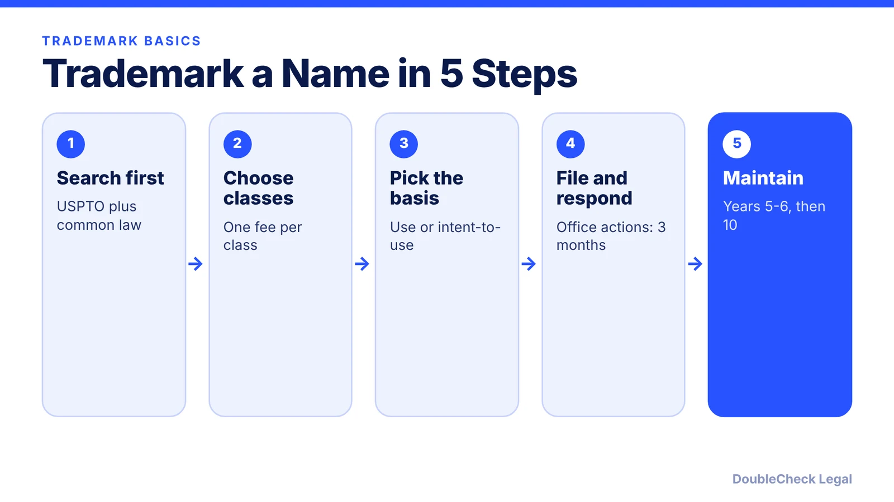
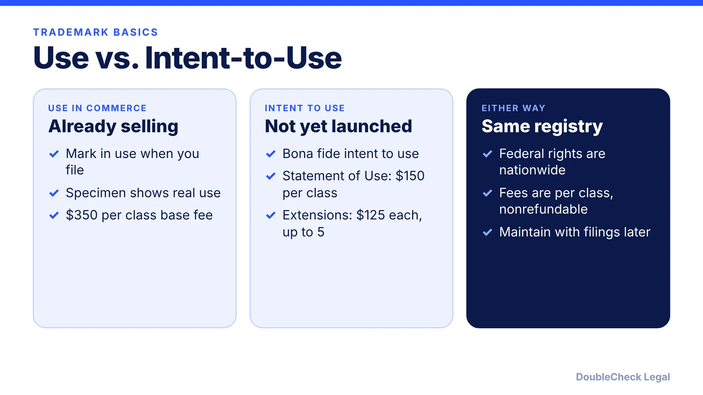

*A practical path to a federal trademark for your business name, with the 2026 fee and timeline numbers we could verify.*

**Key takeaways:**

- Search the USPTO database and common-law sources before you file.
- As of November 2026 the USPTO base fee is $350 per class, with surcharges for incomplete or custom filings.
- Intent-to-use filings add a $150 Statement of Use fee per class and optional $125 extensions.
- Use TM or SM freely; use (R) only after federal registration.

## 1. The quick answer

**Quick answer:** To trademark a business name in the U.S., search the USPTO's free Trademark Search for conflicts, pick the right class or classes for your goods or services, and file a federal application. As of November 2026, the base USPTO application fee is $350 per class (per Finnegan's summary of the fee schedule effective January 18, 2025, and several 2026 guides), with surcharges if the application is incomplete or uses a custom description. Trademark Engine reports average time from filing to registration or abandonment of about 10 months as of March 31, 2026, and intent-to-use applications can take longer.

## 2. Search before you file

Use the USPTO's Trademark Search (tmsearch.uspto.gov, which replaced TESS), per TMarkMetric's guide. Search the exact name, then phonetic variants, alternate spellings, and plurals, since confusion depends heavily on sound. Compare Nice class numbers and read the goods and services descriptions, because marks in related classes can conflict even when they are not identical. Live registrations and live pending applications both matter.

A federal search is not enough. It does not cover state registries or unregistered (common law) use, so also check Google, social media, domain registrars, and your state's Secretary of State records. If you find a live mark in a related class with a similar sound, talk to a trademark attorney before investing in the name. See [checking a business name for trademark conflicts](/blog/trademark-business-name-check/) and [fictitious business names in California](/blog/california-fictitious-business-name-dba/).

## 3. Classes, use vs. intent-to-use, and fees

The USPTO uses 45 classes: 34 for goods and 11 for services, per LegalZoom. Fees are charged per class, and you cannot add classes to a pending application, per TMarkMetric.

**Filing basis:**

- **Use in commerce (Section 1(a)):** the mark is already in use when you file.
- **Intent to use (Section 1(b)):** you have a bona fide intent to use it. Per Sierra IP Law, you later file a Statement of Use ($150 per class) with a specimen, and extensions cost $125 each, up to five.

**Fees (per class):** $350 base; +$100 if information is insufficient; +$200 for a free-form description instead of the ID Manual; +$200 for each extra 1,000 characters beyond the first 1,000. Those fees are nonrefundable even if the application is refused, per TMarkMetric. Verify against the USPTO fee schedule on the day you file.

**After filing:** if the examiner issues an office action, you usually have three months to respond, per LegalZoom. Registered marks need a Section 8 declaration of use between years 5 and 6 and renewal every 10 years.

## 4. TM vs. (R), and state vs. federal

You can use **TM** (goods) or **SM** (services) without any registration, even before you file. The **(R)** symbol may be used only after the USPTO issues a federal registration; pending applications and state registrations do not qualify, per Promise Legal, which quotes the TMEP: state registration "does not entitle a person to use the federal registration notice." Using (R) too early can undermine an infringement claim.

A state registration is checked through the Secretary of State and covers that state, usually at a lower upfront cost but with limited geographic reach, per Zenind. Federal registration provides nationwide constructive notice and prima facie evidence of ownership and validity, per Sierra IP Law. An unregistered mark can still have common law rights from use, but they are limited.

If AI helped you generate a name or logo, check [AI-generated content and copyright](/blog/ai-generated-content-copyright-solo-business/) and consider how a [cease and desist](/blog/how-to-respond-cease-and-desist-letter/) would be handled before you build the brand.

## Where DoubleCheck fits

[DoubleCheck](https://www.contactdoublecheck.com) helps businesses and founders start legal work with AI, verify it, and, when professional advice is warranted, connect with an independent attorney, including for immigration questions. Attorney availability and practice areas vary. Attorneys on DoubleCheck are independent professionals; an attorney-client relationship forms only if an attorney accepts your engagement.

**Sources:** [Finnegan on USPTO fee changes](https://www.finnegan.com/en/insights/blogs/incontestable/uspto-trademark-fees-changes-for-2025.html); [TMarkMetric fees](https://www.tmarkmetric.com/insights/trademark-filing-fees-breakdown); [TMarkMetric search guide](https://tmarkmetric.com/insights/free-trademark-search-guide); [Trademark Engine data](https://www.trademarkengine.com/blog/us-trademark-filings-2026-uspto-data-before-you-file/); [Sierra IP Law](https://sierraiplaw.com/how-much-does-a-trademark-cost/); [LegalZoom](https://www.legalzoom.com/articles/trademarks-before-you-apply); [Promise Legal](https://blog.promise.legal/startup-central/trademark-symbols-r-tm-sm-complete-guide/); [Zenind](https://www.zenind.com/help/post/how-much-does-a-trademark-cost-in-2026-federal-state-and-renewal-fees-explained).

## FAQ

**How much does it cost to trademark a business name?**

The USPTO base application fee is $350 per class, per Finnegan and 2026 guides; add $100 to $200 per class in surcharges for incomplete or custom filings. Attorney fees are separate. Verify on the USPTO schedule.

**How long does a trademark take?**

Trademark Engine reports about 10 months from filing to registration or abandonment as of March 31, 2026, with a first examining action around 4.4 months. Intent-to-use filings can take longer.

**Can I use the (R) symbol while my application is pending?**

No. Use (R) only after the USPTO issues a registration. TM and SM can be used any time, per Promise Legal.

**Do I need a state trademark too?**

Not required. State registration covers that state only and does not allow the (R) symbol. Federal registration gives nationwide notice, per Sierra IP Law and Promise Legal.

---

*General information only. This article is not legal, tax, investment, or accounting advice.*
