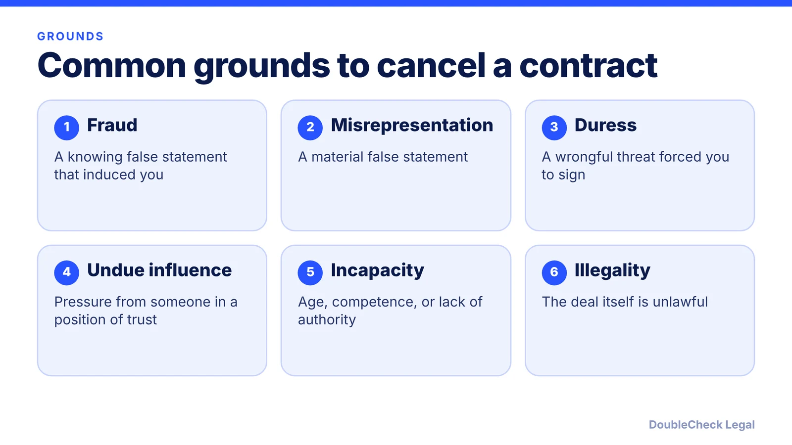
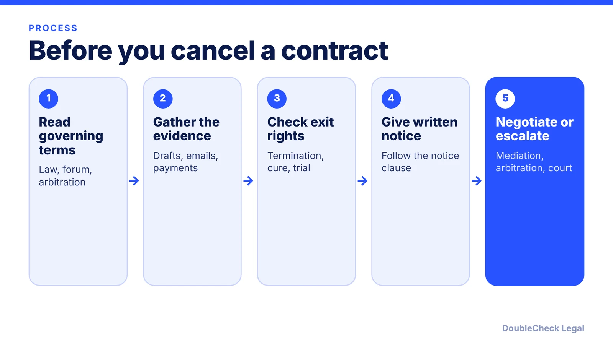

*You can only void a contract on legal grounds, and the right can be lost by delay or by acting as if the deal still stands.*

**Key takeaways:**

- A void contract is invalid from the start; a voidable one is valid until the protected party cancels it.
- Fraud, misrepresentation, duress, undue influence, incapacity, mistake and illegality are the usual grounds.
- A bad bargain is not a ground, and stopping performance without one can expose you to a breach claim.
- Delay and conduct that affirms the deal (ratification) can cost you the right to cancel.

## 1. The quick answer

**Quick answer:** To void or cancel a contract you need a legal reason, not just a bad deal. A void contract is invalid from the start (for example, an illegal purpose); a voidable contract is valid until the protected party chooses to cancel it, usually because of fraud, misrepresentation, duress, undue influence, incapacity or a serious mistake. If you have no such ground, your realistic options are the contract's own exit rights, a negotiated cancellation, or an amendment. Stopping performance without legal grounds can expose you to a breach claim. Rules and deadlines vary by state, so this guide covers the grounds and limits to understand before you act.

## 2. Void vs. voidable vs. unenforceable

These three words get mixed up, and the difference decides what you can do.

- **Void:** invalid from the start. Typical causes are an unlawful purpose, lack of capacity, lack of consideration, uncertain essential terms, public policy violations or initial impossibility. A void agreement generally cannot support a breach claim.
- **Voidable:** valid and enforceable until the party with the right to cancel acts. A voidable contract remains valid and enforceable until that party chooses to void it. Cornell Law School's Legal Information Institute describes it as valid unless rejected by a party with a legally protected option, with a minor as the classic example, since state law may let a minor affirm or reject contract promises.
- **Unenforceable:** a contract that may have been properly formed but cannot be enforced as presented, such as when a required writing is missing.

Two things are not grounds on their own. A bad bargain is not a voidable contract (do not treat a poor bargain as void). And later events such as breach, termination or discharge do not necessarily make the agreement void either. If you want to end a valid contract because the other side broke it, see [how to terminate a contract early](/blog/how-to-terminate-a-contract-early-termination-clause/) and [breach of contract remedies](/blog/breach-of-contract-remedies-what-you-can-recover-small-business/).

Whether the contract was formed properly in the first place is a separate question; see [what makes a contract legally binding](/blog/what-makes-a-contract-legally-binding/).

## 3. Grounds that can make a contract voidable or void

The list below covers the grounds commonly recognized. Each has legal requirements that vary by state, so a label alone does not win a case.

- **Misrepresentation or fraud.** A material false statement that induced you to sign may make the agreement voidable if the legal requirements are met. Keep the emails, decks and messages where the statement was made.
- **Duress or coercion.** You signed because of an improper threat. Evidence of timing and communications matters.
- **Undue influence.** Pressure that overcomes free choice, often in relationships of trust.
- **Incapacity.** Age, mental competence, intoxication or lack of authority to sign for a company. In many US situations a minor's agreement is voidable rather than automatically void (see Cornell LII). For a business, confirm the signer actually had authority.
- **Mistake.** Mutual or fundamental mistake can count. Details vary, and ordinary carelessness (misreading a price) is rarely enough.
- **Unconscionable terms.** Courts generally use this ground sparingly.
- **Illegality.** An agreement to do something unlawful may be both illegal and void.

Also look at the formalities: a required signature or writing, and valid e-signatures. See [electronic signatures under the ESIGN Act](/blog/electronic-signatures-esign-act-contracts/). If part of the contract is invalid, a severability clause and your jurisdiction decide whether the rest survives.

## 4. Limits: ratification, delay and cooling-off rights

The right to cancel a voidable contract is not permanent.

- **Ratification.** A voidable contract can become fully valid if the party who could void it knowingly affirms it, expressly or by conduct, so conduct that affirms the agreement may prevent you from avoiding it. Practical example: discovering a misstatement, then continuing to accept deliveries and pay without objection.
- **Delay.** Act promptly after you discover the issue, because delay may waive the right to void and some jurisdictions set time limits. Check current statutes, court rules and contract terms for time limits. See [statute of limitations for breach of contract by state](/blog/statute-of-limitations-breach-of-contract-by-state-small-business/) for the related deadline for lawsuits.
- **Void contracts cannot be revived.** Later approval or partial performance generally does not make a void agreement valid; the parties can instead sign a new lawful contract.
- **Money already exchanged.** Restitution aims to prevent unjust enrichment, not to give you expected profits.

**No general three-day right to cancel.** Nolo says there is no general right to cancel all contracts within three days; it applies only to certain contracts under specific laws, such as certain door-to-door and off-premises sales and some state-regulated contracts, and generally not to online, mail or phone sales. The FTC Cooling-Off Rule (16 CFR Part 429) requires sellers to tell buyers they can cancel within three business days for covered door-to-door sales. These rules are mostly consumer rules, so a business-to-business agreement usually will not have one unless the contract or another law provides it.

Check the contract itself for a better path: termination for convenience, a cure period, a trial period, or a non-renewal window. See [auto-renewal clauses in business contracts](/blog/auto-renewal-clauses-business-contracts/) and the [FTC click-to-cancel rules for SaaS](/blog/ftc-click-to-cancel-subscription-rules-saas/).

## 5. Steps to take before you try to cancel

A sensible order of operations:

A few details on each:

1. **Governing terms.** Look for choice-of-law, venue and [arbitration clauses](/blog/arbitration-clause-explained-small-business-contracts-pros-cons/). They decide where a dispute goes.
2. **Evidence.** Collect drafts, signed copies, emails, payment records and proof of who signed and with what authority.
3. **Exit rights.** A contractual exit is usually cleaner than arguing the contract is void.
4. **Notice.** Send notice by the method the contract specifies, state the ground factually, and avoid admissions you do not need to make.
5. **Alternatives.** Negotiating a mutual release or [amending the contract instead of replacing it](/blog/contract-amendment-vs-new-contract-how-to-change-a-signed-agreement/) is often faster than a fight. Note whether the contract can be [assigned or transferred](/blog/assignment-clause-explained-can-your-contract-be-transferred/) to another party as a way out.

Also consider whether force majeure or another excuse applies; see [force majeure clauses explained](/blog/force-majeure-clause-explained/).

## 6. Do it yourself, check with AI, or get an attorney

Many small disputes end with a polite written request and a negotiated cancellation. AI tools can help you organize the timeline, list candidate grounds and draft a notice, but the legal conclusion (is this fraud, is it too late, who owns the claim) needs verification; see [how to verify an AI-generated legal document](/blog/verify-ai-generated-legal-document/) and [what to check in AI contract review](/blog/ai-contract-review-what-to-check-before-signing/).

Get an attorney to review before you send a cancellation or stop performing when:

- the contract is large, long-term or has a termination fee;
- you are alleging fraud or misrepresentation;
- the other side is likely to claim breach or sue for damages;
- there is an arbitration clause, personal guarantee or exclusivity;
- you have already paid, performed or kept using the product, which can raise ratification questions.

Not sure how to pick? See [how to choose a good lawyer](/blog/how-to-choose-good-lawyer/) and [when to hire a lawyer for your small business](/blog/when-to-hire-lawyer-small-business/).

## Where DoubleCheck fits

[DoubleCheck](https://www.contactdoublecheck.com) helps businesses and founders start legal work with AI, verify it, and, when professional advice is warranted, connect with an independent attorney, including for immigration questions. Attorney availability and practice areas vary. Attorneys on DoubleCheck are independent professionals; an attorney-client relationship forms only if an attorney accepts your engagement.

**Sources:** [Cornell LII, Voidable](https://www.law.cornell.edu/wex/voidable); [Nolo, Can I Cancel a Contract Within Three Days of Signing It?](https://www.nolo.com/legal-encyclopedia/question-cancel-contract-three-days-28073.html); [FTC, Cooling-Off Rule, 16 CFR Part 429](https://www.ftc.gov/legal-library/browse/rules/cooling-period-sales-made-home-or-other-locations).

## FAQ

**What is the difference between a void and a voidable contract?**

A void contract is invalid from the start, for example because its purpose is illegal. A voidable contract is valid until the party with the right to cancel it chooses to do so (Cornell LII). Examples of voidable contracts include those signed because of fraud, duress or, in many cases, by a minor.

**Can I cancel a business contract within three days of signing?**

Generally no. Nolo says there is no general three-day right to cancel; it applies only to specific contracts, such as certain door-to-door or off-premises consumer sales and some state-regulated contracts. Check the contract for its own cancellation or termination rights.

**Can I cancel a contract just because it is a bad deal?**

No. A poor bargain is not a legal ground to treat a contract as void, and stopping performance without legal grounds can expose you to a breach claim. Look for a contractual exit right or negotiate a cancellation instead.

**How long do I have to void a voidable contract?**

It depends on your state and the ground. Act promptly after discovering the problem, because delay may waive the right, and some jurisdictions impose time limits. Check current statutes, court rules and contract terms for the applicable period.

**What is ratification of a contract?**

Ratification means knowingly affirming a voidable contract, expressly or through conduct, which can make it fully valid (see Cornell LII on voidable contracts). Continuing to perform or accept benefits after you learn of the problem can raise this issue, so ask an attorney before you keep performing.

---

*General information only. This article is not legal, tax, investment, or accounting advice.*
