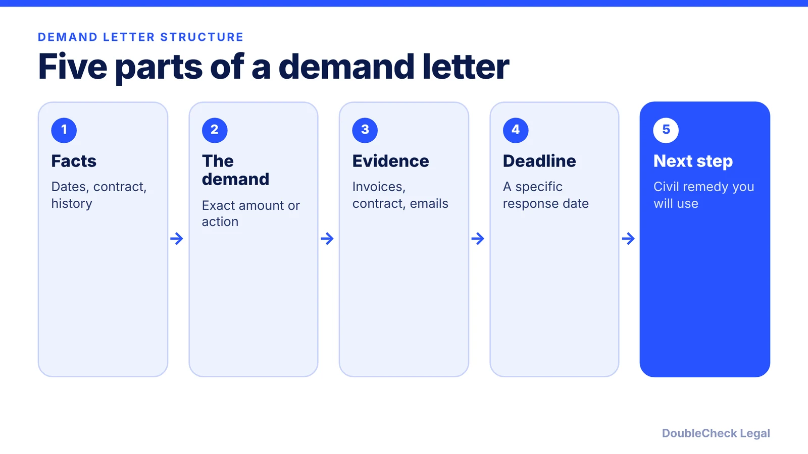
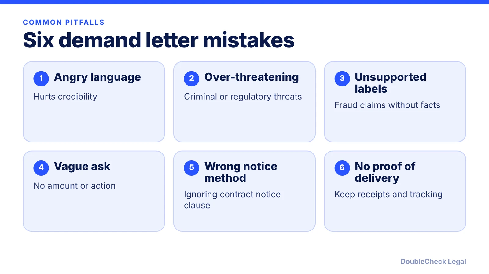

*A good demand letter is short, factual, and specific. It gives the other side a clear way to say yes.*

**Key takeaways:**

- Include facts, a specific demand, supporting evidence, a deadline, and the civil next step, per LegalZoom.
- Keep it factual and polite; emotional language and over-threatening hurt credibility, per Terms.law.
- Follow your contract's notice clause and send by a method you can prove.
- Avoid criminal, immigration, tax, or regulatory threats as leverage; it can create legal risk.

## 1. The quick answer

**Quick answer:** A demand letter is a written request, sent before a lawsuit, that states the facts, what you want, a deadline, and what you will do next if the matter is not resolved. Per LegalZoom, keep it factual, specific, polite, and short ("shorter is better"), attach your evidence, and send it in a way you can prove, such as certified mail with return receipt. Avoid threats and anything that could look like pressure beyond your civil remedies.

## 2. What to include

Per [LegalZoom](https://legalzoom.com/articles/the-dos-and-donts-of-writing-a-demand-letter), include:

- **Facts:** dates, the written agreement or contract, and a brief history of the dispute.
- **The demand:** a specific dollar amount if money is owed, or the exact actions you want, with receipts, invoices, or other support attached. Say whether you would accept a lower settlement.
- **A deadline:** a specific date to respond.
- **Consequences:** the next step if unresolved, such as filing in small claims court.

[Terms.law](https://terms.law/2025/10/18/common-mistakes-in-demand-letters-that-kill-your-leverage/) adds structure: identify the parties, state what was agreed, describe each side's actions in chronological order, and state concrete harm. If you want money, give the total and its breakdown (for example price paid, replacement vendor cost, lost business) and say whether a payment plan is acceptable. A letter that does not state the ask is a complaint, not a demand.

For deadlines, Terms.law suggests about 7 to 10 days for disputes under $5,000, 14 to 21 days for $5,000 to $50,000, and 21 to 30 days above $50,000. Some statutes set their own minimum, so check any required notice period.

## 3. Mistakes that cost you leverage

Terms.law and LegalZoom point to the same pitfalls:

Threats deserve extra care. Terms.law says using criminal, immigration, tax, or regulatory consequences as leverage for payment is risky, and describes California's Flatley v. Mauro, where the California Supreme Court held that a demand tying a confidential settlement to threats of criminal reports and media exposure was extortion as a matter of law. It also notes California Rule of Professional Conduct 3.10 limits lawyers from threatening criminal, administrative, or disciplinary charges to gain advantage in a civil dispute. Stick to civil remedies you are actually prepared to use. Rules differ by state.

Also check your contract's notice clause. Terms.law says many contracts specify method, address, and addressee, and that an email to a project manager often does not qualify. Follow the clause, then send a courtesy copy by email. Do not post the letter publicly or send it to the recipient's customers or partners.

## 4. Sending it and what comes next

**Send it provably.** LegalZoom recommends certified mail with return receipt. Terms.law suggests at least one trackable method plus an emailed PDF, and keeping tracking numbers and receipts in one folder.

**Keep it to one formal demand.** Terms.law says one formal demand, plus a follow-up only if delivery is in doubt, is typically enough. Leave a face-saving path to compliance, such as an invitation to discuss payment.

**Know when to bring a lawyer.** Terms.law says that for disputes over about $25,000 or complex issues, a lawyer's letter is often worth the cost. LegalZoom suggests considering a debt collection attorney.

**If they do not respond,** the next step is often small claims for smaller amounts; see [how to collect unpaid invoices in small claims](/blog/how-to-collect-unpaid-invoices-small-claims/). If you are the one who received a letter, read [how to respond to a cease and desist letter](/blog/how-to-respond-cease-and-desist-letter/) and [what to do if your business is served a lawsuit](/blog/what-to-do-if-your-small-business-is-served-a-lawsuit/). Check your contract for notice and cure terms first, and see [contract red flags](/blog/contract-red-flags-small-business/) for clauses that change your options.

## Where DoubleCheck fits

[DoubleCheck](https://www.contactdoublecheck.com) helps businesses and founders start legal work with AI, verify it, and, when professional advice is warranted, connect with an independent attorney, including for immigration questions. Attorney availability and practice areas vary. Attorneys on DoubleCheck are independent professionals; an attorney-client relationship forms only if an attorney accepts your engagement.

**Sources:** [LegalZoom, The Do's and Don'ts of Writing a Demand Letter](https://legalzoom.com/articles/the-dos-and-donts-of-writing-a-demand-letter); [Terms.law, Common Mistakes in Demand Letters That Kill Your Leverage](https://terms.law/2025/10/18/common-mistakes-in-demand-letters-that-kill-your-leverage/).

## FAQ

**What should a demand letter include?**

Per LegalZoom: the facts and dispute history, a specific demand (dollar amount or exact actions) with supporting documents, a response deadline, and the consequence if unresolved, such as filing in small claims court.

**How long should I give the other side to respond?**

There is no universal rule. Terms.law suggests roughly 7 to 10 days under $5,000, 14 to 21 days for $5,000 to $50,000, and 21 to 30 days above $50,000, and notes some statutes set a minimum notice period. Check your contract and state law.

**Do I need a lawyer to send a demand letter?**

No. Per Terms.law, a lawyer's letter is often worth the cost for disputes over about $25,000 or complex issues, but smaller disputes are commonly handled directly. Have an attorney review it if the stakes are high.

**Can a demand letter get me in trouble?**

Yes, if it overreaches. Per Terms.law, threatening criminal, immigration, tax, or regulatory consequences to obtain payment is risky, and in Flatley v. Mauro the California Supreme Court found a demand with such threats to be extortion as a matter of law. Stick to civil remedies.

---

*General information only. This article is not legal, tax, investment, or accounting advice.*
