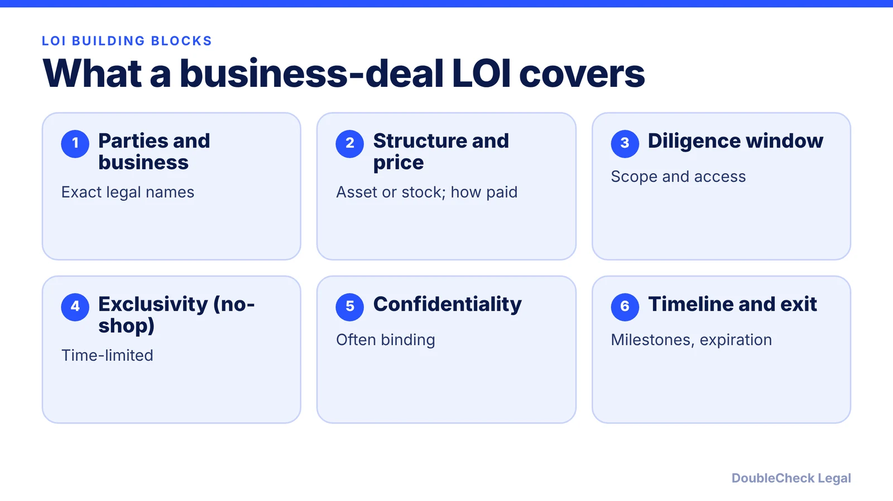
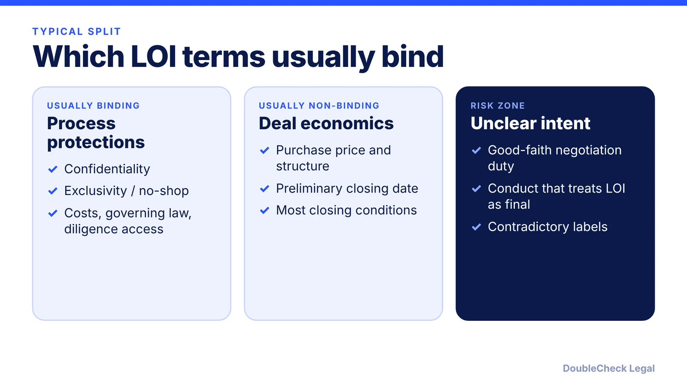

*An LOI is meant to be a handshake in writing. Make sure the parts that bind you are the parts you chose.*

**Key takeaways:**

- Most LOIs are nonbinding except a few provisions, typically confidentiality and exclusivity, per Harris Sliwoski.
- Price, structure, and most closing conditions usually stay nonbinding until the definitive agreement.
- Ambiguous labels can lead a court to treat an LOI, or parts of it, as binding.
- Separate binding and non-binding sections, and avoid acting as if the deal is final.

## 1. The quick answer

**Quick answer:** A letter of intent (LOI) records the main terms of a proposed deal before the final contract is drafted. Per Harris Sliwoski, most LOIs are nonbinding or nonbinding except for a few provisions, typically confidentiality and exclusivity. To write one, state the parties, structure, price, diligence period, and timeline, then label in plain words which sections bind you and which do not. Courts have sometimes treated ambiguous LOIs as binding, so the labels matter.

## 2. What to include

Per [Harris Sliwoski](https://harris-sliwoski.com/blog/buying-a-business-in-the-u-s-part-4-letters-of-intent-lois/), typical LOI contents include:

- Parties and a short description of the target business
- Transaction structure (asset or stock purchase)
- Purchase price, form of payment (cash, seller note, earnout, rollover equity), and any adjustment formula
- Included and excluded assets and liabilities
- Due diligence window, scope, and seller access
- Exclusivity and any break-up fee
- Confidentiality
- Closing conditions such as financing, third-party consents, or regulatory approvals
- Non-compete and non-solicit terms
- Timeline, expenses, governing law, dispute resolution, and termination or expiration

The same article warns against reusing old LOIs, which can leave wrong party names or purchase price errors, and against skipping regulatory issues such as licensing transfers, franchise consents, and landlord approvals. An incomplete term sheet can be as problematic as an overlong one.

## 3. Binding vs. non-binding terms

A hybrid structure is the most common. Per Harris Sliwoski, Heritage Law, and JD Supra:

Points to know:

- JD Supra (Texas): courts normally honor a non-binding disclaimer when it is clearly stated, but an LOI can be enforced as a contract if it has all material terms and shows clear intent to be bound. A duty to negotiate in good faith binds only if clearly defined and expressly designated as binding.
- Heritage Law: courts may enforce parts of an LOI based on communications, extensive negotiations, or performance already begun, and may find liability for walking away after prolonged talks even when the LOI says no deal is required.
- Harris Sliwoski: a "Nonbinding" title with "binding" language in the body can cause real damage.

Rules differ by state, and these sources are general. Treat the Texas guidance as one example.

## 4. Drafting tips and next steps

Drafting practices recommended by Heritage Law and JD Supra:

- Use separate, clearly labeled "Binding" and "Non-Binding" sections, and do not mix them in one paragraph.
- Add a statement that no obligation to negotiate or close exists until a definitive agreement is signed.
- Use firm words ("shall," "will") in binding clauses and "subject to definitive agreement" for the rest.
- Keep non-binding terms broad and leave room to renegotiate if due diligence finds problems.
- Specify governing law and a venue or dispute mechanism.
- Do not start performing, or act publicly as if the deal is final, before the definitive agreement is signed.
- Have an attorney review before signing, so binding terms are intentional.

AI can draft a first version and flag inconsistent labels, but a human with deal experience should check what binds you. Pair this with the [buy or sell a small business checklist](/blog/how-to-buy-or-sell-a-small-business-legal-checklist/), the [NDA guide](/blog/how-to-write-an-nda-startups/) for the confidentiality piece, [what makes a contract legally binding](/blog/what-makes-a-contract-legally-binding/), and [term sheet key terms](/blog/term-sheet-key-terms-explained/) for startup financings. See also [attorney review costs](/blog/how-much-does-a-lawyer-charge-to-review-a-contract/).

## Where DoubleCheck fits

[DoubleCheck](https://www.contactdoublecheck.com) helps businesses and founders start legal work with AI, verify it, and, when professional advice is warranted, connect with an independent attorney, including for immigration questions. Attorney availability and practice areas vary. Attorneys on DoubleCheck are independent professionals; an attorney-client relationship forms only if an attorney accepts your engagement.

**Sources:** [Harris Sliwoski, Buying a Business in the U.S., Part 4: Letters of Intent](https://harris-sliwoski.com/blog/buying-a-business-in-the-u-s-part-4-letters-of-intent-lois/); [JD Supra, Texas Letter of Intent Guide](https://www.jdsupra.com/legalnews/texas-letter-of-intent-guide-when-are-7129448/); [Heritage Law, Letters of Intent: What Should Be Binding](https://www.heritagelawwi.com/letters-of-intent-lois-what-should-be-binding).

## FAQ

**Is a letter of intent legally binding?**

It depends on the wording. Per Harris Sliwoski, most are nonbinding or nonbinding except for a few provisions. Per JD Supra (Texas), an LOI can be enforced as a contract if it has all material terms and shows clear intent to be bound.

**Which LOI provisions are usually binding?**

Per Heritage Law, typically confidentiality, exclusivity (no-shop), due diligence access, governing law, and cost allocation. Purchase price, deal structure, and preliminary closing date are typically nonbinding.

**Can I walk away after signing a nonbinding LOI?**

Often yes as to the nonbinding terms, but there can be costs. Per JD Supra, parties can generally walk away from nonbinding terms with possible reputational or commercial costs, and per Heritage Law courts may find liability for bad-faith conduct or an implied duty to negotiate in some situations. Binding exclusivity and confidentiality still apply.

**What is a no-shop (exclusivity) clause?**

A term in which the seller agrees not to solicit or negotiate with other potential buyers for a set period, per Harris Sliwoski. Sellers may ask for a deposit or other consideration in exchange, and break-up fees may apply if exclusivity is breached.

---

*General information only. This article is not legal, tax, investment, or accounting advice.*
