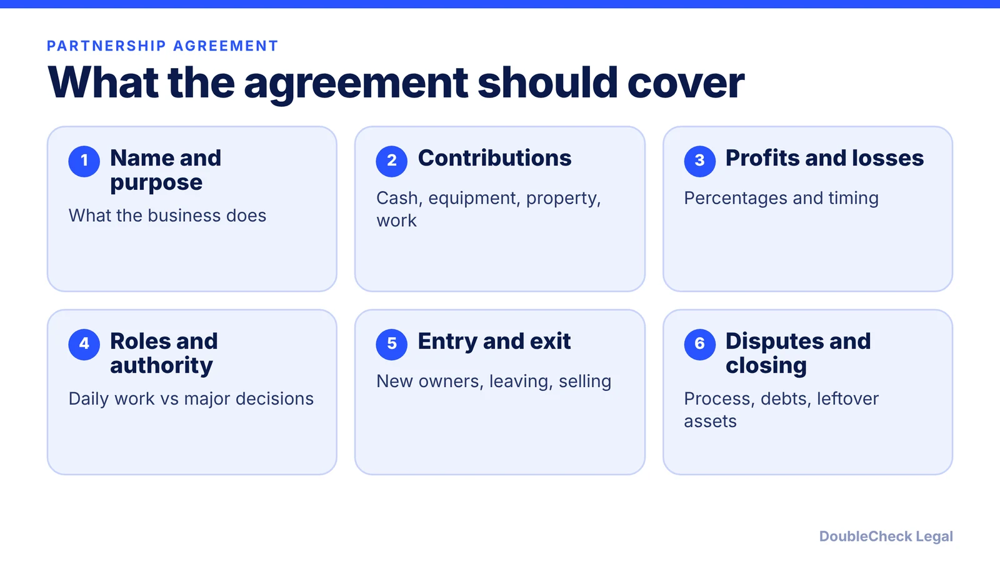
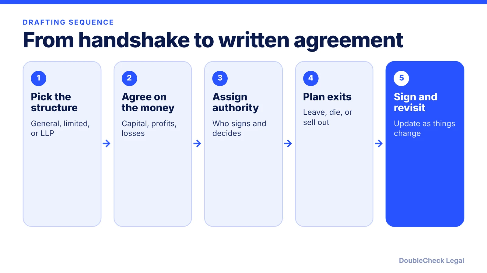

*What belongs in a business partnership agreement, and what happens under state default rules if you skip it.*

**Key takeaways:**

- A partnership can exist without a written agreement, and state law fills the gaps.
- Default rules vary by state, and partners in a general partnership generally have personal liability.
- Cover contributions, profits, authority, entry and exit, disputes, and wind-down.
- Structure choice affects liability; have an attorney review before signing.

## 1. The quick answer

**Quick answer:** A partnership agreement is a written contract among the owners of a partnership that sets who contributes what, how profits and losses are shared, who decides what, and what happens when someone leaves. A partnership can exist even without a signed document, and state law then fills the gaps. FindLaw notes that many states follow the Uniform Partnership Act or the Revised Uniform Partnership Act (RUPA), and that some default rules cannot be changed by agreement.

## 2. Why the written terms matter: the default rules

Without an agreement, state default rules apply, and they may not match what you assumed. FindLaw says state laws based on the Uniform Partnership Act or RUPA supply default rules for profit sharing, management rights, a partner's authority, and what happens when someone leaves. Common default features in many states include equal profit shares regardless of capital contributed, equal management rights, and no salary for working in the business, but the details differ by state, so check your state's statute or ask an attorney.

- **Liability:** FindLaw says partners in a general partnership generally have personal liability for the partnership's debts and obligations.
- **Departure and disputes:** without agreed exit terms, a partner's departure or a dispute can leave the business in an uncertain position, which is why the agreement should cover entry, exit, and wind-down.

A 60/40 capital split with a silent agreement can still produce a different profit split than you expected in some states, which is exactly the surprise a written agreement prevents.

## 3. What to put in it, section by section

FindLaw's list of what to include is a good starting point. A practical outline:

- **Basics:** business name, purpose, partner names, principal place of business.
- **Ownership and money:** each partner's interest, initial contributions, how additional capital is called, how profits and losses are allocated, and when distributions are paid. Consider tax distributions.
- **Management:** who runs daily operations, which decisions need a vote or written approval (for example, spending above a set dollar amount), and what approval percentage applies.
- **Banking and records:** who can access accounts and books.
- **Restrictions:** confidentiality, conflicts of interest, and outside business activities. If you want a non-compete, check your state first, since some states, including California under Bus. & Prof. Code section 16600, restrict them. See our [non-compete guide by state](/blog/non-compete-agreements-by-state-2026/).
- **Entry and exit:** how new partners join, whether a share can be transferred, a notice period for leaving, and buyout terms if a partner quits, dies, or cannot work. A [buy-sell agreement](/blog/buy-sell-agreement-small-business-partners/) can hold these terms.
- **Disputes and wind-down:** mediation or arbitration, governing law, and how debts and remaining property are handled on closing.

The same questions come up in a [co-founder agreement](/blog/co-founder-agreement-startups/) for a startup and in an [LLC operating agreement](/blog/llc-operating-agreement-with-ai/).

## 4. Choosing the structure, and when to involve an attorney

The agreement works inside a legal structure, and the structure drives personal liability. Common options include:

- **General partnership:** simplest, but personal liability for partnership debts.
- **Limited partnership:** at least one general partner has unlimited liability; limited partners are liable up to their investment. FindLaw notes it typically needs a state filing such as a certificate of limited partnership.
- **Limited liability partnership:** FindLaw says LLPs have different liability and filing rules and may need a different agreement and state filing. Some states limit them to certain licensed professions, so check yours.

Many small owners find an LLC fits better than a general partnership; compare in [LLC vs. C-corp](/blog/llc-vs-c-corp-startups/) and the [family-business LLC or partnership](/blog/retail-store-family-business-llc-or-partnership/) post.

An AI draft or a template is a fine starting point for organizing the conversation. Your state's rules, your tax situation, and your partners' specific bargain are what an attorney reviews. Consider a lawyer before signing if the partnership holds real assets, involves large capital, or partners disagree on any term. See [when to hire a lawyer](/blog/when-to-hire-lawyer-small-business/). This is general information, not legal advice.

**Related reading:** [Multi-Member LLC Taxes: Partnership Return and K-1 Explained](/blog/multi-member-llc-taxes-partnership-return-k-1-explained/); [Corporate Bylaws vs Operating Agreement: What Each Covers](/blog/corporate-bylaws-vs-operating-agreement-what-each-covers/); [Shareholder Agreement for a Small Business: What to Include](/blog/shareholder-agreement-small-business-what-to-include/)

## Where DoubleCheck fits

[DoubleCheck](https://www.contactdoublecheck.com) helps businesses and founders start legal work with AI, verify it, and, when professional advice is warranted, connect with an independent attorney, including for immigration questions. Attorney availability and practice areas vary. Attorneys on DoubleCheck are independent professionals; an attorney-client relationship forms only if an attorney accepts your engagement.

**Sources:** [FindLaw: How to write a partnership agreement](https://www.findlaw.com/smallbusiness/business-contracts-forms/how-to-write-a-partnership-agreement.html). State partnership statutes (your state's Uniform Partnership Act or RUPA version) control the default rules; confirm them with your Secretary of State or an attorney.

## FAQ

**Do I need a written partnership agreement?**

A partnership can form through your actions without a signed document, per FindLaw, and then state default rules apply. A written agreement lets you set your own terms, within limits state law imposes.

**What happens if partners don't have an agreement?**

Under many states' versions of the Uniform Partnership Act, default rules cover profit sharing, management rights, and what happens when someone leaves, and they may not match what the partners assumed. Details vary by state, so check your state's statute.

**Are partners personally liable?**

In a general partnership, partners generally have personal liability for the partnership''s debts, according to FindLaw. Limited partnerships and LLPs offer different protection, and rules vary by state.

**Can I use an AI-generated partnership agreement?**

It can help you organize terms, but verify it against your state's law. Consider an independent attorney to review it, especially for liability, buyout, and tax terms.

---

*General information only. This article is not legal, tax, investment, or accounting advice.*
