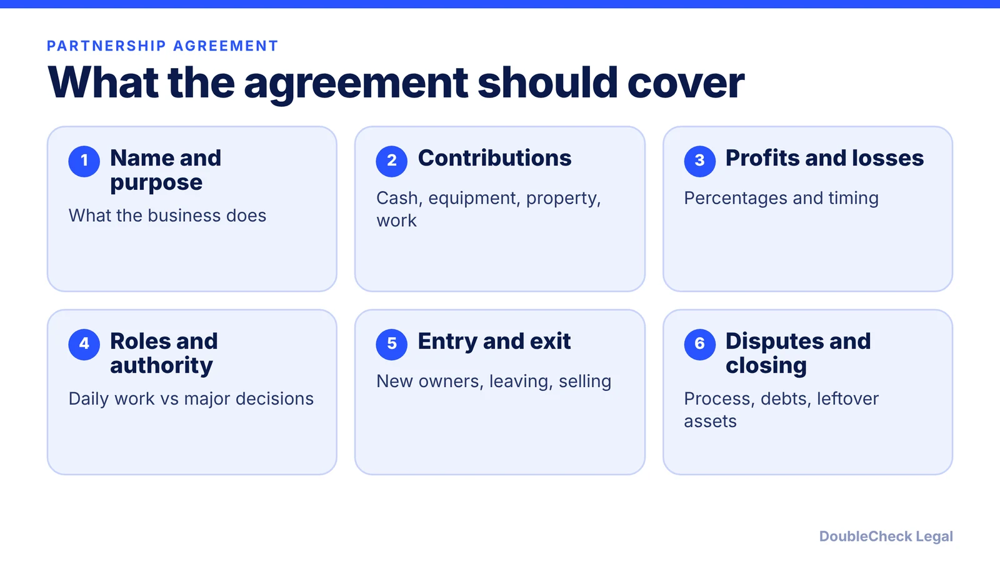
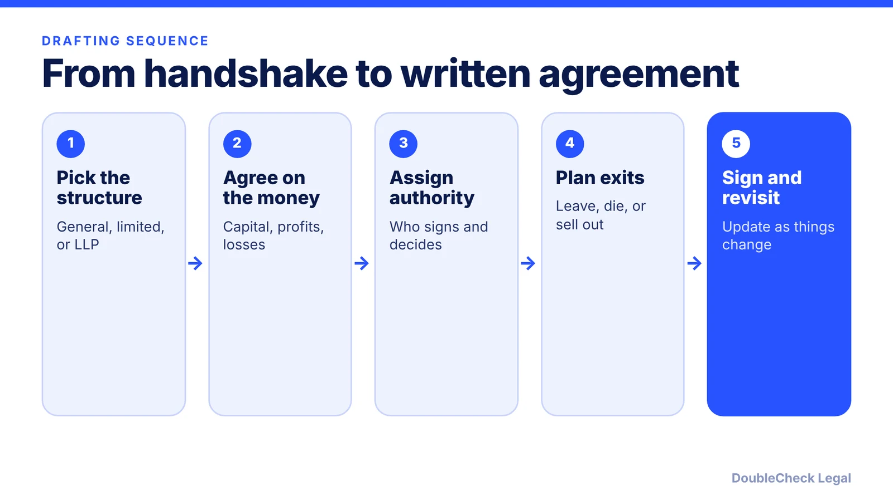

*What belongs in a business partnership agreement, and what happens under state default rules if you skip it.*

**Key takeaways:**

- A partnership can exist without a written agreement, and state law fills the gaps.
- Common defaults: equal profit shares, one vote each, no salary, and personal liability in a general partnership.
- Cover contributions, profits, authority, entry and exit, disputes, and wind-down.
- Structure choice affects liability; have an attorney review before signing.

## 1. The quick answer

**Quick answer:** A partnership agreement is a written contract among the owners of a partnership that sets who contributes what, how profits and losses are shared, who decides what, and what happens when someone leaves. A partnership can exist even without a signed document, and state law then fills the gaps. FindLaw notes that many states follow the Uniform Partnership Act or the Revised Uniform Partnership Act (RUPA), and that some default rules cannot be changed by agreement.

## 2. Why the written terms matter: the default rules

Without an agreement, state default rules apply, and they may not match what you assumed. As summarized by LexPlug's outline of the RUPA framework and by Bay Legal for California:

- **Profits:** shared equally by default, regardless of how much capital each partner put in. Losses follow profits.
- **Votes:** one partner, one vote. Ordinary decisions by majority; extraordinary decisions and amendments to the agreement need unanimous consent.
- **Pay:** no default right to a salary for working in the business.
- **Liability:** in a general partnership, Bay Legal says partners have unlimited personal liability and are jointly and severally liable, including for another partner's misconduct.
- **Departure:** Bay Legal says that in California any partner may dissociate at any time, and without an agreement, disputes often end in court-supervised dissolution, which it calls slow and expensive.

These are descriptions from secondary sources, and each state's statute differs in details. A 60/40 capital split with a silent agreement can still mean a 50/50 profit split, which is exactly the surprise a written agreement prevents.

## 3. What to put in it, section by section

FindLaw's minimum list and Bay Legal's longer one overlap heavily. A practical outline:

- **Basics:** business name, purpose, partner names, principal place of business.
- **Ownership and money:** each partner's interest, initial contributions, how additional capital is called, how profits and losses are allocated, and when distributions are paid. Consider tax distributions.
- **Management:** who runs daily operations, which decisions need a vote or written approval (for example, spending above a set dollar amount), and what approval percentage applies.
- **Banking and records:** who can access accounts and books.
- **Restrictions:** confidentiality, conflicts of interest, and outside business activities. If you want a non-compete, check your state first: Bay Legal notes that in California post-departure non-competes are generally unenforceable under Bus. & Prof. Code section 16600, with a possible exception when a partner sells their entire interest. See our [non-compete guide by state](/blog/non-compete-agreements-by-state-2026/).
- **Entry and exit:** how new partners join, whether a share can be transferred, a notice period for leaving, and buyout terms if a partner quits, dies, or cannot work. A [buy-sell agreement](/blog/buy-sell-agreement-small-business-partners/) can hold these terms.
- **Disputes and wind-down:** mediation or arbitration, governing law, and how debts and remaining property are handled on closing.

The same questions come up in a [co-founder agreement](/blog/co-founder-agreement-startups/) for a startup and in an [LLC operating agreement](/blog/llc-operating-agreement-with-ai/).

## 4. Choosing the structure, and when to involve an attorney

The agreement works inside a legal structure, and the structure drives personal liability. Bay Legal describes the California options:

- **General partnership:** simplest, but personal liability for partnership debts.
- **Limited partnership:** at least one general partner has unlimited liability; limited partners are liable up to their investment. FindLaw notes it typically needs a state filing such as a certificate of limited partnership.
- **Limited liability partnership:** Bay Legal says California limits these to certain licensed professions. Other states differ.

Many small owners find an LLC fits better than a general partnership; compare in [LLC vs. C-corp](/blog/llc-vs-c-corp-startups/) and the [family-business LLC or partnership](/blog/retail-store-family-business-llc-or-partnership/) post.

An AI draft or a template is a fine starting point for organizing the conversation. Your state's rules, your tax situation, and your partners' specific bargain are what an attorney reviews. Consider a lawyer before signing if the partnership holds real assets, involves large capital, or partners disagree on any term. See [when to hire a lawyer](/blog/when-to-hire-lawyer-small-business/). This is general information, not legal advice.

## Where DoubleCheck fits

[DoubleCheck](https://www.contactdoublecheck.com) helps businesses and founders start legal work with AI, verify it, and, when professional advice is warranted, connect with an independent attorney, including for immigration questions. Attorney availability and practice areas vary. Attorneys on DoubleCheck are independent professionals; an attorney-client relationship forms only if an attorney accepts your engagement.

**Sources:** [FindLaw: How to write a partnership agreement](https://www.findlaw.com/smallbusiness/business-contracts-forms/how-to-write-a-partnership-agreement.html); [LexPlug: Management rights and profit sharing](https://www.lexplug.com/outlines/business-associations/management-rights-and-profit-sharing); [Bay Legal](https://baylegal.com/what-is-a-partnership-agreement-and-why-does-every-california-business-partnership-need-one/).

## FAQ

**Do I need a written partnership agreement?**

A partnership can form through your actions without a signed document, per FindLaw, and then state default rules apply. A written agreement lets you set your own terms, within limits state law imposes.

**What happens if partners don't have an agreement?**

Per LexPlug's RUPA outline, profits are shared equally and each partner gets one vote. Bay Legal adds that disputes may end in court-supervised dissolution in California. Details vary by state.

**Are partners personally liable?**

In a general partnership, yes, according to FindLaw and Bay Legal. Limited partnerships and LLPs offer different protection, and rules vary by state.

**Can I use an AI-generated partnership agreement?**

It can help you organize terms, but verify it against your state's law. Consider an independent attorney to review it, especially for liability, buyout, and tax terms.

---

*General information only. This article is not legal, tax, investment, or accounting advice.*
