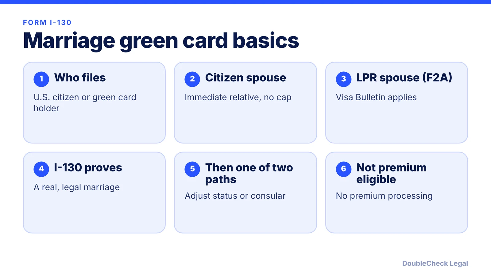
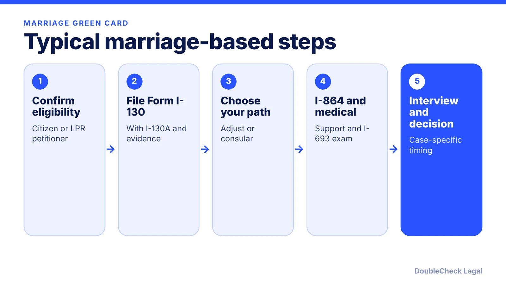

*How the I-130 marriage-based green card process works, as of November 2026.*

**Key takeaways:**

- The I-130 proves the marriage; it is not a green card, and the next step depends on whether your spouse is in the U.S. or abroad.
- Per USCIS, spouses of U.S. citizens are immediate relatives with no visa-number wait; spouses of green card holders follow the Visa Bulletin (F2A).
- Adjustment of status (Form I-485) is for spouses in the U.S. after a lawful admission; consular processing is for spouses abroad.
- Expect to document a real shared life and file Form I-864; processing times vary by office, so check USCIS data.

## 1. The quick answer

**Quick answer:** Form I-130, Petition for Alien Relative, is how a U.S. citizen or green card holder starts a green card case for a spouse. It proves the marriage is real and legal; it does not itself give status. Per [USCIS](https://uscis.gov/green-card/green-card-eligibility/green-card-immediate-relatives-us-citizen), the spouse of a U.S. citizen is an immediate relative, and immigrant visas for immediate relatives are unlimited, so there is no visa-number wait. A green card holder's spouse falls into a preference category (F2A) that follows the Visa Bulletin. Fees in 2026 were reported as $625 online or $675 on paper (per VisaServe and U.S. Immigration Advisor); confirm on the USCIS fee page before filing.

## 2. Who can petition and which category applies

**U.S. citizen petitioner.** Per USCIS, the spouse of a U.S. citizen, an unmarried child under 21, and a parent of a citizen who is 21 or older are immediate relatives. For a spouse, the family relationship must still exist when Form I-485 is filed and when USCIS decides the case.

**Green card holder petitioner.** Per [U.S. Immigration Advisor](https://www.usimmigrationadvisor.com/i-130-guide), permanent residents can petition for a spouse, but that spouse is in the F2A category rather than the immediate relative group. Per [VisaServe](https://visaserve.com/marriage-green-card-in-2026-process-timeline-and-cost/), a spouse of a green card holder can file concurrently only once the F2A date in the Visa Bulletin allows it.

F2A dates have moved a lot. Per [Immigration Help LA](https://immigrationhelpla.com/blog/f2a-current-may-2026-visa-bulletin/), the May 2026 Dates for Filing chart showed F2A as current while the Final Action Date was August 2024, and the page warned this could change. Another page, [Beyond Border Global](https://www.beyondborderglobal.com/resources/form-i-130-processing-times), cites different dates for September 2026, so the sources do not agree. Read the current month's bulletin on travel.state.gov, and see [the Visa Bulletin explained](/blog/visa-bulletin-explained-priority-dates-eb-categories/).

**Other rules to keep in mind.** Per Beyond Border Global, fee waivers are not available for Form I-130 and premium processing does not apply to it. Per VisaServe, online filing lowers the fee by $50 ($625 versus $675).

If you are a U.S. citizen and not sure which route fits your spouse, a short consult with an immigration attorney can save a rejected filing.

## 3. I-130 plus adjustment of status, or consular processing

The I-130 is step one. What happens next depends mostly on where your spouse is. Per [VisaServe](https://visaserve.com/marriage-green-card-in-2026-process-timeline-and-cost/):

- **Adjustment of status** is for a spouse physically in the U.S. after a lawful admission. The spouse files Form I-485, usually attends a biometrics appointment and an interview, and needs a medical exam on Form I-693. If the petitioner is a U.S. citizen, the I-485 can be filed together with the I-130.
- **Consular processing** is for a spouse abroad. After I-130 approval, the National Visa Center collects civil documents and the DS-260, and the case ends with an immigrant visa interview at a U.S. embassy or consulate.

Per USCIS, adjustment requires that the applicant was inspected and admitted or paroled (with limited exceptions), is physically present in the U.S., has no bar to adjustment, and is admissible or eligible for a waiver. USCIS also says the decision is discretionary. See [adjustment of status vs. consular processing](/blog/adjustment-of-status-vs-consular-processing-which-to-choose/), [the I-485 guide](/blog/i-485-adjustment-of-status-guide/), and [advance parole and EAD while an I-485 is pending](/blog/advance-parole-and-ead-while-i-485-pending/) before you plan travel or work.

**Processing time.** Per Beyond Border Global, USCIS does not publish one national I-130 time; it varies by category and service office, so use the USCIS processing times tool with the details from your receipt notice. Sources quote very different figures, for example U.S. Immigration Advisor lists 10 to 14 months for immediate relatives in one place and 12 to 18 months to several years in another. Treat any number as a snapshot, not a promise. For the full sequence, see [the marriage-based green card timeline](/blog/marriage-based-green-card-process-timeline/).

## 4. Documents, I-864, and proving a real marriage

**Evidence of a bona fide marriage.** Officers look for proof of a shared life. Per [U.S. Immigration Advisor](https://www.usimmigrationadvisor.com/i-130-guide), typical items include:

- An official civil marriage certificate (religious certificates alone are often not enough).
- Divorce decrees, annulments or death certificates for any prior marriage of either spouse.
- Joint bank statements, joint tax returns, and insurance naming the spouse.
- A joint lease or mortgage and utility bills in both names.
- Two to three sworn letters from people who know the couple, and dated photos, travel records and communications.
- Form I-130A, completed by the foreign spouse, plus passport-style photos.

**Form I-864, Affidavit of Support.** Per USCIS, Form I-864 or I-864EZ goes with the I-485. Per [a law firm summary dated June 18, 2026](https://lawofficeimmigration.com/blog/i-864-affidavit-of-support-income-requirements-2026.html), the sponsor generally must show income at 125% of the federal poverty guideline, which for 2026 in the 48 contiguous states is $24,650 for a household of two. The page adds that a joint sponsor can fill a shortfall, that the obligation is enforceable under INA 213A, and that divorce does not end it. See [the I-864 guide](/blog/affidavit-of-support-i-864-sponsor-requirements/).

**Fees (reported 2026).** Per VisaServe, the I-130 is $675 by mail or $625 online and the I-485 is $1,440 with biometrics. Fees change, so check USCIS first.

**Handle it yourself, or get an attorney to look?** A simple case with a U.S. citizen petitioner, a lawful entry and clean records can be organized by the couple. Get a lawyer to verify the package if any of these apply: past overstays or unlawful presence (see [the 3 and 10-year bars](/blog/immigration-overstay-unlawful-presence-3-10-year-bars-explained/)), a criminal record, prior marriages, a spouse who entered without inspection, or an income shortfall. Never submit false documents or misstate facts. For cost and finding counsel, see [immigration lawyer fees](/blog/immigration-lawyer-fees-flat-fee-vs-hourly/) and, for the interview, [what to expect](/blog/green-card-interview-what-to-expect/).

## Where DoubleCheck fits

[DoubleCheck](https://www.contactdoublecheck.com) helps businesses and founders start legal work with AI, verify it, and, when professional advice is warranted, connect with an independent attorney, including for immigration questions. Attorney availability and practice areas vary. Attorneys on DoubleCheck are independent professionals; an attorney-client relationship forms only if an attorney accepts your engagement.

**Sources:** [USCIS: green card for immediate relatives of a U.S. citizen](https://uscis.gov/green-card/green-card-eligibility/green-card-immediate-relatives-us-citizen); [U.S. Immigration Advisor](https://www.usimmigrationadvisor.com/i-130-guide); [VisaServe](https://visaserve.com/marriage-green-card-in-2026-process-timeline-and-cost/); [Beyond Border Global on I-130](https://www.beyondborderglobal.com/resources/form-i-130) and [processing times](https://www.beyondborderglobal.com/resources/form-i-130-processing-times); [Immigration Help LA on F2A](https://immigrationhelpla.com/blog/f2a-current-may-2026-visa-bulletin/); [law firm summary on I-864 thresholds](https://lawofficeimmigration.com/blog/i-864-affidavit-of-support-income-requirements-2026.html). The USCIS I-130 and fee pages were not fetched, so fee figures are attributed to secondary sources.

## FAQ

**Who can file Form I-130 for a spouse?**

A U.S. citizen or a green card holder. Per USCIS, the spouse of a U.S. citizen is an immediate relative with no visa wait; per U.S. Immigration Advisor, a green card holder spouse is in the F2A category, which follows the Visa Bulletin.

**What is the difference between adjustment of status and consular processing?**

Per VisaServe, adjustment (Form I-485) is for a spouse physically in the U.S. after a lawful admission, while consular processing is for a spouse abroad and ends with an immigrant visa interview at a U.S. embassy or consulate.

**What proves a bona fide marriage?**

Per U.S. Immigration Advisor, a civil marriage certificate, records of prior marriage endings, joint financial and housing documents, sworn letters from people who know the couple, and dated photos and communications. Officers look for evidence of a shared life.

**How long does an I-130 for a spouse take?**

It varies. Per Beyond Border Global, USCIS does not publish one national time and it differs by category and office, so use the USCIS processing times tool with your receipt notice. Published estimates from other sources differ widely, so treat them as snapshots.

---

*General information only. This article is not legal, tax, investment, or accounting advice.*
