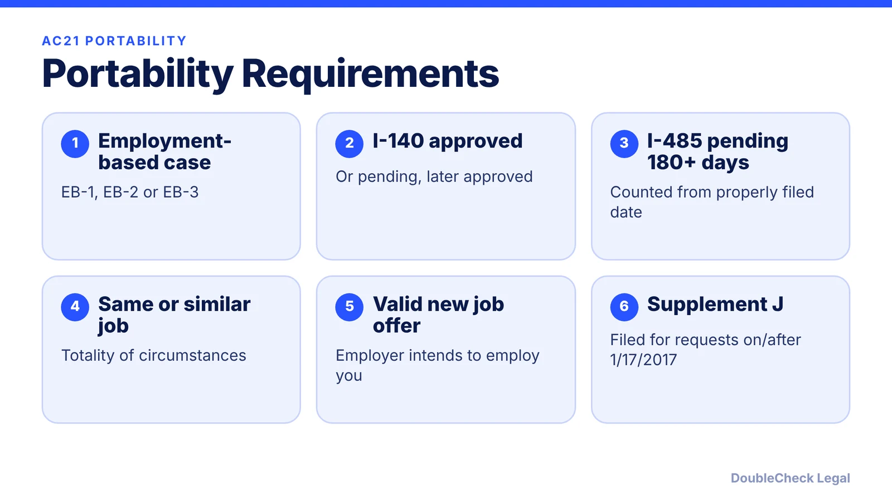
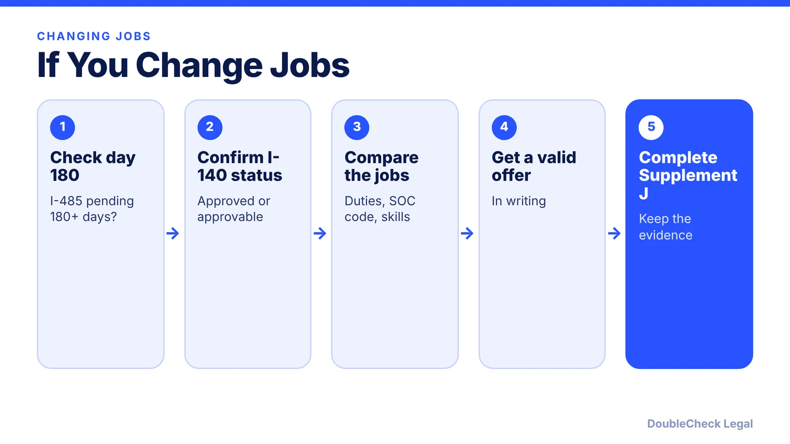

*Thinking of leaving your employer mid-green-card? AC21 portability can protect your case, if you meet the rules first.*

**Key takeaways:**

- AC21 portability needs an I-485 pending 180+ days and an approved (or later-approved) I-140.
- The new job must be in the same or a similar occupational classification.
- Port requests are made on Form I-485 Supplement J.
- A move before day 180 can put the case at risk if the old employer withdraws the I-140.

## 1. The quick answer

**Quick answer:** Under AC21 job portability (INA 204(j)), certain employment-based adjustment applicants in the first, second or third preference categories can move to a new job, with the same or a different employer, without losing their green card case. Per the USCIS Policy Manual, the Form I-485 must have been pending at least 180 days, there must be an approved (or later-approved) I-140, and the new job must be in the same or a similar occupational classification. The request is made on Form I-485 Supplement J.

## 2. The 180-day rule and the I-140

USCIS's Policy Manual (Volume 7, Part E, Chapter 5) sets the core rules:

- **I-485 pending 180+ days.** The I-485 must have been pending at least 180 days when USCIS receives the port request. Counting starts on the properly filed date and includes every calendar day. Visa availability does not need to be continuous. (Beyond Border Global describes the clock as running from the receipt date on the I-797C, which is the same date for a properly filed case; check your notice.)
- **Approved I-140.** An approved I-140, or a pending one that is later approved, must support the case.
- **After 180 days, the original job offer matters less.** If the I-140 is later withdrawn or the business terminates, USCIS says an approved I-140 pending 180+ days, or an I-485 pending 180+ days, may remain valid for priority date retention, and porting is possible if all requirements are met, unless USCIS revokes on substantive grounds. If both the I-140 approval and the I-485 are under 180 days, approval is automatically revoked.
- **Not for everyone.** The manual says extraordinary ability (EB-1A) and national interest waiver applicants do not need to port and are not eligible for AC21 portability, though they may change employers.

Background: our [I-485 guide](/blog/i-485-adjustment-of-status-guide/), [PERM](/blog/perm-labor-certification-green-card-process/), and the [visa bulletin](/blog/visa-bulletin-explained-priority-dates-eb-categories/).

## 3. Same or similar occupation, and Supplement J

USCIS looks at the totality of circumstances. Factors include the SOC code, duties, titles, skills, education, licenses and wages. SOC codes are not determinative: matching six-digit codes are generally favorable, and codes within the same broad occupation are generally treated as similar unless the evidence shows otherwise. Career progression and a wage difference are considered, but a wage difference alone is not decisive. Beyond Border Global gives examples: a software engineer moving to a senior software engineer role likely qualifies, while a move to a primarily managerial role needs analysis, and a research scientist to marketing director does not qualify.

**Supplement J.** The applicant completes their sections and the new employer completes the job sections. Attach the I-797 showing the I-485 receipt date and the I-797 showing the I-140 approval or pending status (USCIS). Per RN Law Group, you do not have to file it every time you change jobs, but USCIS often asks before approval, often through an RFE, so keep offer letters, job descriptions and pay records ready. If USCIS finds the new job is not similar, it denies the Supplement J and typically the adjustment application (USCIS).

## 4. What happens if you change jobs

**Before 180 days.** Beyond Border Global warns that a job change before day 180 can lead the original employer to withdraw the I-140, which jeopardizes the pending I-485. Wait, or get legal advice first.

**After 180 days, in the same or similar role.** Portability protects the case, subject to the rules above. Keep any gap short: RN Law Group notes the 60-day grace period applies to H-1B status, not the pending I-485, and employment gaps are risky because the I-485 depends on a valid job offer when USCIS decides. The new offer should be a permanent, full-time position, according to Beyond Border Global; temporary roles, consulting arrangements and unconverted contract-to-hire jobs do not satisfy it.

**Different field.** If the new job is not similar, you may need a new I-140 and a new I-485 (USCIS). **Self-employment** can qualify if the business and job offer are genuine (USCIS), which is relevant for founders.

**Work and status.** Portability is separate from your work permit and travel documents; see [advance parole and EAD while I-485 is pending](/blog/advance-parole-and-ead-while-i-485-pending/). If you are still on H-1B, see [H-1B transfers](/blog/h-1b-transfer-change-of-employer-portability/) and [layoff grace periods](/blog/h-1b-layoff-60-day-grace-period/).

## Where DoubleCheck fits

[DoubleCheck](https://www.contactdoublecheck.com) helps businesses and founders start legal work with AI, verify it, and, when professional advice is warranted, connect with an independent attorney, including for immigration questions. Attorney availability and practice areas vary. Attorneys on DoubleCheck are independent professionals; an attorney-client relationship forms only if an attorney accepts your engagement.

**Sources:** [USCIS Policy Manual, Vol. 7, Part E, Ch. 5](https://uscis.gov/es/node/90934); [RN Law Group, AC21 portability](https://www.rnlawgroup.com/ac21-portability-after-180-days-changing-jobs-without-losing-your-green-card/); [Beyond Border Global, AC21 job change rules](https://www.beyondborderglobal.com/resources/ac21-job-change-rules-while-i-485-is-pending).

## FAQ

**What is AC21 portability?**

Under INA 204(j), certain employment-based applicants can change jobs without losing their petition if the I-485 has been pending 180 days and the new job is in the same or a similar occupational classification, per the USCIS Policy Manual.

**How long must my I-485 be pending?**

At least 180 days when USCIS receives the port request, counted from the properly filed date, per the USCIS Policy Manual.

**Do I always need to file Supplement J?**

USCIS says port requests are made on Supplement J. RN Law Group notes you do not need to file it at every job change but USCIS typically requests it before approval, so keep evidence ready.

**What if my employer withdraws the I-140?**

Per the Policy Manual, if the I-140 was approved 180+ days or the I-485 has been pending 180+ days, the petition may remain valid for priority date retention and porting may still be possible, unless USCIS revokes on substantive grounds.

---

*General information only. This article is not legal, tax, investment, or accounting advice.*
