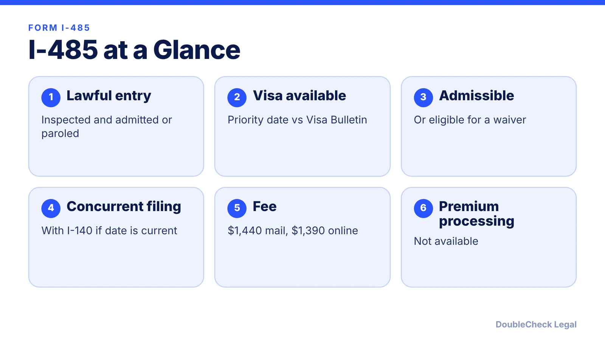
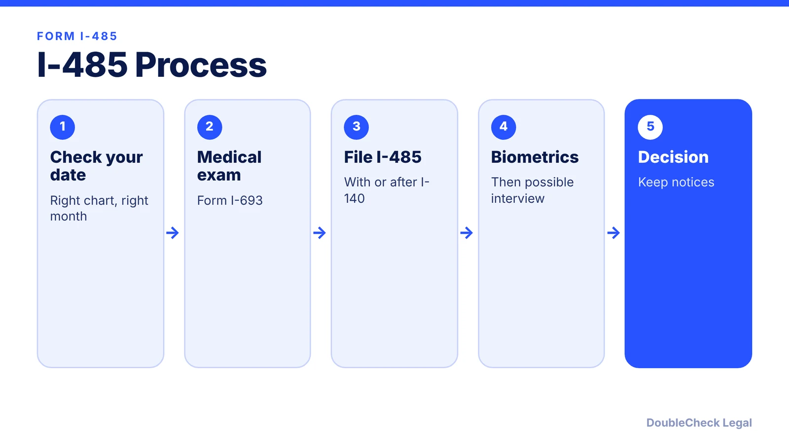

*A plain-English walkthrough of Form I-485 for employment-based applicants: eligibility, concurrent filing, interview, work, travel, and fees.*

**Key takeaways:**

- You need a lawful entry, an available visa number, and admissibility.
- Concurrent filing with the I-140 is possible if your priority date is current.
- Leaving the U.S. without advance parole abandons the application, with limited exceptions.
- The I-485 fee is $1,440 by mail or $1,390 online, per F1Jobs and Beyond Border.

## 1. The quick answer

**Quick answer:** Form I-485 lets you apply for a green card without leaving the U.S. For employment-based cases you generally need a lawful entry, an immigrant visa number available under the Visa Bulletin chart USCIS designates, and admissibility. You can file with the I-140 (concurrent filing) if your priority date is current at filing. As of 2026, Beyond Border and F1Jobs list the I-485 fee at $1,440 by mail or $1,390 online, with biometrics included.

## 2. Who can file and what goes in the package

Per Beyond Border:

- Entry must have been lawful: "inspected and admitted or paroled."
- An immigrant visa must be immediately available based on your priority date and the Visa Bulletin ([how to read it](/blog/visa-bulletin-explained-priority-dates-eb-categories/)).
- You must not be barred under INA 245(c) and must be admissible or eligible for a waiver.
- INA 245(k) can forgive status violations, unauthorized work, or admission breaches for EB-1, EB-2, EB-3, and EB-5 applicants if the total is 180 days or less.

**Concurrent filing.** The I-485 can be filed with the I-140 if the priority date is current at filing, and you can request an EAD and advance parole at the same time. If the I-140 is denied, the concurrently filed I-485 is automatically denied.

**Typical package:** the I-485, evidence of the underlying petition, the medical exam (Form I-693) from a USCIS-designated civil surgeon in a sealed envelope, which is valid for two years from the surgeon's signature, and supporting identity and status documents. Before sending, [check your documents](/blog/check-immigration-documents-with-ai-before-filing/).

## 3. Biometrics, interview, and timing

- **Biometrics:** an in-person fingerprint and photo appointment, typically within a few weeks of filing.
- **Interview:** required by default, but officers can waive it (Beyond Border).
- **Processing:** employment-based cases typically take 10 to 18 months; Beyond Border's overall range across all case types is 8 to 34 months. No premium processing.
- **RFE:** you have 87 days from the notice date, and USCIS must physically receive the response by then; missing it results in denial.
- **Changing jobs:** after 180 days pending, you may change jobs if the new role is in the same or a similar occupational field, via Supplement J. See [I-140 portability](/blog/i-140-portability-ac21-changing-jobs/).

## 4. Work, travel, and fees while pending

**Work:** working on the basis of the pending I-485 requires an approved EAD (Form I-765). See [advance parole and EAD](/blog/advance-parole-and-ead-while-i-485-pending/).

**Travel:** leaving the U.S. abandons the application unless you obtain advance parole first. H-1B and L-1 holders returning to the same employer have a separate exception, per Beyond Border. Discuss any trip with an attorney first.

**Fees (verify current):**

- I-485, age 14 or older: $1,440 by mail or $1,390 online; under 14 filing with a parent: $950 (F1Jobs, July 2026; Beyond Border). Biometrics are included.
- Sources disagree on whether the EAD (I-765) and advance parole (I-131) carry separate fees when filed with the I-485: F1Jobs says no separate fee, Beyond Border lists $260 and $630. Use the current USCIS fee schedule or fee calculator before paying.
- The I-693 medical exam has no USCIS fee; the civil surgeon charges separately.

Where this fits in the whole journey: [H-1B to green card timeline](/blog/h-1b-to-green-card-timeline-tech-workers/).

## Where DoubleCheck fits

[DoubleCheck](https://www.contactdoublecheck.com) helps businesses and founders start legal work with AI, verify it, and, when professional advice is warranted, connect with an independent attorney, including for immigration questions. Attorney availability and practice areas vary. Attorneys on DoubleCheck are independent professionals; an attorney-client relationship forms only if an attorney accepts your engagement.

**Sources:** [Beyond Border, Form I-485](https://www.beyondborderglobal.com/resources/form-i-485); [F1Jobs, I-485 fees](https://www.f1jobs.io/resources/blog/i-485-filing-fees-2026-breakdown). USCIS pages could not be loaded; confirm the form edition and fees at uscis.gov.

## FAQ

**Can I file the I-485 with the I-140?**

Yes, if your priority date is current at filing, per Beyond Border. If the I-140 is denied, the concurrently filed I-485 is automatically denied.

**Can I travel while my I-485 is pending?**

Leaving the U.S. abandons the application unless you have advance parole, per Beyond Border. H-1B and L-1 holders returning to the same employer have a separate exception.

**Do I need an interview?**

Required by default, but officers can waive it, per Beyond Border.

**How much does the I-485 cost?**

$1,440 by mail or $1,390 online for applicants 14 and older, with biometrics included, per F1Jobs (July 2026). Fees change; confirm with USCIS.

---

*General information only. This article is not legal, tax, investment, or accounting advice.*
