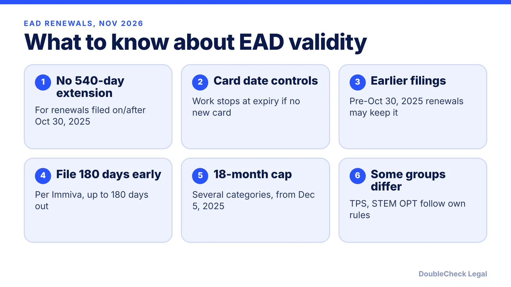
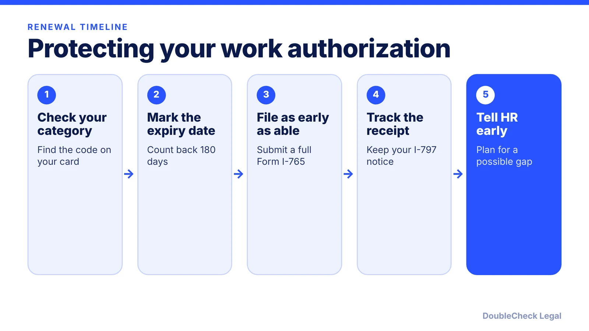

*Does your work permit still extend automatically while a renewal is pending? As of November 2026, usually not. Here is what changed and how to plan.*

**Key takeaways:**

- The 540-day automatic EAD extension ended for I-765 renewals filed on or after October 30, 2025, per Ogletree.
- Affected categories include pending adjustment (c)(9) and H-4 (c)(26); TPS and STEM OPT follow separate rules.
- Fragomen reports an 18-month maximum EAD validity for several categories from December 5, 2025.
- Renewals can be filed up to 180 days early, per Immiva; file early and track the receipt.

## 1. The quick answer

**Quick answer:** As of November 2026, most work permit (EAD) holders can no longer count on the old automatic extension of up to 540 days. A DHS interim final rule that took effect October 30, 2025 removed it for renewal Form I-765 applications filed on or after that date, and Mintz reports that a final rule published in October 2026 adopted the change without substantive change. For affected categories, work authorization ends on the card's expiration date even if the renewal is pending, so file as early as the rules allow.

## 2. What changed, and who is affected

Before the change, a timely renewal of certain EADs extended the old card automatically, first for 180 days and later for up to 540 days. Per Ogletree and the Berkeley International Office, the interim final rule removed that extension for Form I-765 renewals filed on or after October 30, 2025.

Categories that lose the automatic extension, per Ogletree's list, include:

- Pending adjustment of status, category (c)(9), see our [I-485 guide](/blog/i-485-adjustment-of-status-guide/).
- H-4 spouses of certain H-1B workers, category (c)(26), see [H-4 EAD](/blog/h-4-ead-spouses-of-h-1b/).
- Pending asylum applicants (c)(8), refugees and asylees, and several other humanitarian and legalization categories.
- Spouses of E and L workers who hold an EAD under (a)(17) or (a)(18). Ogletree adds that these spouses may keep working without an EAD if their I-94 shows E-1S, E-2S, E-3S or L-2S. See our [spouse work rights guide](/blog/spouse-work-rights-l-2-e-visa-o-3-dependents/).

Ogletree says TPS and F-1 STEM OPT (c)(3)(C) keep separate extension rules, set by Federal Register notices and the OPT regulations. The Berkeley office says it is still reviewing how the rule touches STEM OPT, so students should ask their school's international office.

Renewals filed before October 30, 2025 that qualified at the time keep the extension, per Ogletree.

## 3. Validity periods and filing early

Two separate changes affect how long you can work.

**Shorter cards.** Fragomen reports that USCIS cut the maximum EAD validity from five years to 18 months for adjustment of status applicants, refugees, asylees, people granted withholding of removal, and people with pending asylum, withholding, cancellation or NACARA applications. It covers initial and renewal EADs on Form I-765 applications pending or filed on or after December 5, 2025. Existing cards stay valid through their printed dates.

**No safety net.** Immiva reports that renewals can be filed up to 180 days before the current EAD expires and, using USCIS data as of December 31, 2025, that about 1.67 million I-765 applications were pending, with roughly 64% waiting 180 days or more. Those figures are a snapshot, so check USCIS processing times before relying on them.

The practical result: if your card expires and your renewal was filed on or after October 30, 2025, an employer cannot treat the expired card as valid, per Ogletree. An employer may still accept an I-797 receipt for a timely renewal filed before that date.

## 4. Planning for a gap and who can help

If your category lost the extension, build a buffer. Calendar the day 180 days before expiry, gather your evidence early, and tell your employer when the renewal is filed so HR can plan around the Form I-9 reverification date. If your category is based on a pending green card, ask whether a pending [advance parole and EAD](/blog/advance-parole-and-ead-while-i-485-pending/) combination card, an employer-sponsored status such as H-1B, or another basis might apply. Our guide on [H-1B transfers and portability](/blog/h-1b-transfer-change-of-employer-portability/) covers one such path.

Employers should not guess. USCIS said it would update Form I-9 guidance through I-9 Central and the M-274 handbook, per Ogletree, so check those before treating a card as expired or valid. Do not work after your authorization lapses: unauthorized employment can damage a later green card case.

Edge cases, such as a card with a code you do not recognize, a pending renewal filed just before October 30, 2025, or a TPS holder, are worth a short consult with [an immigration lawyer](/blog/how-to-find-good-immigration-lawyer-startup-founder/). Bring your card, receipt notices and any I-94.

## Where DoubleCheck fits

[DoubleCheck](https://www.contactdoublecheck.com) helps businesses and founders start legal work with AI, verify it, and, when professional advice is warranted, connect with an independent attorney, including for immigration questions. Attorney availability and practice areas vary. Attorneys on DoubleCheck are independent professionals; an attorney-client relationship forms only if an attorney accepts your engagement.

**Sources:** [Mintz on the final rule](https://www.mintz.com/insights-center/viewpoints/2806/2026-10-15-uscis-final-rule-ends-540-day-automatic-ead-extension); [Ogletree](https://ogletree.com/insights-resources/blog-posts/uscis-ends-automatic-extension-of-employment-authorization-with-interim-final-rule/); [UC Berkeley International Office](https://internationaloffice.berkeley.edu/news/dhs-rule-ending-automatic-ead-extensions); [Fragomen on 18-month validity](https://www.fragomen.com/insights/united-states-uscis-reduces-maximum-validity-period-from-five-years-to-18-months-for-several-categories-of-eads-including-adjustment-of-status-eads.html); [Immiva](https://immiva.com/blog/ead-renewal-file-early-backlog-2026).

## FAQ

**Is the 540-day EAD automatic extension still available?**

Generally no for renewals filed on or after October 30, 2025. Ogletree and the Berkeley International Office report the interim final rule removed it, and Mintz reports an October 2026 final rule adopted it. Earlier timely renewals may keep it.

**When can I file an EAD renewal?**

Immiva reports renewals can be filed up to 180 days before the current EAD expires. Confirm the current window on the USCIS Form I-765 page, since filing rules can change.

**Can I keep working if my EAD expires while the renewal is pending?**

For categories that lost the extension and renewals filed on or after October 30, 2025, Ogletree says an expired EAD is no longer valid for work. E and L spouses with an E-1S, E-2S, E-3S or L-2S I-94 notation may work without an EAD.

**Did EAD validity periods get shorter?**

For some categories, yes. Fragomen reports USCIS cut the maximum validity from five years to 18 months for adjustment applicants, refugees, asylees and certain pending relief applicants, for Form I-765 applications pending or filed on or after December 5, 2025.

---

*General information only. This article is not legal, tax, investment, or accounting advice.*
