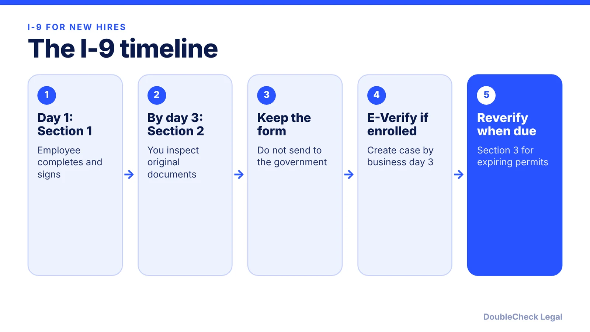
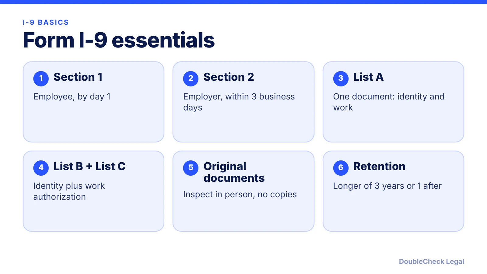

*Hiring your first employee? Here is how Form I-9 works: the day-3 deadline, List A, B, and C documents, retention, and when E-Verify applies.*

**Key takeaways:**

- Section 1 is due the employee's first day; Section 2 within three business days of the start date.
- Employees choose one List A document, or one List B plus one List C.
- Keep each I-9 for the later of three years after hire or one year after employment ends.
- E-Verify is voluntary for most employers, but some states and federal contracts require it.

## 1. The quick answer

**Quick answer:** Every U.S. employer must complete a Form I-9 for each new hire. The employee completes Section 1 by the first day of work, and the employer must complete Section 2 within three business days of the start date, per USCIS. The employee picks documents from List A (identity and work authorization together) or one from List B plus one from List C. E-Verify is a separate, online step that is voluntary for most employers, but some states and federal contracts require it.

## 2. Timing and who does what

Per Berardi Immigration Law, the employee completes Section 1 no later than the first day of employment, and it cannot be completed before the job offer is accepted. Per USCIS's M-274 handbook, the employer or authorized representative completes Section 2 within three business days of the start date, and if someone is hired for fewer than three business days, Section 2 must be done by the first day. Section 3 is used for reverification, for example when work authorization is about to expire or after a rehire, per Berardi.

USCIS says employers generally must review documents in person: "you or your authorized representative must review the employee's documentation in their physical presence." Copies are not acceptable, except certified copies of birth certificates. Employers enrolled in E-Verify may be able to use an alternative remote examination procedure authorized by DHS; confirm the requirements with USCIS before using it. Startups with remote hires should plan for an authorized representative near the employee.

## 3. List A, List B, and List C

USCIS says the employee chooses one of two options:

- **One List A document**, which shows both identity and employment authorization, or
- **One List B document** (identity only) **plus one List C document** (employment authorization only).

If the employee presents acceptable List A documentation, you should not ask for List B or C, and the reverse also applies, per USCIS. You cannot demand specific documents. For E-Verify employers, a List B document must include a photo, per E-Verify.

Keep the process consistent for every hire, and see the DoubleCheck guide to [hiring international employees](/blog/hire-international-employees-remote-eor-vs-contractor-vs-sponsorship/) and to [offer letters](/blog/draft-job-offer-letter-with-ai/). Employees on visas may have an expiring authorization date that you need to track; see [H-1B transfers](/blog/h-1b-transfer-change-of-employer-portability/) and [OPT for founders](/blog/f1-opt-stem-opt-start-your-own-startup/).

## 4. Retention, E-Verify, and penalties

**Retention.** Berardi says to keep each I-9 for the later of three years from the hire date or one year after employment ends, and not to submit it to the government. Keep them separate from personnel files so they are easy to produce in an audit.

**E-Verify.** The E-Verify quick reference guide describes E-Verify as a choice for most employers. If you enroll, you complete the I-9 first, then create a case no later than the third business day after the employee starts work for pay, you may not use it to pre-screen applicants, and you must not take adverse action over a mismatch unless there is a Final Nonconfirmation. Federal contractors with the FAR E-Verify clause generally must enroll within 30 calendar days of contract award, per E-Verify. State rules vary: Paylocity's 2026 summary lists Alabama, Arizona, Mississippi, and Louisiana as requiring E-Verify for all private employers, and Tennessee, Georgia, Florida, North Carolina, South Carolina, and Utah for employers above set headcounts (6, 10, 25, 25, 25, and 150). State laws change, so verify yours.

**Penalties.** A law-firm summary of a DHS final rule reports per-form paperwork penalties of $288 to $2,861 for violations assessed after January 2, 2025. These are inflation-adjusted regularly and knowing-hire penalties are separate, so check the current amounts before relying on them. See also [self-employment and contractor basics](/blog/independent-contractor-vs-employee/) and [sponsoring an H-1B employee](/blog/startup-sponsor-h1b-employee-requirements/).

## Where DoubleCheck fits

[DoubleCheck](https://www.contactdoublecheck.com) helps businesses and founders start legal work with AI, verify it, and, when professional advice is warranted, connect with an independent attorney, including for immigration questions. Attorney availability and practice areas vary. Attorneys on DoubleCheck are independent professionals; an attorney-client relationship forms only if an attorney accepts your engagement.

**Sources:** [USCIS M-274: Section 2](https://www.uscis.gov/i-9-central/form-i-9-resources/handbook-for-employers-m-274/40-completing-section-2-employer-review-and-verification); [Berardi Immigration Law](https://berardiimmigrationlaw.com/need-know-form-9/); [E-Verify: create a case](https://www.e-verify.gov/e-verify-user-manual-20-initial-verification/22-create-a-case); [E-Verify quick reference guide](https://www.e-verify.gov/book/export/html/3625); [E-Verify: federal contractor timeframes](https://www.e-verify.gov/employers/federal-contractors/timeframes-for-enrollment-and-use); [Paylocity E-Verify states](https://www.paylocity.com/resources/learn/articles/e-verify-states/); [NEP York on 2025 I-9 penalties](https://nepyork.com/2025/01/30/hire-authorized-workers-and-maintain-i-9-compliance-or-risk-fines-of-up-to-2861-legal-experts-caution-employers/).

## FAQ

**When must the Form I-9 be completed?**

Per USCIS and Berardi, the employee completes Section 1 by the first day of employment and the employer completes Section 2 within three business days of the start date.

**What are List A, B, and C documents?**

Per USCIS, List A shows identity and work authorization together. List B shows identity only and List C shows work authorization only. The employee presents one List A document or one from each of B and C.

**How long do I keep Form I-9?**

Berardi says to keep it for the later of three years from the hire date or one year after employment ends, and not to send it to the government.

**Is E-Verify required for my startup?**

The E-Verify quick reference guide describes it as a choice for most employers. Federal contractors with the FAR clause and employers in states with mandates, such as those Paylocity lists, may be required to use it.

---

*General information only. This article is not legal, tax, investment, or accounting advice.*
