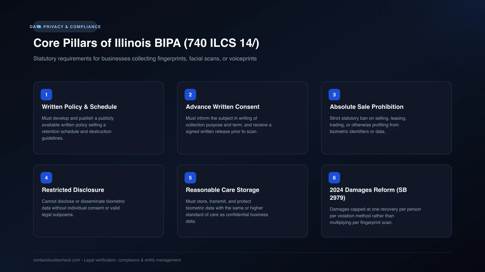
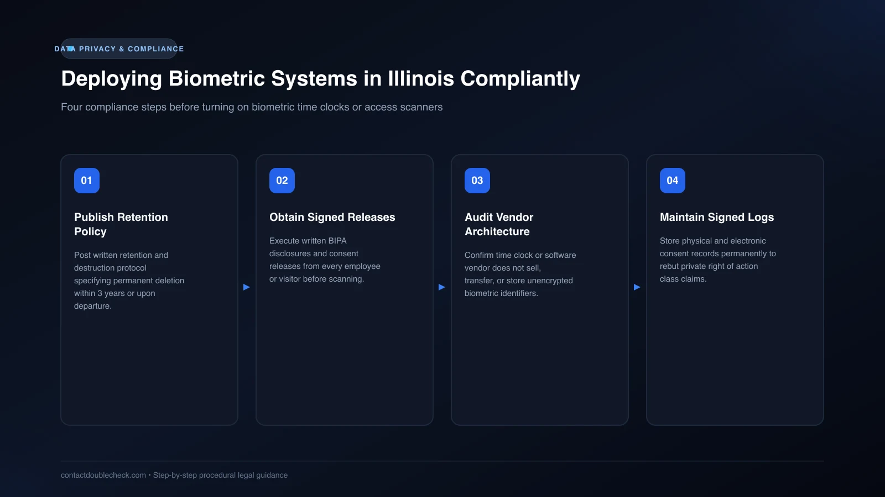

*Compliance guide for businesses, startups, and employers handling biometric data under the Illinois Biometric Information Privacy Act (740 ILCS 14/), as of November 2026. General information, not legal advice.*

**Key takeaways:**

- Illinois BIPA remains the strictest biometric data privacy law in the United States, backed by an active private right of action and attorney fee shifting.
- Covered biometrics include fingerprint scans, facial geometry scans, retina/iris scans, and voiceprints used for identification.
- In August 2024, Illinois enacted SB 2979, reforming damages so plaintiffs recover only once per person rather than racking up penalties on every single fingerprint punch.
- Businesses must publish a written retention policy, obtain signed informed consent before collection, and never profit from biometric data.
- Negligent violations carry $1,000 statutory damages; reckless violations carry $5,000, along with mandatory attorney fees.

## 1. The quick answer

**Quick answer:** The **Illinois Biometric Information Privacy Act (BIPA, 740 ILCS 14/)** prohibits private entities from collecting, capturing, purchasing, or obtaining biometric identifiers (such as fingerprints, hand geometry, or facial recognition scans) without first publishing a written retention schedule, providing written disclosure to the individual, and obtaining an executed **written consent release**. 

Unlike most state data privacy statutes that require administrative enforcement by a state Attorney General, BIPA features an aggressive **private right of action**. Any individual whose biometric data is scanned without compliant consent can file suit directly in court. 

Crucially, in August 2024, Governor JB Pritzker signed **Senate Bill 2979 (Public Act 103-0784)** into law, overruling the catastrophic "per-scan" multiplier established in *Cothron v. White Castle System, Inc.* Under the amended law, an aggrieved individual is limited to a single statutory damage recovery (**$1,000** for negligence or **$5,000** for recklessness) per violating collection method. While this reform ended multi-billion-dollar existential exposure for routine time clock usage, class action lawsuits remain prolific, making strict procedural compliance essential for every business with Illinois personnel.

For enterprise security standards, review our guides on [AI agent security checklists](/blog/ai-agent-gmail-slack-drive-security-checklist/) and [data breach notification laws for small businesses](/blog/data-breach-notification-laws-small-business/).

## 2. What biometric data BIPA regulates

Under 740 ILCS 14/10, the statute separates covered data into two key legal definitions:

1. **Biometric Identifier:** Any retina or iris scan, fingerprint, voiceprint, or scan of hand or face geometry.
2. **Biometric Information:** Any information, regardless of how it is captured, converted, stored, or combined, based on an individual’s biometric identifier used to identify an individual.

**Statutory Exclusions:**
BIPA explicitly excludes:
- Written physical signatures and handwriting samples.
- Physical photographs and video footage (unless facial geometry extraction software is applied).
- Demographic data, tattoos, physical descriptions (height, weight, eye color).
- Medical information governed by HIPAA.

If your business uses a digital fingerprint reader for hourly employee clock-ins, facial recognition cameras for secure building entry, or AI video interview analysis assessing facial landmarks, BIPA governs your operations.

## 3. The five mandatory statutory compliance pillars

Under Section 15 of BIPA, private entities must satisfy five affirmative statutory obligations:

### Pillar 1: Public Retention Schedule (§ 15(a))
A private entity in possession of biometric data must develop a written policy, made available to the public, establishing a retention schedule and guidelines for permanently destroying biometric identifiers and information. Destruction must occur when the initial purpose for collection has been satisfied, or **within three years** of the individual’s last interaction with the entity, whichever occurs first.

### Pillar 2: Written Notice and Informed Consent (§ 15(b))
No private entity may collect, capture, purchase, or obtain biometric data unless it first:
- Informs the subject in writing that biometric data is being collected or stored.
- Informs the subject in writing of the specific purpose and length of term for collection and storage.
- Receives a **written release** signed by the subject (or employee).

### Pillar 3: Absolute Ban on Sale or Profiling (§ 15(c))
No private entity in possession of biometric data may sell, lease, trade, or otherwise profit from an individual’s biometric identifier or biometric information.

### Pillar 4: Restricted Disclosure (§ 15(d))
No private entity may disclose, redisclose, or disseminate biometric data unless:
- The subject grants consent;
- The disclosure completes an authorized financial transaction;
- The disclosure is required by state or federal law; OR
- The disclosure is compelled by a valid warrant or subpoena.

### Pillar 5: Standard of Care Storage (§ 15(e))
Entities must store, transmit, and protect biometric data using the reasonable standard of care within the industry, and in a manner equal to or more protective than other confidential and sensitive business data.

## 4. The 2024 legislative reform: SB 2979 explained

To understand the current legal landscape, employers must examine the seismic shift caused by **Senate Bill 2979** (enacted August 2024).

In February 2023, the Illinois Supreme Court issued its infamous ruling in *Cothron v. White Castle System, Inc.*, holding that a separate BIPA violation occurred *every single time* an employee scanned their finger on a time clock (often 4 to 6 times per shift). For a 50-person restaurant chain, this produced statutory damage models exceeding $50,000,000 for routine payroll punches.

Responding to business outcry, the Illinois General Assembly enacted SB 2979 to amend Section 20 of the Act:
- **Single Recovery Per Person:** A private entity that repeatedly collects or captures biometric identifiers from the same person using the same method in violation of the Act has committed a single violation, and the aggrieved person is entitled to, at most, **one recovery of liquidated damages**.
- **Electronic Signatures Approved:** The amendment formally legalized obtaining consent via electronic signature, confirming that digital onboarding workflows (DocuSign, HRIS portals) satisfy the written release requirement.

While SB 2979 averted systemic company insolvencies, it did not eliminate liability. An employer with 200 workers in Illinois that fails to obtain consent faces baseline statutory damages of **$200,000 to $1,000,000**, plus mandatory plaintiff legal fees.

## 5. Workplace time clocks and security access scanners

The overwhelming majority of BIPA lawsuits target employers utilizing biometric time clocks. Hardware and software vendors frequently market fingerprint or facial scanners to small businesses as "fraud-proof" timekeeping devices without disclosing BIPA compliance obligations.

**Key Workplace Rules:**
- **Third-Party Vendor Storage:** Cloud-hosted biometric systems transmit data to vendor servers. This constitutes dissemination under § 15(d), requiring advance written consent naming the vendor.
- **Offering Opt-Out Alternatives:** If an employee refuses to sign a biometric consent form, best practice is to provide an alternative non-biometric tracking mechanism (such as an RFID badge, keypad PIN, or physical card) to avoid retaliation or wrongful termination claims.
- **Legacy Fingerprint Retention:** When an employee resigns or is terminated, the employer must ensure their biometric profile is permanently deleted from both physical time clock terminals and cloud backups.

## 6. Procedural implementation guide for employers

To eliminate BIPA liability, execute this compliance checklist immediately:

1. **Conduct a Biometric Audit:** Identify all physical hardware, point-of-sale systems, mobile apps, and security gates deployed across your Illinois operations that scan faces, eyes, hands, or fingerprints.
2. **Publish a Standalone Retention Policy:** Draft and publish a standalone "Biometric Information Privacy Policy" on your public company website and employee intranet.
3. **Draft a Dedicated Consent Release Form:** Create a dedicated, standalone consent document. Do not bury the biometric disclosure inside a 60-page employee handbook.
4. **Implement Pre-Collection Gates:** Configure hardware so that biometric enrollment cannot occur until HR records show a countersigned electronic consent release on file.
5. **Execute Vendor Data Processing Agreements:** Require biometric vendors to warrant that data is encrypted, retained solely for your business purpose, and destroyed upon contract termination. See [DPA for AI vendors and small business](/blog/data-processing-agreement-dpa-ai-vendors-small-business/).

## Where DoubleCheck fits

[DoubleCheck](https://www.contactdoublecheck.com) provides businesses and tech companies with AI-powered privacy policy drafting, vendor contract audits, and state-by-state data protection compliance tools. When complex privacy audits, biometric vendor integrations, or class action risk assessments arise, DoubleCheck connects you directly with experienced privacy and labor attorneys.

**Related reading:**
- [Data Breach Notification Laws for Small Business](/blog/data-breach-notification-laws-small-business/)
- [Data Processing Agreements (DPA) for AI Vendors](/blog/data-processing-agreement-dpa-ai-vendors-small-business/)
- [Employee Handbook for Small Business: What to Include](/blog/employee-handbook-small-business-what-to-include/)
- [How to Start an LLC in Illinois](/blog/how-to-start-an-llc-in-illinois/)

**Sources:** [Illinois General Assembly, 740 ILCS 14/ (Biometric Information Privacy Act)](https://www.ilga.gov/legislation/ilcs/ilcs3.asp?ActID=3004); [Illinois General Assembly, Senate Bill 2979 (Public Act 103-0784, 2024 BIPA Amendments)](https://www.ilga.gov/legislation/BillStatus.asp?DocNum=2979&GAID=17&DocTypeID=SB&LegID=152865); [Illinois Supreme Court, Cothron v. White Castle System, Inc., 2023 IL 128004](https://www.illinoiscourts.gov/opinions/); [Illinois Supreme Court, Rosenbach v. Six Flags Entertainment Corp., 2019 IL 123186](https://www.illinoiscourts.gov/opinions/); [Illinois Attorney General, Protecting Biometric Information Guidance](https://www.illinoisattorneygeneral.gov/).

## FAQ

**What is Illinois BIPA (740 ILCS 14/)?**

The Illinois Biometric Information Privacy Act is a state privacy statute regulating the collection, storage, use, and dissemination of biometric identifiers (fingerprints, facial scans, retinal scans) by private entities.

**What changed with the 2024 Illinois BIPA amendment (SB 2979)?**

Signed into law in August 2024, SB 2979 eliminated catastrophic per-scan damage stacking under Cothron v. White Castle. Statutory damages are now strictly capped at one recovery per person per violating method or practice.

**What are the statutory damages under BIPA?**

Liquidated statutory damages are $1,000 for each negligent violation and $5,000 for each intentional or reckless violation, plus mandatory reasonable attorney fees and litigation costs.

**Can an employer use biometric fingerprint time clocks in Illinois?**

Yes, but only if the employer first publishes a written retention policy, informs the employee in writing, and obtains an executed written consent release prior to capturing any biometric data.

**Does BIPA apply to out-of-state tech vendors and cloud providers?**

Yes. If a business collects or processes biometric data of individuals located in Illinois, BIPA applies regardless of where the company or its servers are physically based.

---

*General information only. This article is not legal, tax, investment, or accounting advice.*
