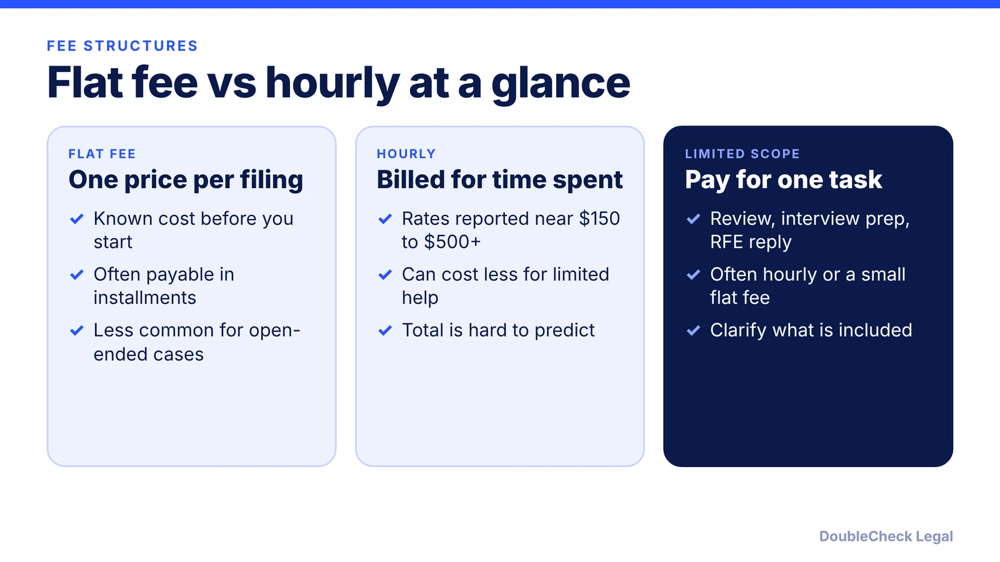
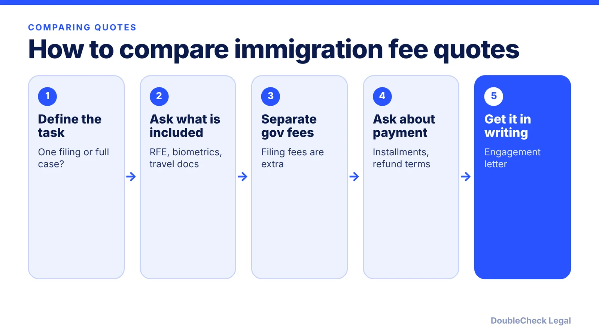

*How do immigration lawyers charge, and what do published ranges say? Here is flat fee vs hourly, with sources named.*

**Key takeaways:**

- Flat fees are common for standard filings; hourly is used for complex or open-ended work.
- Reported hourly rates range from about $150 to $500+ depending on the source.
- Government fees are separate from attorney fees.
- Employers generally cannot pass H-1B LCA and petition costs to employees, per Beyond Border.

## 1. The quick answer

**Quick answer:** Most immigration attorneys quote a flat fee for standard filings and bill hourly for complex or open-ended work. Lighthouse reports hourly rates of $150 to $500+, Beyond Border reports about $250 to $500+, and Nolo reports $200 to $500 or more. Published flat-fee ranges vary by source and case type, for example H-1B petitions at roughly $2,000 to $5,500. These are third-party ranges, not quotes, and your price depends on the attorney and the case.

## 2. What sources report

Figures differ and none is a price list. Attribute them carefully:

- **Hourly:** Lighthouse HQ says $150 to $500+ depending on experience and location. Beyond Border says about $250 to $500+. Nolo says $200 to $500 or more.
- **H-1B (Beyond Border):** new petition about $2,000 to $5,500, extension about $1,500 to $3,500, transfer about $3,000 to $4,500, RFE response about $1,000 to $2,500 when not in the base fee, and H-4 filings about $500 to $1,500.
- **Employment green card (Lighthouse, published February 3, 2026):** PERM $3,000 to $7,000, I-140 $2,000 to $5,000, O-1 $3,000 to $8,000, EB-1 or EB-2 $5,000 to $15,000+.
- **Family (Lighthouse):** I-130 $1,000 to $3,000, adjustment of status (I-485) $2,500 to $5,000, N-400 $1,000 to $2,500.
- **Complex cases (Lighthouse):** deportation defense $5,000 to $20,000+.

Nolo gives one example: a marriage-based green card at a $4,500 flat fee, perhaps $2,000 up front and $2,500 at filing.

These sources are marketing and guide pages, not surveys, so treat them as rough context. Compare to our own guides on [O-1 filing costs](/blog/o-1-visa-cost-filing-and-attorney-fees/) and [startup lawyer cost](/blog/how-much-does-a-startup-lawyer-cost/).

## 3. Flat fee vs hourly: when each fits

Per Nolo:

- **Flat fee pros:** cost known in advance, easier budgeting, installments possible, clients often feel they get more value.
- **Flat fee cons:** less common for criminal-related immigration matters and for unusual or open-ended cases, which may need hourly billing.
- **Hourly pros:** can cost less if you do most of the paperwork and want limited guidance. Nolo's example: a few hours at about $300 an hour for review and interview prep, far less than a $4,500 full-service package.
- **Hourly cons:** calls, emails and meetings are all billed, so the total is hard to predict.

Beyond Border says flat fees are the norm for standard H-1B filings, with hourly mainly for complex RFEs or unusual cases.

Also separate the attorney's fee from government fees. Beyond Border lists examples such as the $780 base I-129 fee ($460 for employers with 25 or fewer employees or nonprofits), the $215 H-1B registration fee and $2,965 premium processing, and says the $100,000 fee under Proclamation 10973 was not being charged as of September 2026 because of litigation. Check [the $100,000 fee status](/blog/h1b-100000-fee-status-2026/) and [premium processing fees](/blog/premium-processing-fees-and-timelines-2026/) for current numbers.

## 4. Who pays, and how to avoid surprises

For employer-sponsored work visas, Beyond Border says preparing and filing the LCA and H-1B petition are employer business expenses under 20 CFR 655.731(c)(9), and that employers cannot pass those costs to employees through payroll deductions. It adds that employees may pay personal costs mainly benefiting them, such as dependent filings, if agreed in writing and within standard limits. If a payment arrangement looks unusual, ask the employer or counsel before agreeing.

Practical steps to avoid surprises:

1. Ask whether an RFE response, a premium upgrade or an amended filing is included. Our guide on the [H-1B amendment](/blog/h-1b-amendment-when-needed-job-change-worksite/) shows one such add-on.
2. Ask how a denial or withdrawal affects fees.
3. Confirm whether dependents are priced separately, such as [H-4 EAD](/blog/h-4-ead-spouses-of-h-1b/) filings.
4. Verify credentials and avoid unlicensed preparers; see [how to find a good immigration lawyer](/blog/how-to-find-good-immigration-lawyer-startup-founder/) and the [notario scam guide](/blog/immigration-notario-scam-how-to-avoid/).

DoubleCheck connects businesses with independent attorneys. It does not set or promise attorney prices, and attorneys on the platform decide their own fees and whether to take a matter. Compare more than one quote.

## Where DoubleCheck fits

[DoubleCheck](https://www.contactdoublecheck.com) helps businesses and founders start legal work with AI, verify it, and, when professional advice is warranted, connect with an independent attorney, including for immigration questions. Attorney availability and practice areas vary. Attorneys on DoubleCheck are independent professionals; an attorney-client relationship forms only if an attorney accepts your engagement.

**Sources:** [Nolo, flat fee or hourly](https://www.nolo.com/legal-encyclopedia/better-pay-immigration-attorney-flat-fee-hourly.html); [Beyond Border, H-1B lawyer fees](https://www.beyondborderglobal.com/resources/h-1b-visa-lawyer-fees); [Lighthouse, immigration attorney fees](https://www.lighthousehq.com/blog/immigration-attorney-fees).

## FAQ

**How much do immigration lawyers charge per hour?**

Sources differ: Lighthouse HQ reports $150 to $500+, Beyond Border about $250 to $500+, and Nolo $200 to $500 or more, depending on experience, location and complexity.

**Is a flat fee or hourly better for immigration?**

Per Nolo, flat fees give cost certainty and installments but are less common for open-ended cases, while hourly can cost less for limited help but is hard to predict. The better fit depends on the matter.

**How much does an H-1B lawyer cost?**

Beyond Border reports about $2,000 to $5,500 for a new petition, $1,500 to $3,500 for an extension and $3,000 to $4,500 for a transfer. Lighthouse reports $2,000 to $5,000 for an H-1B petition. These are reported ranges, not quotes.

**Does DoubleCheck set immigration attorney fees?**

No. DoubleCheck is a marketplace that connects businesses with independent attorneys and does not promise prices. Attorneys set their own fees, and an attorney-client relationship forms only if an attorney accepts the engagement.

---

*General information only. This article is not legal, tax, investment, or accounting advice.*
