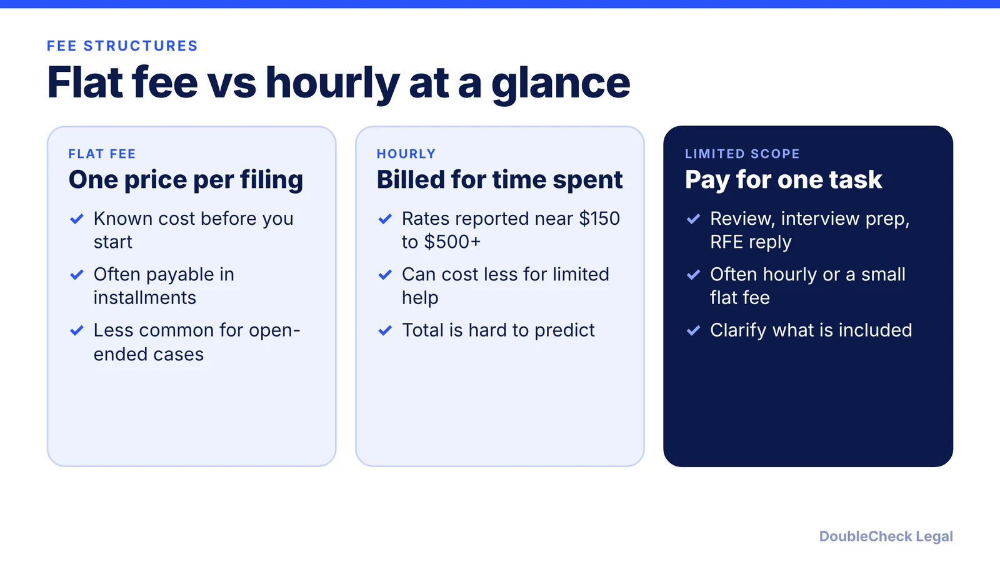
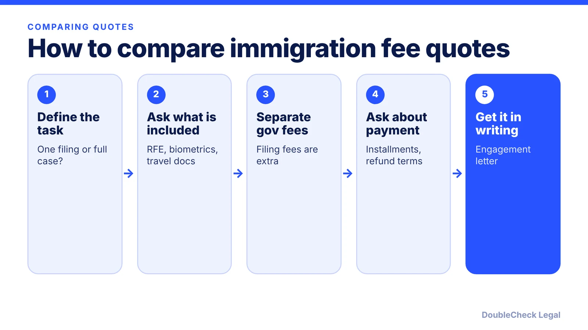

*How do immigration lawyers charge, and what do published ranges say? Here is flat fee vs hourly, with sources named.*

**Key takeaways:**

- Flat fees are common for standard filings; hourly is used for complex or open-ended work.
- Nolo reports hourly rates of about $200 to $500 or more.
- Government fees are separate from attorney fees.
- Employers generally cannot pass H-1B LCA and petition costs to employees, per the U.S. Department of Labor.

## 1. The quick answer

**Quick answer:** Most immigration attorneys quote a flat fee for standard filings and bill hourly for complex or open-ended work. Nolo reports hourly rates of about $200 to $500 or more. Flat-fee prices vary by case type and firm. These are general ranges, not quotes, and your price depends on the attorney and the case.

## 2. What sources report

Figures differ and none is a price list. Treat them as rough context:

- **Hourly:** Nolo says attorneys typically charge about $200 to $500 per hour or more, depending on experience, office location and the complexity or expected length of the case.

Nolo gives one example: a marriage-based green card at a $4,500 flat fee, perhaps $2,000 up front and $2,500 at filing.

Published figures are general guides, not surveys or quotes, so treat them as rough context. Compare to our own guides on [O-1 filing costs](/blog/o-1-visa-cost-filing-and-attorney-fees/) and [startup lawyer cost](/blog/how-much-does-a-startup-lawyer-cost/).

## 3. Flat fee vs hourly: when each fits

Per Nolo:

- **Flat fee pros:** cost known in advance, easier budgeting, installments possible, clients often feel they get more value.
- **Flat fee cons:** less common for criminal-related immigration matters and for unusual or open-ended cases, which may need hourly billing.
- **Hourly pros:** can cost less if you do most of the paperwork and want limited guidance. Nolo's example: a few hours at about $300 an hour for review and interview prep, far less than a $4,500 full-service package.
- **Hourly cons:** calls, emails and meetings are all billed, so the total is hard to predict.

Many firms quote flat fees for standard filings and reserve hourly billing for complex or unusual matters; ask which applies to yours.

Also separate the attorney's fee from government fees. USCIS sets filing, registration and premium processing fees on its [fee schedule](https://www.uscis.gov/g-1055?topic_id=97264) and [H-1B cap season page](https://www.uscis.gov/working-in-the-united-states/temporary-workers/h-1b-specialty-occupations/h-1b-cap-season). Check [the $100,000 fee status](/blog/h1b-100000-fee-status-2026/) and [premium processing fees](/blog/premium-processing-fees-and-timelines-2026/) for current numbers.

## 4. Who pays, and how to avoid surprises

For employer-sponsored work visas, the U.S. Department of Labor says an H-1B worker can never be made to pay attorney fees directly related to filing the Labor Condition Application, and that expenses directly related to the Form I-129 petition, including attorney fees and the premium processing fee, are also excluded from deductions that would cut pay below the required wage (see [DOL Fact Sheet #62H](https://www.dol.gov/agencies/whd/fact-sheets/62h-h1b-pay-deductions)). Other deductions are allowed only if required by law, reasonable and customary, or voluntarily authorized in writing for the worker's benefit. If a payment arrangement looks unusual, ask the employer or counsel before agreeing.

Practical steps to avoid surprises:

1. Ask whether an RFE response, a premium upgrade or an amended filing is included. Our guide on the [H-1B amendment](/blog/h-1b-amendment-when-needed-job-change-worksite/) shows one such add-on.
2. Ask how a denial or withdrawal affects fees.
3. Confirm whether dependents are priced separately, such as [H-4 EAD](/blog/h-4-ead-spouses-of-h-1b/) filings.
4. Verify credentials and avoid unlicensed preparers; see [how to find a good immigration lawyer](/blog/how-to-find-good-immigration-lawyer-startup-founder/) and the [notario scam guide](/blog/immigration-notario-scam-how-to-avoid/).

DoubleCheck connects businesses with independent attorneys. It does not set or promise attorney prices, and attorneys on the platform decide their own fees and whether to take a matter. Compare more than one quote.

## Where DoubleCheck fits

[DoubleCheck](https://www.contactdoublecheck.com) helps businesses and founders start legal work with AI, verify it, and, when professional advice is warranted, connect with an independent attorney, including for immigration questions. Attorney availability and practice areas vary. Attorneys on DoubleCheck are independent professionals; an attorney-client relationship forms only if an attorney accepts your engagement.

**Sources:** [Nolo, flat fee or hourly](https://www.nolo.com/legal-encyclopedia/better-pay-immigration-attorney-flat-fee-hourly.html); [U.S. DOL, Fact Sheet #62H on H-1B pay deductions](https://www.dol.gov/agencies/whd/fact-sheets/62h-h1b-pay-deductions); [USCIS, Fee Schedule](https://www.uscis.gov/g-1055?topic_id=97264); [USCIS, H-1B Cap Season](https://www.uscis.gov/working-in-the-united-states/temporary-workers/h-1b-specialty-occupations/h-1b-cap-season).

## FAQ

**How much do immigration lawyers charge per hour?**

Nolo reports that immigration attorneys typically charge about $200 to $500 per hour or more, depending on experience, location and complexity.

**Is a flat fee or hourly better for immigration?**

Per Nolo, flat fees give cost certainty and installments but are less common for open-ended cases, while hourly can cost less for limited help but is hard to predict. The better fit depends on the matter.

**How much does an H-1B lawyer cost?**

It varies by firm and case. Many firms quote a flat fee for a standard H-1B filing and bill hourly for complex responses, and the U.S. Department of Labor says the employer, not the worker, must bear attorney fees tied to the LCA and the petition. Ask for a written quote.

**Does DoubleCheck set immigration attorney fees?**

No. DoubleCheck is a marketplace that connects businesses with independent attorneys and does not promise prices. Attorneys set their own fees, and an attorney-client relationship forms only if an attorney accepts the engagement.

---

*General information only. This article is not legal, tax, investment, or accounting advice.*
