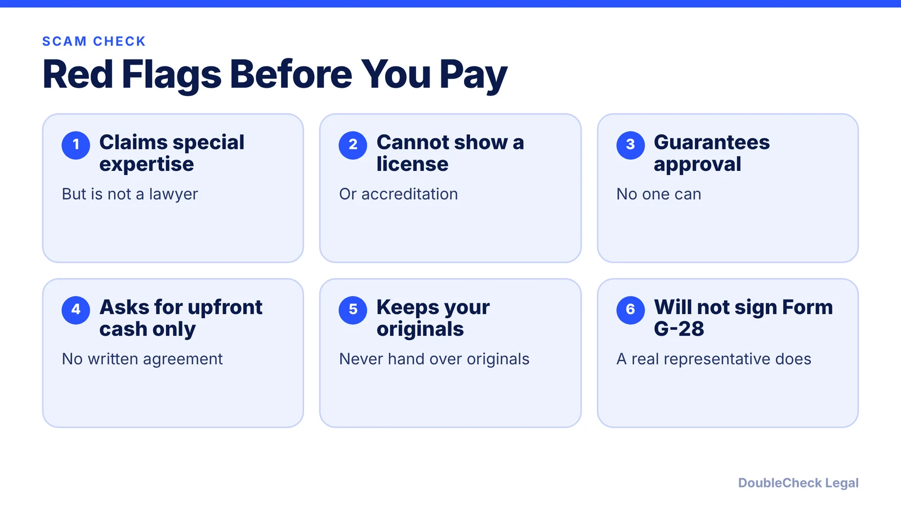
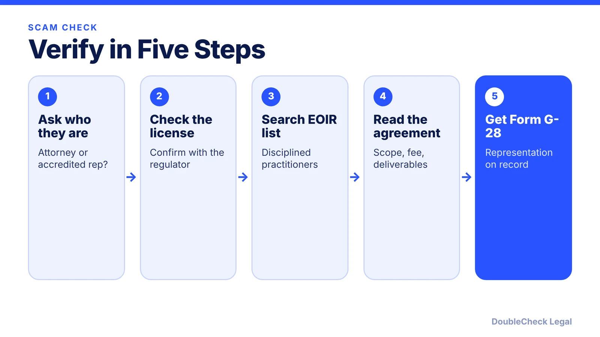
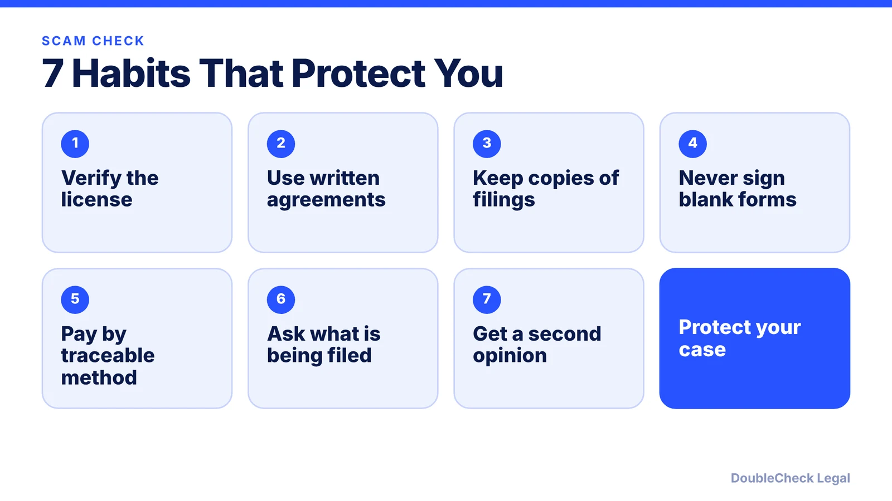

*Who can really help with your immigration case? Here are the red flags, the USCIS verification steps, and habits that protect your file.*

**Key takeaways:**

- USCIS says notarios, notaries, consultants, and businesses cannot give immigration legal advice unless authorized.
- Check the license with the state regulator and the EOIR disciplined practitioners list.
- Accredited representatives work for DOJ-recognized organizations, and approvals last three years.
- Keep copies of everything and never sign a blank form.

## 1. The quick answer

**Quick answer:** Notarios, notary publics, immigration consultants, and ordinary businesses cannot give immigration legal advice unless they are authorized service providers, USCIS says. Others may read you a form, translate it, or write down your answers, and may charge a small fee, but should not claim special immigration expertise. Before paying anyone, confirm they are an attorney in good standing or an EOIR-accredited representative of a recognized organization.

## 2. The five-minute verification routine

USCIS recommends asking to see the attorney's current licensing document and confirming it with the state regulator, and checking the EOIR List of Currently Disciplined Practitioners, where anyone listed with a "No" in the last column is not eligible to advise you without a reinstatement order. For accredited representatives, confirm the approval is still valid, since approvals last three years, and that the organization posts the required public notices.

## 3. Keep your own copies

Keep copies of everything you submit and every receipt notice. Do not sign a blank form, and do not rely on a provider who will not explain what is being filed. If you used AI to draft or translate a document, have a licensed professional review it; see [verify AI-generated legal documents](/blog/verify-ai-generated-legal-document/) and [AI hallucinated citations](/blog/ai-hallucinated-citations-business/).

## 4. Next steps

Read [how to find a good immigration lawyer](/blog/how-to-find-good-immigration-lawyer-startup-founder/), [how to get a lawyer referral](/blog/how-to-get-lawyer-referral/), and [when to hire a lawyer](/blog/when-to-hire-lawyer-small-business/).

## Where DoubleCheck fits

[DoubleCheck](https://www.contactdoublecheck.com) helps businesses and founders start legal work with AI, verify it, and, when professional advice is warranted, connect with an independent attorney, including for immigration questions. Attorney availability and practice areas vary. Attorneys on DoubleCheck are independent professionals; an attorney-client relationship forms only if an attorney accepts your engagement.

**Sources:** [USCIS: Find Legal Services](https://www.uscis.gov/avoid-scams/find-legal-services).

## FAQ

**Can a notario give immigration advice?**

Not unless authorized. USCIS says notarios, notary publics, immigration consultants, and businesses cannot give immigration legal advice unless they are authorized service providers.

**How do I check the EOIR disciplined list?**

Per USCIS, check the EOIR List of Currently Disciplined Practitioners. Anyone listed with a No in the last column is not eligible to advise you without a reinstatement order.

**What can a non-lawyer helper do?**

USCIS says others may read you a form, translate it, or write down your answers, and may charge a small fee.

**Who is an accredited representative?**

A non-attorney approved by the DOJ who works for a recognized nonprofit or similar organization and can give immigration legal advice.

---

*General information only. This article is not legal, tax, investment, or accounting advice.*
